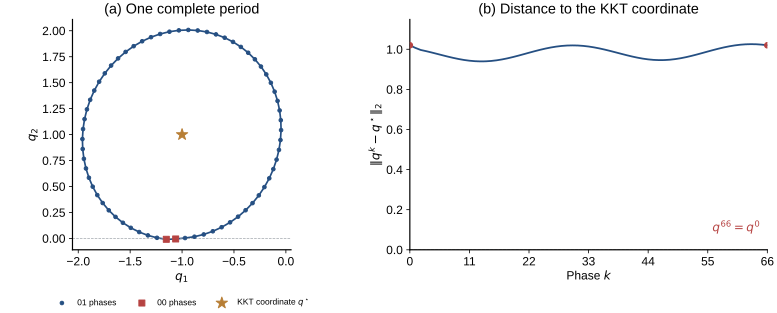

Introducing a nonnegative slack variable into an inequality constraint makes the third constraint block an identity matrix. Its ADMM subproblem becomes a componentwise projection. Although that update is easy to compute, the complete three-block iteration can cycle.

The example below has strongly convex quadratic objectives in its first two blocks, a unique KKT point, and a unique minimizer for every block subproblem. Yet the direct sequential updates admit a nonconstant periodic orbit.

We develop the **period-66** example through its problem data, reduced dynamics, and exact proof. We then discuss the period-23 attracting cycle and the effect of changing the multiplier step. The mathematical results are from the [paper and public verification materials by Kenan Xu and Xiangfeng Wang](https://arxiv.org/html/2608.14396).

## 1. Identity slack and direct three-block ADMM

Consider the convex problem

$$
\min_{x,y}\ F(x)+G(y),
\qquad Ax+By\le b.
$$

A nonnegative slack variable gives the equivalent formulation

$$
\begin{aligned}
\min_{x,y,z}\quad &F(x)+G(y)+\iota_{\mathbb R_+^m}(z),\\
\text{s.t.}\quad &Ax+By+z=b.
\end{aligned}
$$

The indicator $$\iota_{\mathbb R_+^m}$$ is zero for $$z\ge0$$ and positive infinity elsewhere. The third constraint matrix is $$I_m$$.

Using the paper's multiplier sign convention, let $$r=Ax+By+z-b$$ and

$$
\mathcal L_\beta
=
F(x)+G(y)+\iota_{\mathbb R_+^m}(z)
-\lambda^\top r+\frac{\beta}{2}\|r\|^2,
\qquad\beta>0.
$$

The **direct three-block iteration** updates $$x\to y\to z\to\lambda$$

$$
\begin{aligned}
x^{k+1}&=\arg\min_x\mathcal L_\beta(x,y^k,z^k,\lambda^k),\\
y^{k+1}&=\arg\min_y\mathcal L_\beta(x^{k+1},y,z^k,\lambda^k),\\
z^{k+1}&=\left[b-Ax^{k+1}-By^{k+1}+\lambda^k/\beta\right]_+,\\
\lambda^{k+1}&=\lambda^k-\beta\left(Ax^{k+1}+By^{k+1}+z^{k+1}-b\right).
\end{aligned}
$$

Here $$[u]_+$$ takes $$\max(u_i,0)$$ componentwise. With this sign convention, an optimal multiplier for the nonnegative slack constraint satisfies $$\lambda^\star\le0$$.

The update order matters. A two-block formulation can treat $$(y,z)$$ as one variable and minimize jointly over that block. The direct sweep above solves for $$y$$ once and then $$z$$ once. The $$y$$ update uses the old $$z^k$$, so this pair of updates generally does not attain the joint minimum. Convergence therefore requires analysis of this particular three-block map. [The algorithm is defined in §1.1 of the paper](https://arxiv.org/html/2608.14396#S1.SS1).

## 2. Data for the period-66 example

Take $$x,y,z\in\mathbb R^2$$, $$A=B=I_2$$, and $$\beta=1$$

$$
\begin{aligned}
\min_{x,y,z}\quad&
\frac12x^\top Q_1x+\frac12y^\top Q_2y+\iota_{\mathbb R_+^2}(z),\\
\text{s.t.}\quad&x+y+z=b.
\end{aligned}
$$

Define the coefficients of the two quadratic block solution maps by

$$
M=(Q_1+I_2)^{-1},
\qquad N=(Q_2+I_2)^{-1}.
$$

Set

$$
\begin{gathered}
\varepsilon=\frac1{1000},
\quad \mu=\frac{8957}{10000},
\quad \nu=\frac{999}{1000},\\
d_1=(-1,20)^\top,\qquad d_2=(-1,10)^\top,
\end{gathered}
$$

and

$$
\begin{aligned}
M&=\varepsilon I_2+(\mu-\varepsilon)\frac{d_1d_1^\top}{d_1^\top d_1},\\
N&=\varepsilon I_2+(\nu-\varepsilon)\frac{d_2d_2^\top}{d_2^\top d_2},\\
Q_1&=M^{-1}-I_2,\qquad Q_2=N^{-1}-I_2.
\end{aligned}
$$

These formulas specify the rational matrices completely. The eigenvalues of $$M$$ are $$\varepsilon,\mu$$ and those of $$N$$ are $$\varepsilon,\nu$$, giving

$$
\sigma(Q_1)=\left\{999,\frac{1043}{8957}\right\},
\qquad
\sigma(Q_2)=\left\{999,\frac1{999}\right\}.
$$

Both Hessians are positive definite, hence both objectives are strongly convex.

Prescribe a KKT point and use it to define the right-hand side

$$
\begin{gathered}
z^\star=(0,1)^\top,\qquad \lambda^\star=(-1,0)^\top,\\
x^\star=Q_1^{-1}\lambda^\star,\qquad
y^\star=Q_2^{-1}\lambda^\star,\qquad
b=x^\star+y^\star+z^\star.
\end{gathered}
$$

Then

$$
Q_1x^\star=Q_2y^\star=\lambda^\star,\quad
x^\star+y^\star+z^\star=b,\quad
z^\star\ge0,\quad\lambda^\star\le0,\quad
(z^\star)^\top\lambda^\star=0.
$$

These are the KKT conditions for this problem. Strict convexity in $$(x,y)$$ gives a unique primal solution, the constraint fixes $$z$$, and $$Q_1x^\star=\lambda^\star$$ fixes the multiplier.

The ADMM updates reduce to

$$
\begin{aligned}
x^{k+1}&=M(b-y^k-z^k+\lambda^k),\\
y^{k+1}&=N(b-x^{k+1}-z^k+\lambda^k),\\
z^{k+1}&=[b-x^{k+1}-y^{k+1}+\lambda^k]_+,\\
\lambda^{k+1}
&=\lambda^k-(x^{k+1}+y^{k+1}+z^{k+1}-b).
\end{aligned}
$$

The first two updates solve positive-definite linear systems, and the third is a projection. All block minimizers are unique. [See §2.1 for the exact data and uniqueness argument](https://arxiv.org/html/2608.14396#S2.SS1).

## 3. The orbit and projection branches

Define the input to the orthant projection by

$$
q^{k+1}=b-x^{k+1}-y^{k+1}+\lambda^k.
$$

The slack and multiplier updates imply

$$
z^{k+1}=[q^{k+1}]_+,
\qquad
\lambda^{k+1}=q^{k+1}-[q^{k+1}]_+=[q^{k+1}]_-.
$$

Here $$[u]_-$$ takes $$\min(u_i,0)$$ componentwise. After a projection–multiplier update, $$q=z+\lambda$$ therefore determines both variables, and $$z-\lambda=\lvert q\rvert$$.

The four-dimensional state $$s=(y,q)$$ suffices for the subsequent dynamics. The next $$x$$ is recovered by

$$
x^+=M(b-y-\lvert q\rvert).
$$

The reduced recurrence is

$$
\begin{aligned}
g&=(I_2-M)b,\\
p&=My-(I_2-M)\lvert q\rvert+g,\\
y^+&=Np,\\
q^+&=(I_2-N)p+[q]_+.
\end{aligned}
$$

All nonlinearity is concentrated in the componentwise absolute value and positive part. **For a fixed sign pattern of $$q$$, one full update is affine.**

Encode a negative component as 0 and a positive component as 1. Thus 00 means both components are negative, and 01 means the first is negative and the second positive. The orbit uses

$$
\mathcal W=(00)^2(01)^{64}.
$$

Two 00 phases are followed by 64 phases of type 01, and the sequence repeats.

<picture>
  <source media="(max-width: 640px)" srcset="/assets/img/admm-counterexample/period-66-mobile.svg">
  
</picture>

The left panel shows one period in $$q^k=z^k+\lambda^k$$. Red squares mark the two 00 phases, and the star marks the unique KKT coordinate $$q^\star=(-1,1)$$. The right panel shows distance to that coordinate and returns to its starting value after one period. The figure is redrawn from the decimal columns of the [public 66-phase data](https://github.com/ConanXu-math/identity-slack-admm-cycle-certificate/blob/main/certificates/orbit_66.json).

Selected phases are shown to six decimal places

| Phase $$k$$ | $$q_1^k$$ | $$q_2^k$$ | Pattern |
| --- | ---: | ---: | --- |
| 0 | -1.151767 | -0.008619 | 00 |
| 1 | -1.061680 | -0.005357 | 00 |
| 2 | -0.971186 | 0.003711 | 01 |
| 65 | -1.241389 | 0.005771 | 01 |
| 66 | Exactly phase 0 | Exactly phase 0 | 00 |

The picture and rounded values illustrate the geometry. Exact periodicity follows from the rational construction below. [The reduction is developed in §2.3](https://arxiv.org/html/2608.14396#S2.SS3).

## 4. Exact proof of periodicity

### 4.1 The return map and initial state

Let $$\Phi_D$$ denote the affine update on branch $$D$$. Composing the prescribed 66 steps gives

$$
\Phi_{01}^{64}\circ\Phi_{00}^{2}(s)
=
\mathcal P_{66}s+a_{66}.
$$

All coefficients are rational. Returning to the initial state requires

$$
(I_4-\mathcal P_{66})s^0=a_{66}.
$$

Exact elimination verifies that $$I_4-\mathcal P_{66}$$ is invertible, so

$$
s^0=(I_4-\mathcal P_{66})^{-1}a_{66}
$$

specifies a rational initial state. Together with the preceding formulas for $$M,N,b$$ and the reduced recurrence, this determines $$y^0,q^0$$ completely. Set $$z^0=[q^0]_+$$, $$\lambda^0=[q^0]_-$$, and

$$
x^0=M(b-y^{65}-\lvert q^{65}\rvert).
$$

This reconstructs a full initial state consistent with the cycle. The public orbit file stores the expanded rational values.

### 4.2 Admissibility of every projection branch

The return equation was formed using a prescribed sign itinerary. Its solution must also follow that itinerary in the original projection dynamics.

Exact arithmetic establishes

$$
\begin{aligned}
q_1^k&<0 &&(0\le k<66),\\
q_2^k&<0 &&(k=0,1),\\
q_2^k&>0 &&(2\le k<66).
\end{aligned}
$$

All 132 sign inequalities have margin greater than $$1/1000$$. Every original projection therefore realizes the branch used in the composition.

This explains why instability of an individual branch matrix is insufficient by itself. The candidate must actually remain in the prescribed regions throughout its itinerary.

### 4.3 Minimal period and separation from KKT

Closure gives a period dividing 66. To establish minimality, suppose the full state had a proper subperiod. Its sign word would then also repeat a shorter word.

The length-66 word contains exactly two occurrences of 00, leaving two as the only possible proper repetition factor. But its first 33 symbols contain both occurrences, while its last 33 contain none. The halves differ, proving minimal period 66.

Every KKT point is a fixed point of this single-valued ADMM map. A nonconstant cycle cannot pass through such a point, since all later iterates would remain there. The orbit is therefore entirely non-KKT. Repetition of finitely many distinct states gives **bounded nonconvergence**.

The strict sign margin and invertible return equation also imply persistence of a period-66 orbit under sufficiently small perturbations of the problem data. [See Theorem 2.1 and Corollary A.1](https://arxiv.org/html/2608.14396#S2.SS3).

## 5. The period-23 locally attracting cycle

The period-23 construction studies perturbations of the initialization. It has $$m=3$$, strongly convex quadratic objectives with linear terms, and a nonnegative slack variable. Its original $$A,B$$ are invertible. The change of variables $$\widetilde x=Ax$$, $$\widetilde y=By$$ converts all three constraint matrices to identities and preserves the direct ADMM trajectory step by step.

As in the first construction, a strict projection itinerary and a return-map fixed point give an exact cycle. In addition, a rational positive-definite matrix $$P$$ satisfies

$$
P-M_{\mathrm{per}}^\top P M_{\mathrm{per}}\succ0,
$$

where $$M_{\mathrm{per}}$$ is the linear part of the one-period return map. For a nonzero phase-zero error $$e$$, one return strictly reduces

$$
e_+^\top P e_+<e^\top P e
\qquad(e\ne0).
$$

The surrounding trajectories must also retain the same projection itinerary. Using strict sign margins, the paper certifies the return-invariant ellipsoid

$$
\mathcal E=
\left\{
\bar v^0+e:\ e^\top Pe<\frac1{4000}
\right\},
\qquad v=(y,t),\quad t=z+\lambda.
$$

Every reduced initialization in $$\mathcal E$$ follows the repeating itinerary and satisfies phasewise convergence

$$
v^{23n+j}\longrightarrow\bar v^j,
\qquad j=0,\ldots,22.
$$

The full sequence therefore has 23 distinct subsequential limits. This is an open set of reduced initializations for **one fixed optimization problem**.

| Property | Period 66 | Period 23 |
| --- | --- | --- |
| Dimension of each block | 2 | 3 |
| Solution | Unique KKT point | Unique KKT point |
| Periodic conclusion | Exact cycle from a specified rational initial state | Exact cycle and phasewise attraction of nearby initial states |
| Projection conditions | 132 strict inequalities, margin above $$1/1000$$ | 69 strict inequalities, margin above $$1/250$$ |
| Additional property | Persistence under small problem-data perturbations | An open attracting set of reduced initializations for the fixed problem |

The period-23 input matrices are available in the [public instance file](https://github.com/ConanXu-math/identity-slack-admm-cycle-certificate/blob/main/certificates/period23_instance.json). The initialization, Lyapunov matrix, and proof appear in [§4 and Appendix B](https://arxiv.org/html/2608.14396#S4).

## 6. The multiplier step

Keep the primal subproblems and penalty $$\beta$$ fixed, and modify the multiplier update to

$$
\lambda^{k+1}
=
\lambda^k-\tau(Ax^{k+1}+By^{k+1}+z^{k+1}-b),
\qquad\tau>0.
$$

Standard ADMM corresponds to $$\tau=\beta$$. The step-size analysis uses the six-dimensional state $$w=(y,z,\lambda)$$ to retain the separate slack and multiplier updates. For the period-66 problem, $$\beta=1$$, the paper establishes three different scopes

| Step range | Exact guarantee |
| --- | --- |
| $$\tau\in[0.49,0.51]$$ | A common Lyapunov contraction metric near the KKT point |
| $$\lvert\tau-1/2\rvert\le10^{-10}$$ | The specified period-66 initial state converges to KKT |
| $$0<\tau<\tau_c$$, with $$0.9366061114<\tau_c<0.9366061115$$ | For each fixed step, local Q-linear attraction on the strict KKT branch 01 |

The second result encloses the first 232 iterates exactly and proves entry into a projection-safe contracting neighborhood. The first and third statements concern initial states near KKT, with scopes distinct from that specified-initialization result.

At the class level, assume that both objectives are globally smooth and strongly convex and that $$[A\ B]$$ has full row rank. For every fixed problem and penalty, the paper proves the existence of a problem-dependent positive threshold below which the multiplier step gives global R-linear convergence from every finite initialization with $$z^0\ge0$$.

Dependence on the data is essential. For every prescribed relative step $$0<\vartheta=\tau/\beta\le80/119$$, a problem in the class can be constructed with a bounded nonconvergent trajectory. Safe steps for one problem, convergence of one specified initialization, and a uniform guarantee across a class therefore have different quantifiers. [The conditions are stated in §3](https://arxiv.org/html/2608.14396#S3).

## 7. Concrete roles of AI-assisted construction

Computational assistance helped identify representations and candidate data that could subsequently be verified exactly.

The period-66 route shifted the search from Hessians $$Q_1,Q_2$$ to solution-map matrices $$M,N$$ and projection itineraries. A return-map fixed point supplied the initial state, followed by checks of every original ADMM update and strict projection sign.

A separate period-23 route jointly constructed KKT-compatible quadratic-program data and a projection itinerary, then studied return-map contraction to obtain an attracting ellipsoid.

Candidate search, exact rational verification, and auditing the scope of the final mathematical claim served distinct roles. Individual branch spectra, decimal trajectories, and proposed derivations guided discovery. Full itinerary closure and admissibility support the periodicity claims. [See §4.2 and Appendix C for the research records](https://arxiv.org/html/2608.14396#S4.SS2).

## 8. Verification and references

The public repository contains the rational data, full phase records, and verification programs. In the Python environment specified by the repository, readers can run

~~~bash
git clone https://github.com/ConanXu-math/identity-slack-admm-cycle-certificate.git
cd identity-slack-admm-cycle-certificate
python -m pip install -r requirements.txt

python python/verify_certificate_pair.py
python python/verify_period23_certificate.py
~~~

The period-66 entry point checks two state representations and the original ADMM updates. The period-23 program also verifies the Lyapunov inequality and projection conditions needed for local attraction. The figure uses the published decimal representation, while exact equalities and signs use the original rational records.

- [Paper, arXiv:2608.14396](https://arxiv.org/abs/2608.14396).
- [Public repository](https://github.com/ConanXu-math/identity-slack-admm-cycle-certificate).
- [All period-66 phases](https://github.com/ConanXu-math/identity-slack-admm-cycle-certificate/blob/main/certificates/orbit_66.json).
- [Period-23 verifier](https://github.com/ConanXu-math/identity-slack-admm-cycle-certificate/blob/main/python/verify_period23_certificate.py).
