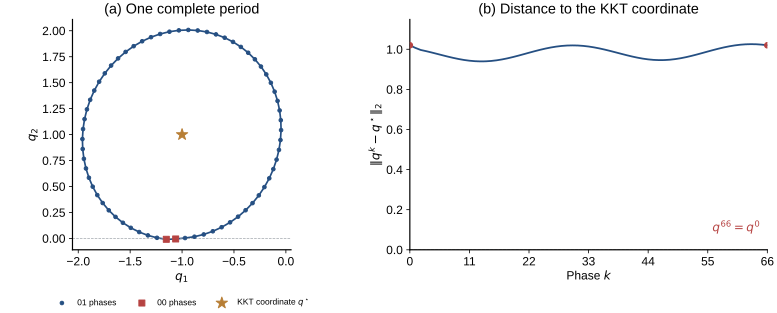

给不等式约束加入非负松弛变量后，第三块约束矩阵自然成为单位阵，第三个子问题也变成逐坐标取正部。这一步很容易计算，但整个三块 ADMM 仍可能循环。

下面介绍的例子同时具有几个看似有利的性质。前两个目标都是强凸二次函数，优化问题有唯一的 KKT 点，三个子问题每一步都有唯一解。即便如此，按照固定顺序直接更新三块变量，仍存在精确重复的周期轨道。

文章以**周期 66** 的二维反例为主，给出足以确定问题和迭代的公式，再解释如何证明周期闭合、投影分支正确，以及轨道始终处于 KKT 点之外。最后介绍周期 23 的局部吸引性和乘子步长的相关结论。数学依据是 Kenan Xu、Xiangfeng Wang 的[论文及公开验证材料](https://arxiv.org/html/2608.14396)。

## 1. 单位阵约束与直接三块 ADMM

考虑凸优化问题

$$
\min_{x,y}\ F(x)+G(y),
\qquad Ax+By\le b.
$$

引入非负松弛变量 $$z$$，得到等价形式

$$
\begin{aligned}
\min_{x,y,z}\quad &F(x)+G(y)+\iota_{\mathbb R_+^m}(z),\\
\text{s.t.}\quad &Ax+By+z=b.
\end{aligned}
$$

这里的示性函数 $$\iota_{\mathbb R_+^m}$$ 在 $$z\ge0$$ 时为零，在其他位置为正无穷。第三块约束矩阵就是 $$I_m$$。

采用论文的乘子符号，记残差为 $$r=Ax+By+z-b$$，增广 Lagrangian 为

$$
\mathcal L_\beta
=
F(x)+G(y)+\iota_{\mathbb R_+^m}(z)
-\lambda^\top r+\frac{\beta}{2}\|r\|^2,
\qquad \beta>0.
$$

**直接三块 ADMM** 按照 $$x\to y\to z\to\lambda$$ 更新

$$
\begin{aligned}
x^{k+1}&=\arg\min_x\mathcal L_\beta(x,y^k,z^k,\lambda^k),\\
y^{k+1}&=\arg\min_y\mathcal L_\beta(x^{k+1},y,z^k,\lambda^k),\\
z^{k+1}&=\left[b-Ax^{k+1}-By^{k+1}+\lambda^k/\beta\right]_+,\\
\lambda^{k+1}&=\lambda^k-\beta\left(Ax^{k+1}+By^{k+1}+z^{k+1}-b\right).
\end{aligned}
$$

符号 $$[u]_+$$ 表示逐坐标取 $$\max(u_i,0)$$。这一符号约定下，非负约束的最优乘子满足 $$\lambda^\star\le0$$。

更新顺序影响算法。两块 ADMM 可以将 $$(y,z)$$ 作为一个整体，要求第二步联合最小化。上面的直接更新只先解一次 $$y$$，再解一次 $$z$$。计算 $$y^{k+1}$$ 时仍使用旧的 $$z^k$$，两步合起来一般达不到联合最小化的要求，因此需要针对这条三块迭代本身分析收敛性。[算法定义见论文 §1.1](https://arxiv.org/html/2608.14396#S1.SS1)。

## 2. 周期 66 的问题数据

取 $$x,y,z\in\mathbb R^2$$、$$A=B=I_2$$、$$\beta=1$$，问题为

$$
\begin{aligned}
\min_{x,y,z}\quad&
\frac12x^\top Q_1x+\frac12y^\top Q_2y+\iota_{\mathbb R_+^2}(z),\\
\text{s.t.}\quad&x+y+z=b.
\end{aligned}
$$

为简洁地表示数据，先定义两个矩阵

$$
M=(Q_1+I_2)^{-1},
\qquad N=(Q_2+I_2)^{-1}.
$$

它们是两个二次子问题解算映射的系数。令

$$
\begin{gathered}
\varepsilon=\frac1{1000},
\quad \mu=\frac{8957}{10000},
\quad \nu=\frac{999}{1000},\\
d_1=(-1,20)^\top,\qquad d_2=(-1,10)^\top,
\end{gathered}
$$

并取

$$
\begin{aligned}
M&=\varepsilon I_2+(\mu-\varepsilon)\frac{d_1d_1^\top}{d_1^\top d_1},\\
N&=\varepsilon I_2+(\nu-\varepsilon)\frac{d_2d_2^\top}{d_2^\top d_2},\\
Q_1&=M^{-1}-I_2,\qquad Q_2=N^{-1}-I_2.
\end{aligned}
$$

这些表达式完全确定了两个有理数矩阵。由于 $$M$$ 的特征值为 $$\varepsilon,\mu$$，$$N$$ 的特征值为 $$\varepsilon,\nu$$，可直接得到

$$
\sigma(Q_1)=\left\{999,\frac{1043}{8957}\right\},
\qquad
\sigma(Q_2)=\left\{999,\frac1{999}\right\}.
$$

全部特征值为正，所以两个目标都是强凸二次函数。

右端项通过一个预先指定的 KKT 点确定

$$
\begin{gathered}
z^\star=(0,1)^\top,\qquad \lambda^\star=(-1,0)^\top,\\
x^\star=Q_1^{-1}\lambda^\star,\qquad
y^\star=Q_2^{-1}\lambda^\star,\qquad
b=x^\star+y^\star+z^\star.
\end{gathered}
$$

于是

$$
Q_1x^\star=Q_2y^\star=\lambda^\star,\quad
x^\star+y^\star+z^\star=b,\quad
z^\star\ge0,\quad\lambda^\star\le0,\quad
(z^\star)^\top\lambda^\star=0.
$$

这些正是此问题的 KKT 条件。目标关于 $$(x,y)$$ 严格凸，约束又确定了 $$z$$，所以原始最优解唯一，$$Q_1x^\star=\lambda^\star$$ 进一步确定唯一乘子。

在这组数据上，迭代公式尤其简单

$$
\begin{aligned}
x^{k+1}&=M(b-y^k-z^k+\lambda^k),\\
y^{k+1}&=N(b-x^{k+1}-z^k+\lambda^k),\\
z^{k+1}&=[b-x^{k+1}-y^{k+1}+\lambda^k]_+,\\
\lambda^{k+1}
&=\lambda^k-(x^{k+1}+y^{k+1}+z^{k+1}-b).
\end{aligned}
$$

前两步是正定线性系统的解，第三步是投影。因而每一步都没有子问题解的选择歧义。[完整数据与唯一性论证见论文 §2.1](https://arxiv.org/html/2608.14396#S2.SS1)。

## 3. 轨道与投影分支

定义每次投影的输入

$$
q^{k+1}=b-x^{k+1}-y^{k+1}+\lambda^k.
$$

由第三步和第四步立即得到

$$
z^{k+1}=[q^{k+1}]_+,
\qquad
\lambda^{k+1}=q^{k+1}-[q^{k+1}]_+=[q^{k+1}]_-.
$$

其中 $$[u]_-$$ 逐坐标取 $$\min(u_i,0)$$。因此，一次投影与乘子更新之后，$$q=z+\lambda$$ 同时记录了 $$z$$ 与 $$\lambda$$，而 $$z-\lambda=|q|$$。

用四维状态 $$s=(y,q)$$ 就能描述后续迭代。原始八维状态中的下一步 $$x$$ 可由

$$
x^+=M(b-y-|q|)
$$

恢复，其余更新约化为

$$
\begin{aligned}
g&=(I_2-M)b,\\
p&=My-(I_2-M)|q|+g,\\
y^+&=Np,\\
q^+&=(I_2-N)p+[q]_+.
\end{aligned}
$$

这个写法把非线性集中到绝对值与取正部。**一旦 $$q$$ 的符号固定，整步就是仿射映射。**

用两个比特记录符号，负数记为 0，正数记为 1。例如，00 表示两个分量均为负，01 表示第一个为负、第二个为正。反例的一个完整周期使用

$$
\mathcal W=(00)^2(01)^{64}.
$$

也就是先经过两个 00 相位，再经过 64 个 01 相位，随后重复。

<picture>
  <source media="(max-width: 640px)" srcset="/assets/img/admm-counterexample/period-66-mobile.svg">
  
</picture>

左图画出 $$q^k=z^k+\lambda^k$$ 的一个周期，红色方块是两个 00 相位，星号是唯一 KKT 坐标 $$q^\star=(-1,1)$$。右图画出同一组相位到 $$q^\star$$ 的距离，周期结束返回初始值。图由[公开的 66 相位数据](https://github.com/ConanXu-math/identity-slack-admm-cycle-certificate/blob/main/certificates/orbit_66.json)的十进制列重绘。

前几个相位及周期末尾的值如下，表中保留六位小数

| 相位 $$k$$ | $$q_1^k$$ | $$q_2^k$$ | 符号 |
| --- | ---: | ---: | --- |
| 0 | -1.151767 | -0.008619 | 00 |
| 1 | -1.061680 | -0.005357 | 00 |
| 2 | -0.971186 | 0.003711 | 01 |
| 65 | -1.241389 | 0.005771 | 01 |
| 66 | 精确等于相位 0 | 精确等于相位 0 | 00 |

图和小数表展示轨道形状。周期存在的严格保证来自下面的有理数构造。[状态约化见论文 §2.3](https://arxiv.org/html/2608.14396#S2.SS3)。

## 4. 周期闭合的精确证明

### 4.1 回返映射与初值

在符号为 $$D$$ 的区域内，将上述仿射更新记为 $$\Phi_D$$。按照给定符号路径复合 66 步，有

$$
\Phi_{01}^{64}\circ\Phi_{00}^{2}(s)
=
\mathcal P_{66}s+a_{66}.
$$

所有系数都是有理数。要求更新后回到原状态，就是求解

$$
(I_4-\mathcal P_{66})s^0=a_{66}.
$$

论文用有理数消元验证 $$I_4-\mathcal P_{66}$$ 可逆，因此

$$
s^0=(I_4-\mathcal P_{66})^{-1}a_{66}
$$

给出一个精确的有理数初值。这个式子连同前面的 $$M,N,b$$ 和约化公式，完整确定了 $$y^0,q^0$$。取 $$z^0=[q^0]_+$$、$$\lambda^0=[q^0]_-$$，再令

$$
x^0=M(b-y^{65}-|q^{65}|),
$$

就得到与周期相容的完整 ADMM 初值。展开后的分子、分母很长，公开轨道文件保存了全部数值。

### 4.2 投影分支的可行性

回返方程用的是预先指定的符号路径。还必须检查由此求出的轨道，确实在每一步进入相应的区域。

精确计算给出

$$
\begin{aligned}
q_1^k&<0 &&(0\le k<66),\\
q_2^k&<0 &&(k=0,1),\\
q_2^k&>0 &&(2\le k<66).
\end{aligned}
$$

而且全部 132 个符号不等式都有严格余量，距零均大于 $$1/1000$$。因此每一步原始投影都确实实现了预设符号，整个仿射复合对应一条真正的 ADMM 轨道。

这一步也说明，单独找到某个分支矩阵的不稳定特征值，还不足以构造这个反例，轨道需要实际遵循那条投影路径。

### 4.3 最小周期与非 KKT 性

闭合说明周期是 66 的约数，还要排除更短的周期。若完整状态有真子周期，符号序列也必须由更短的字重复而成。

字 $$\mathcal W$$ 长度为 66，恰好出现两次 00，所以唯一可能的真重复次数是两次。但前 33 个符号含两个 00，后 33 个符号没有 00，两半不同。因此最小周期恰好为 66。

任意 KKT 点在这条单值 ADMM 迭代下都是不动点。如果一个非恒定周期经过 KKT 点，后续就会停在那里，与最小周期 66 矛盾。因而周期中的所有状态都处于 KKT 点之外。有限多个状态不断重复，直接得到**有界且不收敛**的轨道。

严格符号余量和回返方程的可逆性，还使该周期在问题数据的小幅扰动下持续存在。这是关于数据扰动的结论。[证明见论文定理 2.1 与推论 A.1](https://arxiv.org/html/2608.14396#S2.SS3)。

## 5. 周期 23 与局部吸引性

周期 23 的例子进一步研究初值扰动。原始数据的维数为 $$m=3$$，两个目标为带线性项的强凸二次函数，第三块仍为非负松弛变量。数据中的 $$A,B$$ 可逆，经过变量替换 $$\widetilde x=Ax$$、$$\widetilde y=By$$，约束系数也可全部改写成单位阵，逐步对应原始迭代。

这个例子同样构造一条严格投影路径，并求解 23 步回返映射的不动点。它还给出有理数正定矩阵 $$P$$，满足

$$
P-M_{\mathrm{per}}^\top P M_{\mathrm{per}}\succ0,
$$

其中 $$M_{\mathrm{per}}$$ 是一个周期回返映射的线性部分。若 $$e$$ 表示相位零状态的误差，那么每完成一个周期，

$$
e_+^\top P e_+<e^\top P e
\qquad(e\ne0).
$$

仅有这个下降式，还要保证附近轨道沿用相同投影路径。论文通过严格符号余量，验证下面的椭球在 23 步回返下保持不变

$$
\mathcal E=
\left\{
\bar v^0+e:\ e^\top Pe<\frac1{4000}
\right\},
\qquad v=(y,t),\quad t=z+\lambda.
$$

每个从 $$\mathcal E$$ 出发的缩减初值，都沿相同路径重复，并且对每个固定相位 $$j$$ 满足

$$
v^{23n+j}\longrightarrow\bar v^j,
\qquad j=0,\ldots,22.
$$

这叫逐相位趋近周期轨道。整个序列有 23 个不同的子序列极限，呈现持续的周期性振荡。这里的开放初值集合属于**同一个固定问题的缩减状态空间**。

| 性质 | 周期 66 | 周期 23 |
| --- | --- | --- |
| 每块变量的维数 | 2 | 3 |
| 最优解 | 唯一 KKT 点 | 唯一 KKT 点 |
| 周期结论 | 指定有理数初值生成精确周期 | 精确周期与附近初值的逐相位吸引 |
| 投影条件 | 132 个严格不等式，余量大于 $$1/1000$$ | 69 个严格不等式，余量大于 $$1/250$$ |
| 额外性质 | 小幅改变问题数据后周期持续存在 | 固定问题具有开放的周期吸引初值集合 |

周期 23 的原始矩阵、初值和 Lyapunov 矩阵见[公开数据](https://github.com/ConanXu-math/identity-slack-admm-cycle-certificate/blob/main/certificates/period23_instance.json)及[论文 §4、附录 B](https://arxiv.org/html/2608.14396#S4)。

## 6. 乘子步长的作用

保留三个原始变量子问题和罚参数 $$\beta$$，只将乘子更新改为

$$
\lambda^{k+1}
=
\lambda^k-\tau(Ax^{k+1}+By^{k+1}+z^{k+1}-b),
\qquad\tau>0.
$$

标准 ADMM 对应 $$\tau=\beta$$。步长分析使用六维状态 $$w=(y,z,\lambda)$$，直接保留松弛变量和乘子的独立更新。在周期 66 问题中，$$\beta=1$$，论文得到以下三种不同范围的结果

| 步长范围 | 精确保证 |
| --- | --- |
| $$\tau\in[0.49,0.51]$$ | KKT 点附近存在共同的 Lyapunov 收缩度量 |
| $$\lvert\tau-1/2\rvert\le10^{-10}$$ | 原来产生周期 66 的那一个初值会收敛到 KKT 点 |
| $$0<\tau<\tau_c$$，$$0.9366061114<\tau_c<0.9366061115$$ | 每个固定步长下，KKT 点的严格 01 分支局部 Q-线性吸引 |

表中第二项通过精确包围前 232 步，证明原初值进入一个投影安全的收缩邻域。第一项和第三项描述 KKT 点附近的性质，初值范围与第二项不同。

论文还证明，在两个目标全局光滑、强凸且 $$[A\ B]$$ 满行秩的条件下，对每个固定问题和 $$\beta>0$$，存在一个依赖问题数据的正步长阈值，使足够小的 $$\tau$$ 从任意有限且 $$z^0\ge0$$ 的初值全局 R-线性收敛。

这个阈值需要依赖数据。令相对步长 $$\vartheta=\tau/\beta$$，对于任意预先给定的 $$0<\vartheta\le80/119$$，论文都能构造该问题类中的有界不收敛例子。因此，固定问题的安全步长、一个特殊初值的收敛区间、整个问题类的统一保证，需要分别陈述。[具体条件见论文 §3](https://arxiv.org/html/2608.14396#S3)。

## 7. AI 辅助构造的具体环节

这项研究中的计算辅助，主要用于寻找可以严格验证的表示和候选数据。

周期 66 路线把搜索对象从 Hessian 矩阵 $$Q_1,Q_2$$ 转为解算矩阵 $$M,N$$，再研究投影分支的切换。指定符号路径后，通过回返映射求出周期初值，最后逐项检查原始 ADMM 更新和严格符号。

周期 23 路线在另一套工作环境中，从满足 KKT 结构的二次规划数据与投影路径共同构造候选，随后研究回返映射的收缩，给出局部吸引椭球。

两条路线中，候选搜索、精确有理数验证和最终结论的范围审查，各有明确作用。单个分支的谱、小数轨迹和模型提出的推导，可以帮助发现结构。本文的周期结论则由完整路径的精确闭合和分支验证支撑。[过程说明见论文 §4.2 与附录 C](https://arxiv.org/html/2608.14396#S4.SS2)。

## 8. 验证入口与文献

公开仓库提供两个周期的有理数记录、完整相位和验证程序。读者可以在仓库要求的 Python 环境中运行

~~~bash
git clone https://github.com/ConanXu-math/identity-slack-admm-cycle-certificate.git
cd identity-slack-admm-cycle-certificate
python -m pip install -r requirements.txt

python python/verify_certificate_pair.py
python python/verify_period23_certificate.py
~~~

周期 66 的入口检查两种状态表示及原始 ADMM 更新，周期 23 的入口还检查局部吸引所需的 Lyapunov 不等式和投影条件。绘图使用公开轨道的十进制表示，严格等式与符号条件使用原始有理数记录。

- [论文 arXiv:2608.14396](https://arxiv.org/abs/2608.14396)。
- [项目仓库](https://github.com/ConanXu-math/identity-slack-admm-cycle-certificate)。
- [周期 66 的全部相位](https://github.com/ConanXu-math/identity-slack-admm-cycle-certificate/blob/main/certificates/orbit_66.json)。
- [周期 23 的数据与检查器](https://github.com/ConanXu-math/identity-slack-admm-cycle-certificate/blob/main/python/verify_period23_certificate.py)。
