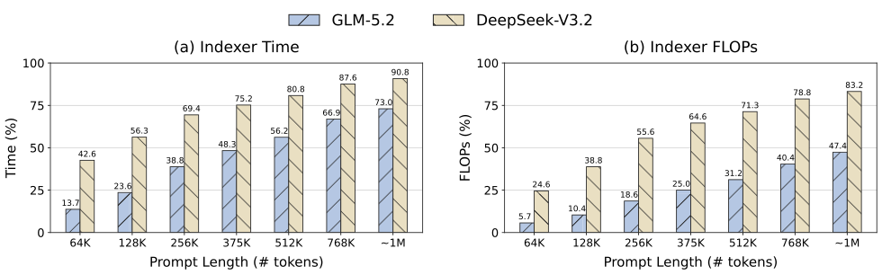
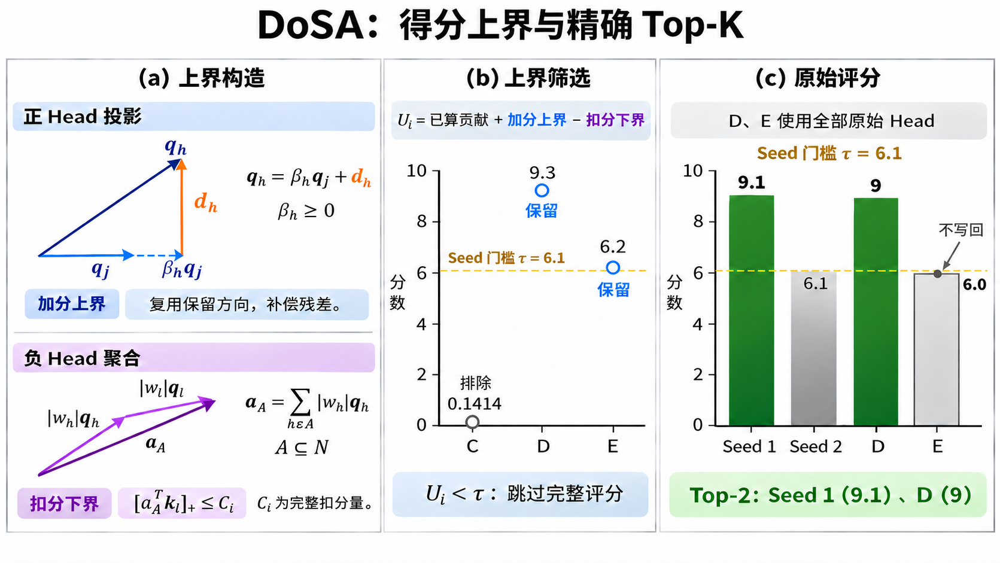
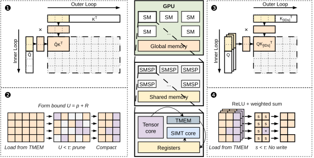

长上下文中的稀疏 Attention 只访问少量历史位置，但找到这些位置，仍可能需要扫描全部历史 Key。DoSA 关注的就是这一步位置选择，用安全的得分上界，提前排除无法进入 Top-K 的候选。

本文整理 Fanxu Meng、Taosong Fang 的 *DoSA: Dots Sparse Attention*，结合一个 Top-2 算例介绍数学原理、GPU 实现和作者报告的结果。

## 论文与幻灯片

| 材料 | 内容 |
| --- | --- |
| [论文 PDF](/assets/papers/dosa/dosa-paper.pdf) | arXiv:2610.13990v1，英文原文 |
| [中文幻灯片 PDF](/assets/papers/dosa/dosa-slides.pdf) | 24 页，包含背景、上界推导、GPU 实现、实验与附录 |
| [交互式流程 HTML](/assets/papers/dosa/) | 左侧展开训练、Prefill 和 Decoding，右侧通过关联线解释 DoSA 的改进 |
| [作者代码](https://github.com/llm-sys/flash-indexer) | 论文提供的实现入口 |

交互页中的训练过程、Head 评分和层内计算均可展开。实验说明也可单独打开，按需要查看对应公式和测量条件。

## Indexer 的计算开销

DSA 先用 Indexer 给可见历史位置评分，Top-K 返回位置编号，主 MLA 再从这些位置读取 KV 并汇集信息。

固定当前 Query，Indexer 产生 $$H$$ 个向量 $$q_h$$ 和对应权重 $$w_h$$。历史位置 $$i$$ 提供一个共享 Key $$k_i$$，它的分数为

$$
s_i=\sum_{h=1}^{H}w_h[q_h^\top k_i]_+,
\qquad [x]_+=\max(x,0).
$$

这里的 Head 是同一条 Query 的多个评分方向。一个历史 Token 接受全部 $$H$$ 路评分，最后得到一个标量分数。DeepSeek-V3.2 的 Indexer 有 64 个 Head，每个方向为 128 维。面对 100 万个 Key，单条 Query 就需要约 6400 万次向量内积。

作者在约百万 Token 的输入上测得，Indexer 占 Prefill GPU 时间的 73.0%（GLM-5.2）和 90.8%（DeepSeek-V3.2）。时间包括 Q/K 准备、缓存读取、评分和选择，图中的 FLOPs 则统计理论矩阵运算。两者分别描述实际耗时和算术规模。

## Seed 与筛选门槛

假设要选 Top-2，已经完整算出两个不同位置的分数为 9.1 和 6.1。全局第二名的分数至少为 6.1。如果另一个位置的得分上界只有 5，就可以省去它的完整评分。

推广到 Top-K，从可见位置集合 $$\Omega$$ 中选出至少 $$K$$ 个不同位置，组成 Seed 集合 $$\mathcal S$$。用原始 Indexer 完整评分后，取第 $$K$$ 大值

$$
\tau=\tau_K(\mathcal S)\le\tau_K(\Omega).
$$

若候选得分满足

$$
s_i\le U_i<\tau,
$$

就能安全排除。等于门槛的位置继续保留，最后按原始完整分数和一致的同分规则选择。

图中的 C 上界为 0.1414，可以提前排除。D、E 的上界分别为 9.3 和 6.2，继续接受完整评分。D 的完整分数为 9，达到门槛并写回，E 的分数为 6，省去写回。最终 Top-2 为 Seed 1 和 D。这是一组教学算例。

## 多 Head 评分的上界

DoSA 保留 $$r$$ 个 Head 直接计算，记为集合 $$R$$。未保留的正、负权重 Head 分别记为 $$P,N$$。剩余加分取上界，剩余扣分取下界，两者结合后覆盖总分。

对未保留正 Head，选择一个已保留方向，写成

$$
q_h=\beta_hq_j+d_h,\qquad \beta_h\ge0.
$$

利用 ReLU 的次可加性、正齐次性和 Cauchy–Schwarz 不等式，得到

$$
[q_h^\top k_i]_+
\le \beta_h[q_j^\top k_i]_+
+\lVert d_h\rVert_2\lVert k_i\rVert_2.
$$

投影部分复用已知点积，残差部分用范数覆盖。多个 Head 使用相同参照时，可以先合并投影系数。

对未保留负 Head，选取子集 $$A\subseteq N$$，准备聚合向量

$$
a_A=\sum_{h\in A}|w_h|q_h.
$$

再利用 ReLU 次可加性得到扣分下界

$$
[a_A^\top k_i]_+
\le\sum_{h\in N}|w_h|[q_h^\top k_i]_+.
$$

作者根据 Seed 上的激活频率选择聚合集合，以减少聚合前的正负点积抵消。任意合法子集都满足下界，选择方式影响筛选能力。

合并后，得分上界为

$$
\begin{aligned}
U_i={}&\sum_{j\in R}\widetilde w_j[q_j^\top k_i]_+\\
&+E_P\lVert k_i\rVert_2-[a_A^\top k_i]_+.
\end{aligned}
$$

投影、系数与辅助向量在当前 Query 一侧准备，随后跨 Key 复用。DoSA 使用训练好的 Indexer，候选完整评分继续采用原始 Head 和权重。

## GPU 实现

论文图 2 按四步组织计算。Tensor Cores 计算筛选内积，SIMT 线程计算上界并整理候选。候选 Key 再交给 Tensor Cores 计算全部原始 Head，SIMT 线程归约完整分数，达到门槛才写回。

实现中还有三项数据组织。

- 保留 Head 预算相近的 Query 组成规则计算块，下一块 Key 的加载与当前块计算重叠。
- 每组四条 Query 中，对所有 Query 可见、且至少通过两条筛选的 Key，可以共享读取后完成评分。这减少重复传输，同时可能增加部分点积。
- 只写回完整分数达到门槛的记录，与 Seed 合并后执行精确 Top-K。分数编码边界按原始分数处理。

这里的 SIMT 是“单指令、多线程”，一组 GPU 线程执行相同操作，各自处理不同数据。在 DoSA 中，它承担 ReLU、加权归约、上界比较和候选整理等工作。

## 筛选的计算成本

进入候选完整评分后，会重新计算全部原始 Head。因此筛选省下的工作，需要覆盖扫描和重复评分的成本。

记 Seed 数量为 $$N_0$$，待筛选位置数为 $$N_s$$，通过筛选的候选数为 $$M$$。按逻辑点积估算

$$
\begin{aligned}
D_{\mathrm{base}}&=H(N_0+N_s),\\
D_{\mathrm{DoSA}}&\approx HN_0+(r+d_a)N_s+HM.
\end{aligned}
$$

只有保留率满足

$$
\frac{M}{N_s}<1-\frac{r+d_a}{H},
$$

才会减少逻辑点积。以 $$H=32,r=16,d_a=2$$ 为例，候选保留率需要低于 43.75%。GPU 时延还受到准备、分组、数据传输、写回和选择等成本影响。

## 实验结果与消融

完整 Indexer 测试使用 GLM-5.2，单 GPU，覆盖 21 个 Indexer 层，计入 Q/K 准备、评分和选择。英文、中文与代码三类输入，五种上下文长度和四种 Query chunk 组成 60 组配置。

| 测量对象 | 相对 SGLang | 相对 LiteTopK |
| --- | --- | --- |
| 完整 Indexer，60 组配置 | 1.12–2.74 倍 | 1.17–1.69 倍 |
| GLM-5.2，约 1M Token 的 TTFT | 1.86 倍 | 1.26 倍 |
| DeepSeek-V3.2，约 1M Token 的 TTFT | 1.94 倍 | 1.50 倍 |

TTFT 使用 TP8 测量独立请求，每次清除前缀缓存，两个模型的 Prefill chunk 分别为 32K 和 16K。完整请求还包含主 Attention、FFN 等计算，收益取决于 Indexer 在请求中的时间占比。

筛选与写回消融在 SciFact 的 16K Query、896K Key 上进行，报告 21 层平均检索时延。两项都关闭时为 76.2 ms，同时开启后为 40.2 ms，约加速 1.90 倍。

另一组上界组成消融使用 GLM-5.2 的末尾 4K Query。移除负 Head 聚合后，平均候选保留率从 2.65% 升至 95.06%，Indexer 时延变为完整 DoSA 的约 9.51 倍。时延比取几何平均，计入候选容量不足时的恢复开销。这说明负聚合在该负载中对筛选能力有很大影响。

上述性能和消融数字均为论文作者报告。

## 适用条件

Seed 门槛越接近全局 Top-K 门槛，上界越紧，越容易提前排除低分 Key。短输入或候选大量聚集在门槛附近时，准备和筛选成本可能削弱收益。

Screening 仍需扫描全部可见 Key。Key 读取的节省主要来自完整评分阶段减少候选和复用重复访问，全序列 Prefill 仍保留二次扫描项。超出模型声明上下文的时延测量支持计算扩展观察，任务准确率需要单独验证。

## 原文与图示

- [DoSA 论文 HTML](https://arxiv.org/html/2610.13990v1)，方法见 §2，GPU 实现见 §3，实验见 §4，数值与候选条件见附录 C。
- [作者实现](https://github.com/llm-sys/flash-indexer)。
- [DeepSeek-V3.2 技术报告](https://arxiv.org/html/2512.02556v1)，用于补充 DSA 架构与 Indexer 训练背景。

论文作者为 Fanxu Meng、Taosong Fang，Dots Studio，Xiaohongshu Inc.。论文及原图采用 CC BY 4.0。三栏总览为方法与教学算例的说明图。
