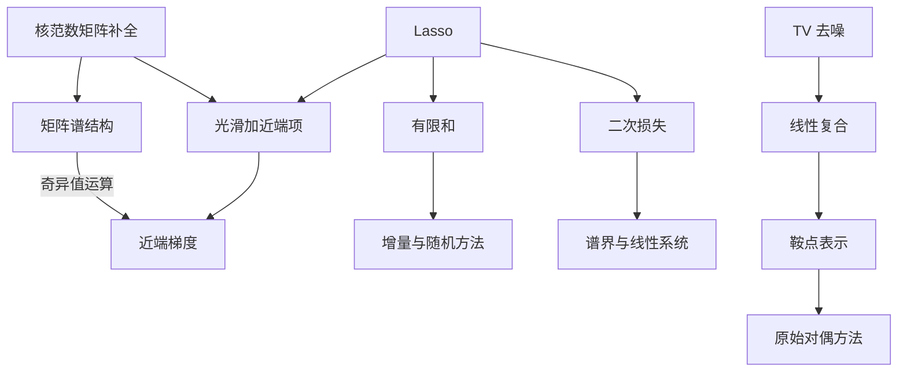
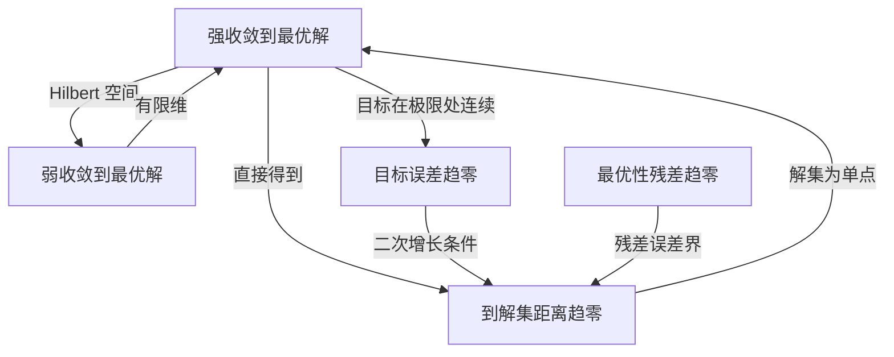
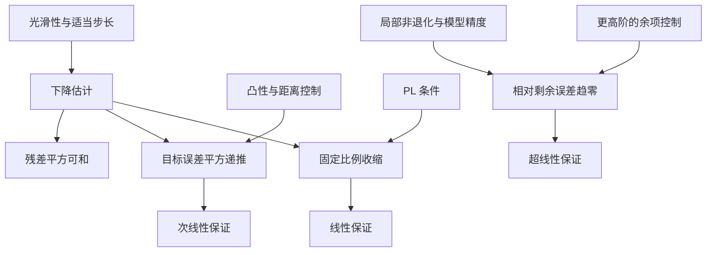
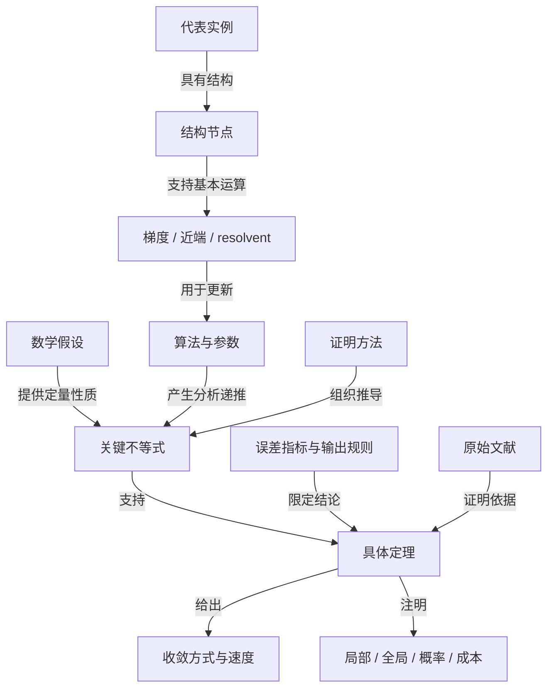

“这个算法收敛”需要说明多少事情？迭代点可能在移动，函数值已经稳定；梯度范数可能趋于零，极限却只满足驻点条件；同样写成 $O(1/k)$，一个定理研究最后迭代点，另一个研究平均点。

继续追问速度，还会遇到另一个问题：从次线性到线性，再到超线性，究竟是哪一条条件发挥了作用？是算法使用了更多曲率信息，还是某个不等式把残差与当前误差联系得更紧？

我希望把这些问题放进同一张知识地图。它的主线是：**先确定问题结构和目标误差，再找算法产生的进展估计，最后检查哪些条件把这条估计转化为收敛结论。** 这样阅读证明时，每个假设都有具体的位置，每个速度也都有明确的对象。

在[一阶最优性条件与变分法](/blog/optimization-variations-and-discretization/)中，关注点是候选对象应满足什么条件。这篇文章沿着它继续讨论：一个迭代过程怎样接近这些条件、怎样接近解，以及计算误差会怎样影响这个过程。

全文涵盖有限维光滑与非光滑优化、凸与非凸优化、Hilbert 空间中的算子方法和随机优化。第 2 节用具体模型说明问题结构，第 3—7 节整理收敛结论的各个属性，第 8—10 节解释证明方法，第 11—13 节把误差传播、变化问题和定理记录连接起来。文中的对应表列出常见充分条件；使用某条结果时，仍需核对原文中的完整假设。

## 1. 把一条收敛定理放进知识地图

这张地图的中心是一条具体的定理。问题结构、算法、误差指标和数学条件共同进入定理，定理再给出极限性质和速度。多个前提通过同一个定理节点组合，箭头同时记录它们各自承担的作用。

```mermaid
flowchart TD
  P["问题类别与空间"] -->|确定可用结构| C["结构条件"]
  P -->|选择更新规则| A["算法与参数"]
  A -->|产生| O["序列与误差指标"]
  A -->|建立| I["关键不等式"]
  C -->|支持| I
  M["证明方法"] -->|组织推导| I
  N["计算误差与随机噪声"] -->|进入| I
  I -->|形成| T["收敛定理"]
  O -->|指定研究对象| T
  T -->|说明极限性质| W["收敛方式"]
  T -->|给出定量估计| R["速度与复杂度"]
  C -->|限定结论范围| T
```

**定理节点**同时记录：研究问题与所在空间、算法更新公式与参数、结构假设、误差指标、输出方式、拓扑或概率方式、局部或全局范围、速度、计算单位与原始文献。例如，“光滑凸梯度下降最后迭代点的目标误差为 $O(1/k)$”，与“单调变分不等式方法平均点的 gap 为 $O(1/k)$”，应当分别建立节点。

以下统一记

$$
S=\operatorname*{argmin}F,\qquad F^\star=\inf_xF(x),\qquad
\Delta_k=F(x_k)-F^\star,\qquad
d_k=\operatorname{dist}(x_k,S),\qquad r_k=r(x_k).
$$

对非凸临界点分析，函数差通常写成 $F(x_k)-F(\bar x)$，并明确 $\bar x$ 的性质。

---

## 2. 问题结构告诉我们可以利用什么

### 2.1 从数学形式看到可计算的操作

结构化问题按照可利用的数学组织方式建立节点：函数项怎样组合、变量怎样耦合、约束具有何种几何、数据怎样提供、基本运算能否高效计算。同一个问题可同时属于多个类别。凸性、强凸性、PL、error bound 和 KL 性质作为**分析条件**单独保存，且要注明成立的区域与相关常数。

例如，写出 $f+g$ 以后，还需要问梯度和近端算子是否容易计算。写出有限和以后，还需要问算法能否访问单个分量。结构决定了可以怎样组织一次更新，正则性和增长条件则进一步决定这次更新能产生多少进展。

| 结构类别 | 典型数学形式 | 代表实例 | 适用的基本操作及算法 |
|---|---|---|---|
| 二次与最小二乘 | $\frac12\lVert Ax-b\rVert^2$；一般 $\frac12\lVert R(x)\rVert^2$ | Ridge 回归、参数识别、非线性曲线拟合 | 矩阵向量积、Jacobian、线性系统；共轭梯度、Gauss–Newton、Levenberg–Marquardt |
| 光滑加近端项 | $f(x)+g(x)$，$f$ 光滑、$\operatorname{prox}_g$ 可计算 | Lasso、Elastic Net、Group Lasso | 梯度、近端算子；Proximal Gradient、FISTA |
| 线性复合 | $f(x)+g(Kx)$ | TV 去噪、Fused Lasso、分析型稀疏正则 | $K,K^\top$、$\operatorname{prox}_{g^\star}$；原始对偶方法 |
| 有限和 | $\frac1n\sum_{i=1}^nf_i(x)+r(x)$ | 经验风险最小化、逻辑回归 | 分量梯度、抽样、梯度记忆；SGD、SVRG、SAGA |
| 期望目标 | $\mathbb E_\xi[\ell(x;\xi)]+r(x)$ | 总体风险、随机需求资源配置 | 采样、随机梯度、样本平均近似 |
| 分块与可分项 | $f(x_1,\ldots,x_m)+\sum_jg_j(x_j)$ | Group Lasso、矩阵因子模型 | 分块梯度与近端、分块子问题；坐标下降、交替优化 |
| 简单集合约束 | $\min_{x\in C}f(x)$ | 单纯形权重选择、盒约束估计 | 投影或线性最小化子问题；投影梯度、Frank–Wolfe |
| 线性耦合与一致性 | $\min f(x)+g(z)$，$Ax+Bz=c$ | 分布式回归、资源配置 | 独立子问题、乘子更新；ADMM、增广拉格朗日法 |
| 凸凹鞍点 | $\min_x\max_yL(x,y)$ | 零和博弈、TV 的对偶表示 | 两组梯度或近端；Extragradient、Mirror-Prox、PDHG |
| 单调包含与 VI | $0\in A(x)+B(x)$；$0\in F(x)+N_C(x)$ | 凸优化最优性系统、单调均衡 | resolvent 与算子计算；Forward-Backward、Douglas–Rachford |
| 多面体与凸锥 | $\min\langle c,x\rangle$，$Ax=b,\ x\in K$ | LP、SOCP、SDP、最小费用流 | 锥投影、障碍函数、线性系统；内点法 |
| 低秩与矩阵谱 | 损失 $+\lambda\lVert X\rVert_*$；$X=UV^\top$；$\operatorname{rank}(X)=r$ | 矩阵补全、推荐系统、低秩恢复 | 奇异值运算、因子参数化、切空间运算 |
| 流形约束 | $\min_{X\in\mathcal M}f(X)$ | PCA、固定秩矩阵、旋转估计 | Riemannian 梯度与 Hessian、retraction、流形信赖域 |
| 概率与熵几何 | 线性目标加熵正则，满足概率约束 | 熵正则最优传输、概率权重 | Bregman 散度、乘法更新、矩阵缩放；Mirror Descent、Sinkhorn |
| 双层优化 | $\min_\lambda E(w^\star(\lambda),\lambda)$，$w^\star(\lambda)\in\arg\min_wL(w,\lambda)$ | 正则参数选择、超参数学习、元学习 | 内层求解、隐式求导、超梯度 |

上表列出可利用的结构与算法族，每种方法的适用性仍取决于具体定理。例如，非线性最小二乘通常具有非凸性，分块凸性需要与联合凸性分别研究。参考 [Parikh–Boyd, Proximal Algorithms](https://web.stanford.edu/~boyd/papers/pdf/prox_algs.pdf)、[Boyd–Vandenberghe, Convex Optimization](https://web.stanford.edu/~boyd/cvxbook/bv_cvxbook.pdf) 和 [Ryu–Boyd, A Primer on Monotone Operator Methods](https://web.stanford.edu/~boyd/papers/pdf/monotone_primer.pdf)。

### 2.2 多种结构怎样连接同一个实例

该图记录实例和计算结构之间的关系。若要获得速度定理，还需把结构与算法参数、分析条件、误差指标和输出规则共同连接起来。

### 2.3 实例一：Lasso 与 Elastic Net

设 $A\in\mathbb R^{m\times n}$、$b\in\mathbb R^m$，$A$ 的第 $i$ 行为 $a_i^\top$，$\lambda>0$。Lasso 模型为

$$
\begin{aligned}
\min_xF(x)
&=\frac12\|Ax-b\|_2^2+\lambda\|x\|_1\\
&=\sum_{i=1}^{m}\frac12(a_i^\top x-b_i)^2
+\lambda\sum_{j=1}^{n}|x_j|.
\end{aligned}
$$

它同时具有二次损失、有限和、光滑加非光滑项、坐标可分正则四种结构。若 $f(x)=\frac12\lVert Ax-b\rVert^2$，则

$$
\nabla f(x)=A^\top(Ax-b),\qquad L=\|A\|_2^2.
$$

$g(x)=\lambda\lVert x\rVert_1$ 的近端算子可以逐坐标计算：

$$
\big[\operatorname{prox}_{\alpha g}(v)\big]_j
=\operatorname{sign}(v_j)\max\{|v_j|-\alpha\lambda,0\}.
$$

**结构与分析的联系：** 有限和允许逐样本访问梯度；可分正则支持逐坐标近端计算；二次损失使谱界和线性代数工具可用。当 $A$ 满列秩时，$A^\top A\succ0$，Lasso 的目标函数强凸。一般秩条件下可继续研究二次增长和近端残差误差界。

Elastic Net 在该目标中再加上 $\frac{\gamma}{2}\lVert x\rVert_2^2$，$\gamma>0$，得到至少 $\gamma$ 的强凸参数。参考 [Parikh–Boyd §7.1](https://web.stanford.edu/~boyd/papers/pdf/prox_algs.pdf)。

### 2.4 实例二：TV 去噪、线性复合与单调算子

令 $D$ 表示离散差分矩阵，采用各向异性离散 TV：

$$
\min_x \frac12\|x-b\|_2^2+\lambda\|Dx\|_1.
$$

由 $\lambda\lVert z\rVert_1=\max_{\lVert y\rVert_\infty\le\lambda}\langle z,y\rangle$，可将其写成

$$
\min_x\max_{\|y\|_\infty\le\lambda}
\left\{\frac12\|x-b\|_2^2+\langle Dx,y\rangle\right\}.
$$

算法可以分别利用 $D,D^\top$、二次函数的近端算子与盒约束投影。各向同性 TV 采用逐像素梯度的 $\ell_2$ 范数之和，对偶约束相应成为逐像素的 $\ell_2$ 球。

一般线性复合结构 $f(x)+g(Kx)$，在 $g$ 为 proper、下半连续凸函数时，Fenchel 表示为

$$
f(x)+g(Kx)
=\sup_y\{f(x)+\langle Kx,y\rangle-g^\star(y)\}.
$$

当 $f,g$ 为适当闭凸函数且存在鞍点时，对应的最优性系统为

$$
0\in
\begin{pmatrix}\partial f(x)\\\partial g^\star(y)\end{pmatrix}
+
\begin{pmatrix}K^\top y\\-Kx\end{pmatrix}.
$$

这把**复合目标 → 鞍点形式 → 单调包含 → 原始对偶算法 → Fejér 与 gap 分析**连接起来。一般情形还应检查鞍点存在、资格条件及相关运算可解性。TV 的原始目标具有强凸性；原始与对偶变量的联合线性速度仍依赖具体方法及其假设。参考 [Chambolle–Pock](https://optimization-online.org/wp-content/uploads/2010/06/2646.pdf)、[Ryu–Boyd](https://web.stanford.edu/~boyd/papers/pdf/monotone_primer.pdf)。

### 2.5 实例三：逻辑回归、有限和与分布式一致性

令 $y_i\in\lbrace-1,1\rbrace$、$\lambda>0$。考虑

$$
\min_w F(w)=\frac1n\sum_{i=1}^{n}
\log\!\left(1+\exp(-y_i a_i^\top w)\right)
+\frac\lambda2\|w\|_2^2.
$$

有限和结构允许单个样本梯度计算，二次正则提供强凸性。在分量光滑、采样规则与参数满足相关条件时，SVRG、SAGA 等方法可得到期望意义下的线性收敛，复杂度需要记录分量梯度计算次数。参考 [Johnson–Zhang, SVRG](https://proceedings.neurips.cc/paper/2013/file/ac1dd209cbcc5e5d1c6e28598e8cbbe8-Paper.pdf)。

当数据分布在 $p$ 个节点上，可以引入变量副本：

$$
\min_{w_1,\ldots,w_p,z}\ \sum_{i=1}^{p}f_i(w_i)+r(z)
\quad\text{s.t.}\quad w_i=z,\quad i=1,\ldots,p.
$$

它具有线性一致性结构，支持 consensus ADMM。新增误差指标包括 $\lVert w_i-z\rVert$，成本指标包括通信轮数。把所有 $w_i$ 归为一个变量块，再与 $z$ 构成两块形式，可以使用标准两块 ADMM 分析；多块顺序更新需要对应定理。参考 [Boyd 等, Distributed Optimization and Statistical Learning via ADMM](https://stanford.edu/~boyd/papers/pdf/admm_distr_stats.pdf)。

### 2.6 实例四：矩阵补全、谱正则与非凸因子化

令 $\Omega$ 为观测位置集合，$\mathcal P_\Omega$ 仅保留相应矩阵元素。核范数正则模型是

$$
\min_X\frac12\|\mathcal P_\Omega(X-M)\|_F^2+\lambda\|X\|_*.
$$

这是凸复合问题，核范数近端通过奇异值阈值完成；主要计算成本涉及观测算子和奇异值计算。参考 [Mazumder–Hastie–Tibshirani, Spectral Regularization](https://www.jmlr.org/papers/volume11/mazumder10a/mazumder10a.pdf)。

若令 $X=UV^\top$，得到因子化形式：

$$
\min_{\substack{U\in\mathbb R^{m\times r}\\V\in\mathbb R^{n\times r}}}
\frac12\|\mathcal P_\Omega(UV^\top-M)\|_F^2
+\frac\lambda2\big(\|U\|_F^2+\|V\|_F^2\big).
$$

它对固定的单个因子块通常是凸二次问题，对 $(U,V)$ 联合而言通常为非凸问题。固定因子列数限制了可表示矩阵的秩。收敛定理需要保留秩参数、因子非唯一性与所研究的驻点或最优解性质。若采用 $\operatorname{rank}(X)=r$ 约束，还可连接固定秩矩阵流形。

### 2.7 实例五：PCA、Stiefel 与 Grassmann 流形

设 $\Sigma$ 是 $d\times d$ 协方差矩阵，$1\le r<d$。PCA 的优化表达为

$$
\min_{U^\top U=I_r}-\operatorname{tr}(U^\top\Sigma U).
$$

可行集是 Stiefel 流形。对任意 $r\times r$ 正交矩阵 $Q$，$U$ 与 $UQ$ 代表同一个子空间，具有相同目标值。若第 $r$ 与第 $r+1$ 个特征值之间存在严格间隔，最优主子空间唯一，而基矩阵仍有正交变换自由度。

适合的误差指标包括投影矩阵距离

$$
\left\|UU^\top-U^\star(U^\star)^\top\right\|_F.
$$

因而可以连接主角度、Grassmann 流形与到解集的距离。参考 [Boumal, An Introduction to Optimization on Smooth Manifolds](https://www.nicolasboumal.net/book/IntroOptimManifolds_Boumal_2023.pdf)。

### 2.8 实例六：熵正则最优传输、Sinkhorn 与多种误差

设 $a\in\mathbb R^n,b\in\mathbb R^m$ 元素均为正，各自总和为 $1$，$C$ 为有限成本矩阵，$\varepsilon>0$，约定 $0\log0=0$。考虑

$$
\begin{aligned}
\min_{P\ge0}\quad
F_\varepsilon(P)&=
\langle C,P\rangle+
\varepsilon\sum_{i,j}P_{ij}(\log P_{ij}-1),\\
\text{s.t.}\quad
P\mathbf1&=a,\qquad P^\top\mathbf1=b.
\end{aligned}
$$

该模型具有线性边际约束、可分熵正则与 Kullback–Leibler 散度几何。令 $K_{ij}=\exp(-C_{ij}/\varepsilon)$，最优矩阵可表示为

$$
P^\star=\operatorname{diag}(u)K\operatorname{diag}(v).
$$

Sinkhorn 通过交替更新缩放因子满足边际约束；缩放因子存在共同缩放自由度，正则问题的最优运输矩阵唯一。参考 [Cuturi, Sinkhorn Distances](https://papers.nips.cc/paper/2013/file/af21d0c97db2e27e13572cbf59eb343d-Paper.pdf)。

这里的 Kullback–Leibler 散度与收敛分析的 Kurdyka–Łojasiewicz 性质是不同概念，应使用独立节点。需要同时监测：

1. 固定 $\varepsilon$ 下的优化误差；
2. 边际约束可行性误差；
3. $\varepsilon$ 引起的正则近似误差。

有限步交替缩放通常仅能使其中一组边际约束精确满足，因此可以使用

$$
r_k=\|P^k\mathbf1-a\|_1+\|(P^k)^\top\mathbf1-b\|_1.
$$

若 $\widetilde P$ 满足两组边际约束，且
$F_\varepsilon(\widetilde P)-\min F_\varepsilon\le\delta$，则概率矩阵的熵范围给出

$$
0\le
\langle C,\widetilde P\rangle-
\min_{\substack{P\ge0\\P\mathbf1=a,\;P^\top\mathbf1=b}}\langle C,P\rangle
\le\delta+\varepsilon\log(nm).
$$

该式分别表达算法误差与正则参数误差。对于边际约束尚未全部满足的中间迭代，还需要另外处理可行性残差。固定 $\varepsilon$ 的迭代极限与 $\varepsilon\to0$ 的参数极限应建立不同节点。

### 2.9 实例七：双层 Ridge 正则参数选择与超梯度

令 $\lambda\in[\lambda_{\min},\lambda_{\max}]$，其中 $\lambda_{\min}>0$。训练数据与验证数据分别为 $(A_{\mathrm{train}},b_{\mathrm{train}})$、$(A_{\mathrm{val}},b_{\mathrm{val}})$：

$$
w_\lambda=\arg\min_w\left\{
\frac12\|A_{\mathrm{train}}w-b_{\mathrm{train}}\|_2^2
+\frac\lambda2\|w\|_2^2
\right\},
$$

$$
\min_{\lambda\in[\lambda_{\min},\lambda_{\max}]}
\frac12\|A_{\mathrm{val}}w_\lambda-b_{\mathrm{val}}\|_2^2.
$$

内层二次目标拥有统一正的强凸参数下界，解唯一；外层凸性需另外验证。内层最优性方程和导数为

$$
(A_{\mathrm{train}}^\top A_{\mathrm{train}}+\lambda I)w_\lambda
=A_{\mathrm{train}}^\top b_{\mathrm{train}},
$$

$$
\frac{dw_\lambda}{d\lambda}
=-(A_{\mathrm{train}}^\top A_{\mathrm{train}}+\lambda I)^{-1}w_\lambda.
$$

此例将内层求解误差、线性系统误差、超梯度误差和外层收敛连接起来。参考 [Franceschi 等, Bilevel Programming for Hyperparameter Optimization](https://proceedings.mlr.press/v80/franceschi18a/franceschi18a.pdf)。

### 2.10 结构怎样影响速度与误差分析

| 结构或附加条件 | 对算法产生的作用 | 应连接的分析节点 |
|---|---|---|
| 可分、稀疏、低秩、有限和 | 降低单步成本，支持并行或抽样 | 运算量、样本查询、通信次数、奇异值与线性求解成本 |
| 强凸、PL、QG、error bound | 将残差或下降量与目标误差、距离联系起来 | 收缩递推、线性速度，注明具体指标 |
| 有限和与方差缩减 | 逐渐控制梯度估计的方差 | 随机 Lyapunov、期望速度、抽样成本 |
| Jacobian、Hessian、广义导数与非退化性 | 建立局部模型并控制余项 | 局部超线性或二次、内部求解精度 |
| 多面体、部分光滑性、活动集合 | 支持误差界与活动结构识别 | 识别后的局部速度、到解集距离 |
| 线性耦合、鞍点、单调包含 | 产生原始与对偶更新和固定点表达 | Fejér、averagedness、gap、可行性残差 |
| 正则化、采样、双层求解 | 引入参数误差、数据误差和内层误差 | 扰动分析、多种误差的联合控制 |

结构可能降低每步计算成本，也可能在额外条件下改善收敛速度。两类结果应分别记录，不应仅凭问题具有某种结构就赋予速度结论。

---
## 3. 说“收敛”之前，先确定研究哪个量

同一个算法可以同时产生很多序列：迭代点、目标值、梯度范数、约束残差和原始对偶间隙。它们之间存在联系，而每一次联系都需要相应的条件。研究“收敛”之前，应固定误差指标、解集以及所选的输出点。

| 对象 | 代表性表达 | 需要注明的结论边界 |
|---|---|---|
| 迭代点 | $x_k\to x^\star$ 或 $x_k\rightharpoonup x^\star$ | 极限是最优解、局部极小点、临界点、固定点还是鞍点 |
| 到解集的距离 | $\operatorname{dist}(x_k,S)\to0$ | 解集可以包含多个点；仍需识别具体极限 |
| 目标值 | $F(x_k)\to\ell$ | 是否已证明 $\ell=F^\star$ |
| 最优值误差 | $F(x_k)-F^\star\to0$ | 最优值可达性与约束问题的可行性 |
| 光滑驻点残差 | $\lVert\nabla f(x_k)\rVert\to0$ | 非凸情形主要表示接近一阶驻点条件 |
| 非光滑最优性残差 | $\operatorname{dist}(0,\partial F(x_k))\to0$ | 需要说明次微分类型，非凸情形常用 limiting subdifferential |
| 近端梯度残差 | $\lVert G_\gamma(x_k)\rVert\to0$ | 用于光滑与闭凸非光滑项的复合结构 |
| 固定点残差 | $\lVert x_k-T(x_k)\rVert\to0$ | 固定点怎样对应原始问题的解 |
| 可行性误差 | $\lVert h(x_k)\rVert+\lVert[g(x_k)]_+\rVert\to0$ | 约束违背与到可行集距离之间可能需要 error bound |
| 原始与对偶间隙 | $P(x_k)-D(y_k)\to0$ | 原始与对偶可行性、弱对偶及 gap 定义 |
| 步长 | $\lVert x_{k+1}-x_k\rVert\to0$ | 渐近正则性通常是中间性质 |
| 轨迹长度 | $\sum_k\lVert x_{k+1}-x_k\rVert<\infty$ | 完备空间中支持迭代点强收敛 |

### 3.1 近端梯度残差

对于标准复合目标 $F=f+g$，其中 $f$ 可微、$g$ proper、下半连续凸函数，定义

$$
G_\gamma(x)=\frac1\gamma\left[
x-\operatorname{prox}_{\gamma g}\bigl(x-\gamma\nabla f(x)\bigr)
\right].
$$

有

$$
G_\gamma(x)=0
\iff 0\in\nabla f(x)+\partial g(x).
$$

这一关系连接可计算算法残差和最优性条件。在非凸问题中，残差为零可能只对应临界点。

### 3.2 gap 的定义依赖问题形式

原始与对偶间隙、鞍点 gap、变分不等式 gap 以及固定点残差需要分别定义。以鞍点问题为例，可考虑指定测试集合 $X\times Y$ 上的

$$
\operatorname{Gap}_{X,Y}(\bar x,\bar y)
=\sup_{y\in Y}L(\bar x,y)-\inf_{x\in X}L(x,\bar y).
$$

如果 $X,Y$ 是受限测试集合，所得为 restricted gap；其趋于零能否识别全局鞍点，取决于集合的选择和问题条件。参考 [Chambolle–Pock, Theorem 1](https://optimization-online.org/wp-content/uploads/2010/06/2646.pdf)。

---

## 4. 以什么方式收敛，又是哪一个序列收敛

确定误差对象以后，还要确定观察它的方式。在无限维空间中，范数与弱拓扑提供不同的极限概念；在随机算法中，还要说明结论以什么概率意义成立。平均点和最后点也应当分别记录。这些属性相互组合，共同构成一条完整的收敛结论。

### 4.1 强收敛与弱收敛

在 Hilbert 空间 $\mathcal H$ 中，

$$
x_k\to x\iff \|x_k-x\|\to0,
$$

$$
x_k\rightharpoonup x
\iff \langle x_k,v\rangle\to\langle x,v\rangle
\quad\forall v\in\mathcal H.
$$

强收敛推出弱收敛。在有限维空间中二者一致；在无限维 Hilbert 空间中，弱收敛加上 $\lVert x_k\rVert\to\lVert x\rVert$ 能推出强收敛。

标准例子为 $\ell^2$ 空间中的单位向量序列 $e_k$：

$$
e_k\rightharpoonup0,\qquad \|e_k\|=1.
$$

有界序列在有限维空间具有强收敛子序列；Hilbert 空间中的有界序列具有弱收敛子序列。需要区分“存在收敛子序列”“所有聚点满足某性质”以及“全序列收敛”。参考 [Bauschke–Dao–Moursi, Fejér Monotone Sequences](https://arxiv.org/pdf/1507.05585)。

### 4.2 各类收敛结论之间的关系图

其中的连续性、二次增长和 error bound 都是箭头的适用条件。下半连续性通常首先给出下极限不等式；要得到目标值的完整极限，还需要上极限控制。

三个反映结论边界的例子：

1. 若 $F(x,y)=x^2$，$z_k=(0,(-1)^k)$，目标误差和到最优解集的距离恒为零，$z_k$ 持续交替。
2. 若 $f(x)=x^4-x^2$，$x_k=0$，则梯度恒为零，该点高于函数的全局最优值。
3. 若 $x_k=\sum_{j=1}^k1/j$，则 $\lvert x_{k+1}-x_k\rvert\to0$，步长平方可和，但序列无界。

### 4.3 随机收敛

| 方式 | 定义或典型表达 | 常见联系 |
|---|---|---|
| 几乎处处收敛 | $\mathbb P(\lim_kX_k=X)=1$ | 推出依概率收敛 |
| 依概率收敛 | 对所有 $\varepsilon>0$，$\mathbb P(\lVert X_k-X\rVert>\varepsilon)\to0$ | 推出依分布收敛 |
| $L^p$ 收敛 | $\mathbb E\lVert X_k-X\rVert^p\to0$ | 推出依概率收敛；$p=2$ 为均方收敛 |
| 依分布收敛 | 所有有界连续测试函数的期望收敛 | 极限为常数时与依概率收敛等价 |
| 非负误差的期望收敛 | $\mathbb E[E_k]\to0$，$E_k\ge0$ | Markov 不等式给出误差依概率收敛 |
| 高概率界 | $\mathbb P(E_k\le b(k,\delta))\ge1-\delta$ | 需注明 $\delta$ 与是否对全部 $k$ 同时成立 |

典型蕴含关系是

$$
L^p\text{ 收敛}\Longrightarrow\text{依概率收敛},
$$

$$
\text{几乎处处收敛}\Longrightarrow
\text{依概率收敛}\Longrightarrow\text{依分布收敛}.
$$

几乎处处收敛与 $L^p$ 收敛之间一般需要附加条件。依概率收敛加上一致可积性支持 $L^1$ 收敛。向量均值 $\mathbb E[X_k]$ 的收敛，与非负误差 $\mathbb E\lVert X_k-x^\star\rVert$ 的收敛具有不同含义。Hilbert 空间中的向量弱收敛，与概率测度的弱收敛应分别记录。参考 [Durrett, Probability: Theory and Examples](https://math.duke.edu/~rtd/PTE/PTE5_011119.pdf)。

### 4.4 输出规则与保证范围

| 属性 | 常见取值 | 注意事项 |
|---|---|---|
| 输出规则 | 最后点、最佳点、遍历平均点、平均误差、随机输出点 | 定理证明的对象必须与实际输出一致 |
| 序列范围 | 全序列、某个子序列、所有聚点 | 聚点为解还需论证是否具有同一极限 |
| 初值范围 | 全局、局部 | 全局收敛针对初始值范围；极限是否全局最优应分别记录 |
| 时间范围 | 渐近、非渐近 | 非渐近界给出有限迭代次数的保证 |
| 计算单位 | 外层迭代、梯度查询、样本、Hessian 向量乘积、通信轮次、实际成本 | 不同口径应分别计量 |

常用输出形式：

$$
\bar x_K=\frac{\sum_{k=0}^{K-1}w_kx_k}{\sum_{k=0}^{K-1}w_k},
\qquad
E_K^{\mathrm{best}}=\min_{0\le k<K}E_k.
$$

若 $F$ 凸，$w_k\ge0$ 且 $\sum w_k>0$，Jensen 不等式给出

$$
F(\bar x_K)\le
\frac{\sum_{k=0}^{K-1}w_kF(x_k)}{\sum_{k=0}^{K-1}w_k}.
$$

平均点结论和最后点结论应建立不同节点。随机输出点还要记录抽样分布。

---

## 5. 从定性收敛到速度与复杂度

固定非负误差 $E_k$，讨论 $E_k\to0$。上界形式允许具体序列具有更快速度，因此应区分“理论保证”和“准确渐近阶”。

| 速度类别 | 典型表达 | 解释 |
|---|---|---|
| 定性收敛 | $E_k\to0$ | 尚无统一速度 |
| 多项式次线性 | $E_k=O(k^{-a})$，$a>0$ | 常见指数 $1/2,1,2$ |
| 其他次线性 | 例如 $E_k=e^{-\sqrt{k}}$ | 包含非多项式速度 |
| Q-linear 保证 | 最终 $E_{k+1}\le qE_k$，$q\in(0,1)$ | 相邻误差有固定收缩比例 |
| R-linear 保证 | $E_k\le Cq^k$，$q\in(0,1)$ | 几何上界允许相邻误差出现波动 |
| Q-superlinear | $E_{k+1}/E_k\to0$ | 相对剩余误差趋于零 |
| 至少 $p$ 阶 | $E_{k+1}\le CE_k^p$，$p>1$ | $p=2$ 为二次，$p=3$ 为三次 |
| 有限终止 | 存在有限 $K$，之后 $E_k=0$ | 需区分整个问题求解与活动结构识别 |

Q 型约束相邻误差，R 型通过一个具有相应 Q 型速度的上界序列控制误差。Q-linear 推出 R-linear。$O(1/k^2)$ 属于次线性保证；二次收敛使用 $E_{k+1}$ 和 $E_k^2$ 的关系。超线性允许不存在任何固定 $p>1$ 的情形。

### 5.1 迭代复杂度

设 $K(\varepsilon)$ 表示达到 $E_k\le\varepsilon$ 所需迭代数。典型转换为

$$
E_k\le Ck^{-a}
\Longrightarrow
K(\varepsilon)=O(\varepsilon^{-1/a}),
$$

$$
E_k\le Cq^k
\Longrightarrow
K(\varepsilon)
=O\left(\frac{\log(C/\varepsilon)}{-\log q}\right).
$$

若局部已经满足 $E_{k+1}\le CE_k^p$、$p>1$，且进入足够小的邻域，则新增迭代次数通常为

$$
K(\varepsilon)=O(\log\log(1/\varepsilon)).
$$

这里按局部外层迭代次数计量，单步代价仍需单独计算。另需注意：若 $\lVert\nabla f(x_k)\rVert^2=O(1/k)$，对梯度范数本身只给出 $O(1/\sqrt{k})$ 的相应保证。

---

## 6. 每一条结构条件在证明中提供什么

阅读收敛定理时，我更关心一个假设随后被用在哪条不等式里。光滑性通常提供上界模型，凸性提供下界模型，误差界把可计算残差转成距离信息，局部非退化性则让逆映射保持稳定。按这些作用归类，可以直接看到证明还缺少哪一种关系。

| 条件 | 直接提供的关系或性质 | 典型用途 |
|---|---|---|
| 解存在、下半连续、紧性 | 聚点和极小值的存在性 | 定性收敛，特别是无限维问题 |
| 目标有下界、轨迹有界 | 下降量可累加，聚点可提取 | 目标值极限、残差可和性 |
| $L$-smooth | 二次上界模型、下降引理 | 步长选择与下降估计 |
| 凸性 | 一阶下界、Jensen 不等式 | 驻点到最优性、平均点分析 |
| 强凸性 | 统一二次下界、唯一最优解、强单调性 | 距离控制、线性收缩 |
| PL 条件 | 梯度范数平方控制目标误差 | 目标误差线性速度 |
| Quadratic Growth | 目标误差控制到解集距离平方 | 函数误差转为距离误差 |
| Error Bound | 残差控制到解集距离 | 后验误差证书、线性速度 |
| Metric Subregularity | 局部算子残差误差界 | 单调包含与约束问题的局部速度 |
| KL 性质 | 临界点附近斜率与函数差关系 | 有限长度、全序列收敛与速度 |
| 单调性、最大单调性 | 变分不等式结构与 resolvent 性质 | PPA、Forward-Backward、Douglas–Rachford |
| Cocoercivity、averagedness | Fejér 或能量型估计 | 固定点收敛、渐近正则性 |
| 强单调性、压缩性 | 定量收缩 | 强收敛、线性速度 |
| 非退化性与局部导数正则性 | 逆映射稳定、Taylor 余项控制 | Newton 类超线性与二次 |
| 约束资格与二阶条件 | KKT 表达及局部稳定 | SQP、原始与对偶方法 |
| 随机条件期望、方差和尾部界 | 噪声可以定量控制 | 期望、几乎处处、高概率定理 |
| 可和误差与相对精度条件 | 控制累计扰动 | 保持定性收敛或指定速度 |

四种常用结构关系是

$$
\begin{aligned}
\text{PL:}\qquad&
\frac12\|\nabla f(x)\|^2
\ge\mu(f(x)-f^\star),\\[2mm]
\text{Quadratic Growth:}\qquad&
F(x)-F^\star\ge
\frac{\mu}{2}\operatorname{dist}(x,S)^2,\\[2mm]
\text{Error Bound:}\qquad&
\operatorname{dist}(x,S)\le\kappa r(x),\\[2mm]
\text{Metric Subregularity:}\qquad&
\operatorname{dist}(x,A^{-1}(0))
\le\kappa\operatorname{dist}(0,A(x))
\quad\text{在指定邻域内}.
\end{aligned}
$$

每条关系都需要注明适用范围、常数、残差定义和次微分或算子定义。强凸性支持 PL 和二次增长；PL、QG 与 EB 之间的进一步关系取决于凸性、光滑性、残差类型和局部范围。参考 [Karimi–Nutini–Schmidt, PL Conditions](https://optimization-online.org/wp-content/uploads/2016/08/5590.pdf)、[Drusvyatskiy–Lewis, Error Bounds, Quadratic Growth, and Linear Convergence](https://sites.math.washington.edu/~ddrusv/split_arxiv.pdf)。

---

## 7. 把算法、条件和速度放在同一张表中

以下是常见的**充分条件**。每个定理还需具备相应的解存在、定义域和子问题可解性要求。

| 算法与问题 | 主要条件和参数 | 指标与输出 | 典型速度保证 |
|---|---|---|---|
| 梯度下降，凸光滑 | 凸、$L$-smooth、步长 $1/L$ | 最后点目标误差 | $O(1/k)$ |
| 梯度下降，PL | $L$-smooth、PL 常数 $\mu$、步长 $1/L$ | 最后点目标误差 | $\Delta_k\le(1-\mu/L)^k\Delta_0$ |
| 加速梯度，凸光滑 | 凸、$L$-smooth、标准加速参数 | 规定输出点目标误差 | $O(1/k^2)$ |
| 加速梯度，强凸光滑 | $\mu$-强凸、$L$-smooth、相应加速参数 | 规定输出点目标误差 | $O(e^{-k/\sqrt\kappa})$，$\kappa=L/\mu$ |
| 投影次梯度，凸非光滑 | 次梯度有界 $G$、距离上界 $R$、匹配步长 | 平均点或最佳点目标误差 | $O(RG/\sqrt K)$ |
| Proximal Gradient | $f$ 凸且 $L$-smooth，$g$ 闭凸，步长 $1/L$ | 最后点复合目标误差 | $O(1/k)$ |
| FISTA | 同上，使用标准 FISTA 参数 | FISTA 输出点目标误差 | $O(1/k^2)$ |
| 梯度下降，非凸光滑 | $L$-smooth、目标下界有限、步长 $1/L$ | 前 $K$ 步最小梯度范数平方 | $\min_{k<K}\lVert\nabla f(x_k)\rVert^2=O(1/K)$ |
| Mirror-Prox | 单调、Lipschitz 算子、有限 Bregman 直径、适当步长 | 遍历平均点的 VI gap | $O(1/K)$ |
| Chambolle–Pock | 闭凸鞍点结构、鞍点存在、$\tau\sigma\lVert K\rVert^2<1$、$\theta=1$ | 平均点在有界测试集上的 restricted gap | $O(1/K)$ |
| PPA，凸函数 | 精确近端子问题、固定 $\lambda>0$ | 最后点目标误差 | $O(1/k)$ |
| PPA，强凸函数 | $\mu$-强凸、精确近端步 | 到解距离 | $d_{k+1}\le d_k/(1+\mu\lambda_k)$ |
| Newton | 非退化解邻域内 Hessian 正定且 Lipschitz、充分近的初值、完整步 | 到解距离 | 局部二次 |
| 拟 Newton | 已收敛到非奇异解、完整步、Dennis–Moré 条件 | 到解距离 | 局部 Q-superlinear |
| SGD，强凸光滑 | 条件期望等于梯度、方差有界、合适的 $1/k$ 步长 | 最后点目标误差的期望 | $O(1/k)$ |
| 投影随机次梯度，凸 | 条件期望为次梯度、二阶矩有界、距离上界、匹配步长 | 平均点目标误差的期望 | $O(1/\sqrt K)$ |

参考：[Bubeck, Convex Optimization: Algorithms and Complexity](https://arxiv.org/pdf/1405.4980)、[PL 分析](https://optimization-online.org/wp-content/uploads/2016/08/5590.pdf)、[Nemirovski, Mirror-Prox](https://www2.isye.gatech.edu/~nemirovs/SIOPT_042562-1.pdf)、[Chambolle–Pock](https://optimization-online.org/wp-content/uploads/2010/06/2646.pdf)、[Rockafellar, PPA](https://sites.math.washington.edu/~rtr/papers/rtr066-MonoOpProxPoint.pdf)、[Dennis–Moré](https://www.math.unm.edu/~vageli/courses/Ma576/Broyden/dennis_more74.pdf) 和 [Bottou–Curtis–Nocedal, Optimization Methods for Large-Scale Machine Learning](https://arxiv.org/pdf/1606.04838)。

### 7.1 非凸梯度下降的残差复杂度

由

$$
\min_{0\le k<K}\|\nabla f(x_k)\|^2=O(1/K)
$$

可以得到最佳迭代梯度范数 $O(1/\sqrt K)$，达到梯度范数不超过 $\varepsilon$ 的复杂度通常为 $O(\varepsilon^{-2})$。此处已经明确：误差对象为**梯度范数**，输出方式为**最佳迭代点**。

### 7.2 强凸随机梯度的假设

常见条件为

$$
\mathbb E[g_k\mid\mathcal F_k]=\nabla F(x_k),\qquad
\mathbb E[\|g_k-\nabla F(x_k)\|^2\mid\mathcal F_k]\le\sigma^2.
$$

选取适当 $k_0$ 与

$$
\alpha_k=\frac{2}{\mu(k+k_0)}
$$

可在标准强凸光滑条件下得到最后点目标误差的期望 $O(1/k)$。固定步长并保留持续随机噪声时，通常会出现与步长及方差有关的误差邻域。参数和噪声条件需要一并保存。

---
## 8. 证明方法各自解决哪一个环节

一份证明通常同时使用多种工具。下降估计处理“是否持续进展”，聚点分析处理“极限是否满足最优性”，Opial 或有限长度处理“整个序列是否趋向同一对象”，误差界和局部展开再处理“速度有多快”。按证明中的任务来理解这些方法，可以减少对算法名称的依赖。

| 分析方法 | 主要处理对象 | 关键操作 | 常见结论 |
|---|---|---|---|
| 下降与累加 | 目标差、残差平方 | 逐步下降并累加 | 残差可和性、最佳点或平均残差界 |
| Lyapunov 函数 | 目标差、距离、动量等组合 | 构造递减能量并控制关注的误差 | 定性收敛、加速、稳定性 |
| Estimate Sequence | 目标函数的上界与下界模型 | 协调模型与输出目标值 | 加速复杂度 |
| Bregman 三点恒等式 | 非欧氏距离、目标差、VI gap | 近端最优性与距离差结合 | Mirror Descent、Mirror-Prox |
| Fejér 与 quasi-Fejér | 到解集各点的距离 | 距离极限、有界性、累计进展 | 为点收敛建立基础 |
| Opial 与 demiclosedness | 弱聚点和固定点残差 | 聚点识别、弱极限唯一性 | Hilbert 空间弱收敛 |
| 压缩映射 | 两点距离或到解距离 | 给出统一收缩因子 | 唯一固定点、强收敛、线性速度 |
| 单调算子分析 | resolvent、反射算子、平均算子 | 最优性条件转为固定点关系 | PPA、Forward-Backward、Douglas–Rachford |
| PL、QG 与 error bound | 梯度、残差、函数差、距离 | 不同误差指标之间的定量转换 | 线性速度、停止证书 |
| KL 与有限长度 | 非凸临界点、步长总和 | 充分下降与相对误差相结合 | 全序列收敛及指数相关速度 |
| Taylor 与局部线性化 | 到解距离、方程残差 | 主导项、模型余项与逆映射 | 局部线性、超线性、二次 |
| 超鞅与随机逼近 | 随机能量、累计下降 | 条件期望递推、可和误差 | 几乎处处极限与残差 |
| 鞅和集中不等式 | 随机波动 | 控制矩和尾部概率 | 高概率误差界 |
| 连续时间方法 | ODE、梯度流、微分包含 | 能量耗散、LaSalle、微分不等式 | 连续轨迹极限与速度 |
| PEP 与半定规划 | 算法最坏情形误差 | 将性能估计写为优化问题 | 速度常数、最坏情形与算法参数 |
| Oracle 下界 | 指定查询模型与函数类别 | 构造困难问题 | 最优复杂度的参照 |

方法之间可以组合。例如，单调算子方法提供 Fejér 不等式，demiclosedness 负责识别弱聚点，Opial 用于全序列弱收敛，error bound 再提供线性速度。连续时间分析用于离散算法时，还需要相应的离散稳定性与一致性论证。参考 [Combettes–Vũ, Variable Metric Quasi-Fejér](https://arxiv.org/pdf/1206.5705)、[Combettes–Pesquet, Stochastic Quasi-Fejér](https://arxiv.org/pdf/1404.7536)、[Drori–Teboulle, Performance Estimation](https://arxiv.org/pdf/1206.3209)。

---

## 9. 速度提升发生在递推的哪个位置

前面的分类最终要回到可以计算的关系。下面几条证明路径展示了同一个过程：先从更新公式得到进展估计，再用问题条件消去其中尚未控制的量。

### 9.1 下降与累加：得到残差平方可和

假设 $F(x_{k+1})\le F(x_k)-a r_k^2$，$a>0$，并且 $F(x_k)\ge F_{\inf}$。逐步累加可得

$$
\sum_{k=0}^{K-1}r_k^2
\le\frac{F(x_0)-F_{\inf}}{a}.
$$

因此

$$
\min_{0\le k<K}r_k^2
\le\frac{F(x_0)-F_{\inf}}{aK},
$$

以及

$$
\sum_{k=0}^{\infty}r_k^2<\infty
\quad\Longrightarrow\quad r_k\to0.
$$

这首先给出残差结论。若要进一步证明迭代点收敛，需要聚点识别、Fejér、KL 或其他结构。目标值单调并有下界直接给出目标值存在有限极限，通常还需要进一步证明该极限等于所期望的目标值。

### 9.2 凸性与 PL：从次线性递推转为线性递推

假设已经获得下降关系

$$
\Delta_{k+1}\le\Delta_k-a r_k^2,\qquad a>0.
$$

若进一步拥有

$$
r_k^2\ge b\Delta_k,\qquad b>0,
$$

则

$$
\boxed{\Delta_{k+1}\le(1-ab)\Delta_k.}
$$

选用有效常数，使 $1-ab\in[0,1)$，便得到目标误差的线性保证。若下降量只能由 $\Delta_k^2$ 控制，常得到类似

$$
\Delta_{k+1}\le\Delta_k-c\Delta_k^2
$$

的递推，进而给出 $O(1/k)$ 型结论。由此可以定位从次线性到线性的关键条件：能否把**可计算的残差平方**定量下界为**当前目标误差的一次量级**。

以光滑梯度下降为例，步长 $1/L$ 给出

$$
f(x_{k+1})-f^\star
\le f(x_k)-f^\star-\frac1{2L}\|\nabla f(x_k)\|^2.
$$

PL 条件

$$
\frac12\|\nabla f(x)\|^2\ge\mu(f(x)-f^\star)
$$

得到

$$
f(x_{k+1})-f^\star
\le\left(1-\frac\mu L\right)(f(x_k)-f^\star).
$$

参考 [Karimi–Nutini–Schmidt](https://optimization-online.org/wp-content/uploads/2016/08/5590.pdf)。

### 9.3 Fejér 与误差界：到解集距离的线性速度

若

$$
d_{k+1}^2\le d_k^2-a r_k^2,\qquad
d_k\le\kappa r_k,
$$

则

$$
d_{k+1}^2
\le\left(1-\frac a{\kappa^2}\right)d_k^2.
$$

选择有效常数，使收缩因子属于 $[0,1)$，得到到解集距离的线性保证。该结论关于 $d_k$，若需要到特定解的速度，还应使用解的唯一性或其他聚点结论。参考 [Drusvyatskiy–Lewis](https://sites.math.washington.edu/~ddrusv/split_arxiv.pdf)。

### 9.4 Lyapunov 函数与加速

构造非负能量 $V_k$ 和正系数 $A_k$，满足

$$
V_{k+1}\le V_k,\qquad V_k\ge A_k\Delta_k.
$$

由此获得

$$
\Delta_k\le\frac{V_0}{A_k}.
$$

例如，

$$
A_k\asymp k\quad\Longrightarrow\quad\Delta_k=O(1/k),
$$

$$
A_k\asymp k^2\quad\Longrightarrow\quad\Delta_k=O(1/k^2).
$$

能量函数可包括目标函数差、距离、动量、Bregman 距离或方差状态。核心工作是利用算法公式消除或控制更新中出现的交叉项，然后使能量下界覆盖想研究的误差。

### 9.5 Fejér 与 Opial：弱收敛的典型路径

设 $S$ 为非空解集，且对每个 $z\in S$ 有

$$
\|x_{k+1}-z\|^2
\le(1+\beta_k)\|x_k-z\|^2-D_k+\varepsilon_k,
$$

其中 $\beta_k,\varepsilon_k,D_k\ge0$，

$$
\sum_k\beta_k<\infty,\qquad
\sum_k\varepsilon_k<\infty.
$$

这类 quasi-Fejér 估计常用于证明有界性、到每个解的距离有极限及累计进展可控制。在 Hilbert 空间中，再证明所有弱聚点属于 $S$，便可通过 Opial 型论证得到弱收敛。若进一步拥有 $\operatorname{dist}(x_k,S)\to0$，则标准 quasi-Fejér 框架可以得到强收敛。

单纯的非扩张性一般不能保证直接 Picard 迭代收敛，例如 $T=-I$ 使 $x_{k+1}=-x_k$ 交替。averagedness 或合适的 Mann 松弛可以提供适合迭代的额外性质。参考 [Combettes–Vũ](https://arxiv.org/pdf/1206.5705)、[Bauschke–Dao–Moursi](https://arxiv.org/pdf/1507.05585)。

### 9.6 局部线性化：线性到超线性的另一条路径

令 $e_k=x_k-x^\star$、$d_k=\lVert e_k\rVert$。考虑局部误差方程

$$
e_{k+1}=M_ke_k+u_k.
$$

典型充分条件包括：

$$
\|M_k\|\le q<1,\quad u_k=o(d_k)
\quad\Longrightarrow\quad \text{局部线性保证},
$$

$$
M_k\to0,\quad u_k=o(d_k)
\quad\Longrightarrow\quad \text{局部超线性保证},
$$

$$
\|M_k\|=O(d_k^\nu),\quad
\|u_k\|=O(d_k^{1+\nu})
\quad\Longrightarrow\quad d_{k+1}=O(d_k^{1+\nu}).
$$

需要保证迭代始终处于展开适用的邻域内。对于固定迭代映射 $T$，条件 $\rho(DT(x^\star))<1$ 通常支持原范数中的局部 R-linear 保证；若算子范数本身小于 $1$，则可直接建立该范数中的局部压缩。

完整 Newton 步通过曲率修正消去一阶误差项；拟 Newton 则可借助沿当前迭代方向的 Dennis–Moré 条件获得超线性性质。参考 [Dennis–Moré, A Characterization of Superlinear Convergence](https://www.math.unm.edu/~vageli/courses/Ma576/Broyden/dennis_more74.pdf)。

具体看 Newton 更新。记 $H_k=\nabla^2f(x_k)$，在解附近写成

$$
\nabla f(x_k)=H_ke_k+u_k.
$$

完整 Newton 步给出

$$
e_{k+1}=e_k-H_k^{-1}(H_ke_k+u_k)=-H_k^{-1}u_k.
$$

与当前误差同阶的部分在这里被消去了。如果逆 Hessian 一致有界，并且 $u_k=o(d_k)$，便得到超线性；若 Hessian 为 Lipschitz 连续，使 $u_k=O(d_k^2)$，则得到局部二次速度。

这也解释了步长的作用。固定阻尼 $0<\alpha<1$ 会留下

$$
e_{k+1}=(1-\alpha)e_k+O(d_k^2).
$$

一阶项仍然参与更新。因此，使用 Hessian、解处非退化、模型余项受控，以及最终接受完整步，这些条件需要共同进入局部速度定理。

还可以直接检查 $f(x)=x^4$：Newton 更新为 $x_{k+1}=2x_k/3$，所以只有线性速度。这个例子中，解处 Hessian 为零，所需的非退化性没有成立。

### 9.7 超鞅与随机逼近

设 $\mathcal F_k$ 表示迭代历史信息，且

$$
\mathbb E[V_{k+1}\mid\mathcal F_k]
\le(1+\beta_k)V_k-D_k+\varepsilon_k,
$$

其中 $V_k,D_k,\beta_k,\varepsilon_k\ge0$，并假设 $\beta_k,\varepsilon_k$ 几乎处处可和以及所需的适应性和可积性。Robbins–Siegmund 型结论给出

$$
V_k\to V_\infty<\infty\quad\text{几乎处处},
\qquad
\sum_kD_k<\infty\quad\text{几乎处处}.
$$

要证明 $V_\infty=0$，还需利用问题结构和残差识别。例如，

$$
\sum_k\alpha_kr_k<\infty,\qquad
\sum_k\alpha_k=\infty,\qquad r_k\ge0
$$

直接给出 $\liminf_kr_k=0$；若要加强为 $r_k\to0$，需要进一步条件。参考 [Combettes–Pesquet](https://arxiv.org/pdf/1404.7536)、[Bertsekas 数学附录](https://web.mit.edu/dimitrib/www/Appendix_A_NEW_ALG.pdf)。

---

## 10. KL 性质把几何、有限长度和速度连接起来

非凸下降分析经常先得到函数值收敛和残差趋于零。要让整个迭代序列趋向一个临界点，还需要控制它在解附近的移动。Kurdyka–Łojasiewicz 性质通过斜率与函数差之间的关系，为这种控制提供条件。

采用如下指数约定：对临界极限点 $\bar x$，在某个邻域内且 $F(x)-F(\bar x)>0$ 时，

$$
\operatorname{dist}(0,\partial F(x))
\ge c\big(F(x)-F(\bar x)\big)^\theta,
\qquad c>0,\quad 0\le\theta<1.
$$

不同文献可能采用 $1-\theta$ 作为指数，记录定理时必须保存原始公式。

在标准有限维非凸下降框架中，通常结合：

**充分下降**

$$
F(x_k)-F(x_{k+1})
\ge a\|x_{k+1}-x_k\|^2;
$$

**相对误差**

$$
\operatorname{dist}(0,\partial F(x_{k+1}))
\le b\|x_{k+1}-x_k\|;
$$

**函数值与聚点的相容性**

$$
x_{k_j}\to\bar x,\qquad F(x_{k_j})\to F(\bar x).
$$

这些条件与 KL 性质共同支持有限长度与全序列收敛：

$$
\sum_{k=0}^{\infty}\|x_{k+1}-x_k\|<\infty,
\qquad x_k\to\bar x,
$$

其中 $\bar x$ 为相应临界点。参考 [Attouch–Bolte–Svaiter, Convergence of Descent Methods, Theorem 2.9](https://bolte.perso.math.cnrs.fr/MPA.pdf)。

令 $\delta_k=F(x_k)-F(\bar x)$，在典型条件下可推得

$$
\delta_k-\delta_{k+1}\ge c_0\delta_{k+1}^{2\theta}.
$$

这条递推产生函数差的速度；要获得迭代点距离的速度，通常还要利用有限长度和 KL 不等式。

| KL 指数区间 | 函数差的典型保证 | 迭代点距离的经典保证 |
|---|---|---|
| $\theta=0$ | 有限终止 | 有限终止 |
| $0<\theta<1/2$ | $\delta_{k+1}\le C\delta_k^{1/(2\theta)}$，超线性 | 至少 R-linear |
| $\theta=1/2$ | Q-linear | R-linear |
| $1/2<\theta<1$ | $O(k^{-1/(2\theta-1)})$ | $O(k^{-(1-\theta)/(2\theta-1)})$ |

迭代点的经典分类参见 [Attouch–Bolte–Redont–Soubeyran, Proximal Alternating Minimization, Theorem 11](https://arxiv.org/pdf/0801.1780)。低指数区间的函数差超线性估计由上面的递推直接得到。**函数差、迭代点距离、KL 指数定义和所用的收敛定理应分别保存。**

---
## 11. 计算不精确时，原有收敛结论还能保留多少

误差分析研究当前误差的来源、大小、可计算证书及传播；收敛分析研究这些误差怎样随迭代次数、样本规模或近似参数变化。两者共享下降不等式、稳定性估计与误差界。

### 11.1 误差来源

| 误差类型 | 代表性对象 | 适用的分析工具 |
|---|---|---|
| 优化误差 | 当前点距离当前问题的精确最优解或最优值 | 下降、Lyapunov、error bound、gap |
| 内部求解误差 | Newton 方程、近端或投影子问题的残差 | 绝对容差、相对容差、forcing term |
| 查询误差 | 近似梯度、近似函数值或近似模型 | 扰动递推、模型一致性 |
| 随机误差 | 条件均值误差、随机波动 | 矩估计、超鞅、集中不等式 |
| 数值误差 | 浮点运算、线性代数求解误差 | 前向误差、后向误差、条件数 |
| 统计误差 | 样本目标与总体目标的差 | 一致收敛、稳定性、概率界 |
| 模型近似误差 | 函数类限制或替代模型 | 逼近理论、稳定性、误差分配 |
| 离散化误差 | 连续问题与离散问题之间的差异 | 一致性、稳定性、网格尺度分析 |
| 数据与参数扰动 | 数据改变导致的解映射变化 | 敏感性、metric regularity、解映射分析 |

### 11.2 误差估计方式

| 方式 | 回答的问题 |
|---|---|
| 先验估计（a priori） | 根据问题常数、迭代次数、步长、样本数预先估计误差 |
| 后验估计（a posteriori） | 根据已经计算出的残差、gap 或模型差判断当前精度 |
| 前向误差（forward error） | 输出与原问题精确解有多大距离 |
| 后向误差（backward error） | 输出可视为多大数据扰动下问题的精确解 |
| 稳定性与敏感性 | 小的输入误差或内部误差能够产生多大的输出变化 |
| 概率误差界 | 期望、矩和指定置信水平下能够保证什么 |
| 绝对与相对精度 | 允许误差是否随着当前误差或残差尺度调整 |

### 11.3 扰动递推：误差如何影响线性速度

对于

$$
E_{k+1}\le qE_k+\varepsilon_k,\qquad 0<q<1,
$$

反复代入得到

$$
\boxed{
E_k\le q^kE_0+\sum_{j=0}^{k-1}q^{k-1-j}\varepsilon_j.
}
$$

| 扰动条件 | 可得到的保证 |
|---|---|
| $\varepsilon_k\le\bar\varepsilon$ | $\limsup_kE_k\le\bar\varepsilon/(1-q)$ |
| $\varepsilon_k\to0$ | $E_k\to0$ |
| $\varepsilon_k\le cE_k$ 且 $q+c<1$ | 保持线性保证 |
| 名义系数 $q_k\to0$ 且 $\varepsilon_k=o(E_k)$ | 支持超线性 |
| 名义递推为平方量级且 $\varepsilon_k=O(E_k^2)$ | 保持二次保证 |

这里的“名义系数”对应更一般的递推 $E_{k+1}\le q_kE_k+\varepsilon_k$。可和扰动通常有助于定性收敛；要保持特定速度，需要相应的数量级。比如 $\varepsilon_k=1/k^2$ 虽然可和，但持续带有这种扰动的递推，其误差可能只按照多项式速度趋于零。

### 11.4 inexact Newton 的相对精度与速度

令

$$
H_ks_k=-g_k+r_k,\qquad
g_k=\nabla f(x_k),\qquad
\|r_k\|\le\eta_k\|g_k\|.
$$

设 $v_k=\lVert g_k\rVert$。在解处 Hessian 非奇异、局部 Lipschitz 连续、完整步及相应邻域条件下，可得

$$
\boxed{v_{k+1}\le\eta_kv_k+Cv_k^2.}
$$

若 $\eta_k$ 被统一控制在小于 $1$ 的适当范围内，局部支持线性速度；若 $\eta_k\to0$，支持超线性；若 $\eta_k=O(v_k)$，支持二次。这里的 $\eta_k$ 为允许的残差上界，具体子问题可能被求解得更准确。参考 [Eisenstat–Walker, Choosing the Forcing Terms in an Inexact Newton Method](https://users.wpi.edu/~walker/Papers/forcing_terms,SISC_17,1996,16-32.pdf)。

### 11.5 统计误差与优化误差的分配

令 $R$ 为总体目标，$R_n$ 为样本目标，在共同的决策集合上，有

$$
R(x_k)-\inf_xR(x)
\le
\underbrace{R_n(x_k)-\inf_xR_n(x)}_{\text{optimization error}}
+
2\underbrace{\sup_x|R_n(x)-R(x)|}_{\text{statistical error}}.
$$

该关系直接由加减 $R_n(x_k)$、比较最优值以及一致误差上界得到。要使统计项趋于零，还需要样本、函数类别与概率方面的条件。

### 11.6 离散化误差与优化误差

若离散最优解 $x_h^\star$ 和连续问题最优解 $x^\star$ 均被表示在共同空间中，则

$$
\|x_{h,k}-x^\star\|
\le
\underbrace{\|x_{h,k}-x_h^\star\|}_{\text{optimization error}}
+
\underbrace{\|x_h^\star-x^\star\|}_{\text{discretization error}}.
$$

其中 $h$ 为离散尺度，$k$ 为求解离散问题的迭代次数。该关系说明迭代精度与问题近似精度需要共同控制。

---

## 12. 当优化问题本身也在变化

在这一分支中，收敛对象可以是函数列 $F_n$ 或 $F_h$ 本身。典型场景包括样本数增加、正则参数变化、离散尺度收缩、模型逼近与解映射稳定性。

| 收敛类型 | 研究内容 | 优化中的意义 |
|---|---|---|
| 逐点收敛 | 对每个固定 $x$，$F_n(x)\to F(x)$ | 表示逐点模型近似 |
| 一致或局部一致收敛 | 对整个集合或每个紧集统一控制函数误差 | 将区域内的目标误差估计传递给极限问题 |
| epi-convergence | 在指定拓扑下的下极限不等式与恢复序列 | 与极小化、极小值、近似极小点稳定性相容 |
| $\Gamma$-convergence | 同样使用下极限条件及恢复序列的变分收敛框架 | 常用于变分问题和离散化极限 |
| Mosco convergence | 弱下极限条件与强恢复序列 | Hilbert 空间凸问题、次微分和 resolvent 近似 |
| 算子图与 resolvent 收敛 | 算子或其解算映射随参数变化 | 单调包含与 VI 的近似 |
| 可行集收敛 | 集合及约束随参数变化 | 最优解、可行点、约束稳定性 |

有限维标准 epi-convergence 结果：在适当的下半连续性和等度水平有界性等前提下，可证明极小值收敛，近似极小点的聚点属于极限问题的最优解集。若极限问题最优解唯一，且保留所需紧性，可以进一步证明近似极小点全序列收敛。参考 [Rockafellar–Wets, Variational Analysis, Theorem 7.33](https://sites.math.washington.edu/~rtr/papers/rtr169-VarAnalysis-RockWets.pdf)。

对于多索引问题，建议明确保留

$$
k:\text{迭代次数},\qquad
n:\text{样本规模},\qquad
h:\text{离散尺度},\qquad
\lambda:\text{正则参数}.
$$

交换这些极限的顺序时，需要检查对应的一致估计。例如，固定 $h$ 令 $k\to\infty$，与在 $h\to0$ 的同时选择 $k=k(h)$，需要不同的精度控制。

---

## 13. 用定理节点组织阅读和研究

我会把一条定理记录成一张包含输入、关键不等式和输出的卡片。这样，从一个实例出发可以找到可用算法；从一个目标速度出发，可以反查所需条件；从某个计算误差出发，也可以检查它进入递推后是否改变结论。

### 13.1 定理节点字段

| 字段 | 必须保存的内容 |
|---|---|
| 问题类型 | 优化目标、约束、空间、解集、是否为变化问题 |
| 结构表示 | 有限和、复合、分块、线性耦合、低秩、流形、随机等，可同时具备多种 |
| 算法 | 更新公式、可使用的基本运算、输出规则 |
| 参数 | 步长、动量、近端参数、内层精度等 |
| 数学假设 | 逐项记录公式、量词、常数与局部邻域 |
| 误差指标 | 函数差、点距离、解集距离、残差、gap 及使用的范数 |
| 关键不等式 | 下降、Fejér、误差界、Lyapunov、Taylor 余项等 |
| 证明方法 | 累加、Opial、KL、超鞅、局部线性化等 |
| 收敛结论 | 极限对象、拓扑或概率方式、Q/R 速度 |
| 适用范围 | 局部或全局、全序列或子序列、最后点或平均点 |
| 成本单位 | 迭代、梯度查询、样本、通信、矩阵运算或实际成本 |
| 文献来源 | 作者、标题、原始 URL、定理编号和完整前提 |
| 关联关系 | 使用的引理、可替换条件、推广、特例和适用实例 |

### 13.2 推荐的关系类型

图谱边建议使用明确的语义：“具有结构”“满足条件”“使用操作”“产生不等式”“推出结论”“需要额外条件”“作为特例”“推广”“给出反例”。涉及多个假设的证明，应以同一条定理节点保存其组合关系。强弱收敛与不同速度之间的箭头也需要注明误差对象与适用前提。

### 13.3 示例：PL 梯度下降定理节点

**问题：** $f:\mathbb R^n\to\mathbb R$ 为可微、$L$-smooth，最优解存在，且满足全局 PL 条件。

**算法：**

$$
x_{k+1}=x_k-\frac1L\nabla f(x_k).
$$

**指标与输出：** 最后迭代点的目标误差 $\Delta_k=f(x_k)-f^\star$。

**关键递推：**

$$
\Delta_{k+1}\le\Delta_k-\frac1{2L}\|\nabla f(x_k)\|^2
\le\left(1-\frac\mu L\right)\Delta_k.
$$

**结论：**

$$
\Delta_k\le\left(1-\frac\mu L\right)^k\Delta_0.
$$

此定理节点连接 $L$-smooth、PL、下降引理、最后点目标误差和全局线性保证。若需要点到某个最优解的速度，则继续增加距离控制条件并另建结论。

### 13.4 示例：Fejér–Opial 弱收敛定理节点

**问题：** Hilbert 空间中的固定点或单调包含问题，解集 $S$ 非空。

**典型证明条件：** 对每个 $z\in S$，到 $z$ 的距离具有极限；序列有界；所有弱聚点属于 $S$。

**方法：** quasi-Fejér 分析用于距离极限，demiclosedness 或相关最优性条件用于聚点识别，Opial 用于推出全序列弱收敛。

**结论：** $x_k\rightharpoonup x^\star\in S$。

这一节点的证明方法、误差对象和拓扑均与 PL 梯度下降节点不同。

---

## 14. 参考文献

这些文献分别支撑问题结构、算子方法、误差界、局部速度与随机分析。具体使用时，应核对原文中的定理编号、变量定义与完整假设。

| 文献 | 主要内容 |
|---|---|
| [Bubeck, Convex Optimization: Algorithms and Complexity](https://arxiv.org/pdf/1405.4980) | 次梯度、梯度、加速、Mirror 方法、复杂度 |
| [Karimi–Nutini–Schmidt, Linear Convergence Under the PL Condition](https://optimization-online.org/wp-content/uploads/2016/08/5590.pdf) | PL、proximal-PL 与线性收敛 |
| [Drusvyatskiy–Lewis, Error Bounds, Quadratic Growth, and Linear Convergence](https://sites.math.washington.edu/~ddrusv/split_arxiv.pdf) | EB、QG、metric subregularity |
| [Attouch–Bolte–Svaiter, Convergence of Descent Methods](https://bolte.perso.math.cnrs.fr/MPA.pdf) | 充分下降、相对误差、KL 与有限长度 |
| [Attouch–Bolte–Redont–Soubeyran, Proximal Alternating Minimization](https://arxiv.org/pdf/0801.1780) | KL 指数与点收敛速度 |
| [Combettes–Vũ, Variable Metric Quasi-Fejér Monotonicity](https://arxiv.org/pdf/1206.5705) | 变量度量、弱收敛与强收敛 |
| [Bauschke–Dao–Moursi, Fejér Monotone Sequences](https://arxiv.org/pdf/1507.05585) | Fejér 与非扩张映射 |
| [Combettes–Pesquet, Stochastic Quasi-Fejér](https://arxiv.org/pdf/1404.7536) | 随机固定点方法、几乎处处收敛 |
| [Dennis–Moré, A Characterization of Superlinear Convergence](https://www.math.unm.edu/~vageli/courses/Ma576/Broyden/dennis_more74.pdf) | 拟 Newton 超线性条件 |
| [Eisenstat–Walker, Choosing the Forcing Terms in an Inexact Newton Method](https://users.wpi.edu/~walker/Papers/forcing_terms,SISC_17,1996,16-32.pdf) | 内部求解精度与 Newton 速度 |
| [Rockafellar, Monotone Operators and the Proximal Point Algorithm](https://sites.math.washington.edu/~rtr/papers/rtr066-MonoOpProxPoint.pdf) | PPA、线性与超线性 |
| [Nemirovski, Prox-Method for Variational Inequalities](https://www2.isye.gatech.edu/~nemirovs/SIOPT_042562-1.pdf) | 单调 VI、Mirror-Prox、遍历 gap |
| [Chambolle–Pock, A First-Order Primal-Dual Algorithm](https://optimization-online.org/wp-content/uploads/2010/06/2646.pdf) | 原始与对偶方法、restricted gap |
| [Bottou–Curtis–Nocedal, Optimization Methods for Large-Scale Machine Learning](https://arxiv.org/pdf/1606.04838) | SGD、噪声、步长与大规模优化 |
| [Durrett, Probability: Theory and Examples](https://math.duke.edu/~rtd/PTE/PTE5_011119.pdf) | 概率收敛、随机过程与鞅 |
| [Rockafellar–Wets, Variational Analysis](https://sites.math.washington.edu/~rtr/papers/rtr169-VarAnalysis-RockWets.pdf) | epi-convergence、解稳定性、变分分析 |
| [Drori–Teboulle, Performance Estimation](https://arxiv.org/pdf/1206.3209) | PEP、最坏情形分析与性能常数 |
| [Parikh–Boyd, Proximal Algorithms](https://web.stanford.edu/~boyd/papers/pdf/prox_algs.pdf) | 复合优化、近端算子、Lasso |
| [Boyd–Vandenberghe, Convex Optimization](https://web.stanford.edu/~boyd/cvxbook/bv_cvxbook.pdf) | 凸优化、对偶、约束与内点方法 |
| [Ryu–Boyd, A Primer on Monotone Operator Methods](https://web.stanford.edu/~boyd/papers/pdf/monotone_primer.pdf) | 单调算子与分裂算法 |
| [Johnson–Zhang, SVRG](https://proceedings.neurips.cc/paper/2013/file/ac1dd209cbcc5e5d1c6e28598e8cbbe8-Paper.pdf) | 有限和与方差缩减 |
| [Boyd 等, Distributed Optimization and Statistical Learning via ADMM](https://stanford.edu/~boyd/papers/pdf/admm_distr_stats.pdf) | 一致性、分布式优化、ADMM |
| [Mazumder–Hastie–Tibshirani, Spectral Regularization](https://www.jmlr.org/papers/volume11/mazumder10a/mazumder10a.pdf) | 核范数正则、矩阵补全 |
| [Boumal, An Introduction to Optimization on Smooth Manifolds](https://www.nicolasboumal.net/book/IntroOptimManifolds_Boumal_2023.pdf) | Stiefel、Grassmann、流形优化 |
| [Cuturi, Sinkhorn Distances](https://papers.nips.cc/paper/2013/file/af21d0c97db2e27e13572cbf59eb343d-Paper.pdf) | 熵正则最优传输和矩阵缩放 |
| [Franceschi 等, Bilevel Programming for Hyperparameter Optimization](https://proceedings.mlr.press/v80/franceschi18a/franceschi18a.pdf) | 双层优化、隐式求导与超梯度 |
| [Bertsekas, Mathematical Appendices](https://web.mit.edu/dimitrib/www/Appendix_A_NEW_ALG.pdf) | 随机递推与超鞅工具 |
