给定一个优化算法产生的序列 $(x_k)$，我希望证明

$$
\exists\,\bar x\in S,\qquad x_k\to\bar x,
$$

其中 $S$ 是问题的解集。接下来应该计算什么？

一个直接的思路是先寻找足以推出这个结论的性质。例如，找到一个属于 $S$ 的聚点，并证明到每个解的距离都有极限。这样，问题就转化为两个可以继续探索的任务：怎样识别聚点，怎样控制距离。函数值、一阶信息、算法更新和 Lyapunov 函数，随后分别进入它们能够发挥作用的位置。

速度分析也可以从目标出发。希望证明线性收敛，就寻找固定比例的误差削减；希望证明超线性收敛，就寻找趋于零的相对剩余误差。每个条件是否有用，可以通过它是否提供了当前需要的控制关系来判断。

本文沿着这些目标展开。前四节以有限维、确定性迭代为主，随后加入计算误差、随机性、无限维空间和变化问题。正文展示证明怎样被找到，文末索引保存收敛类型、速度、结构条件、算法与分析方法的对应关系。

[第 7 节的收敛分析图谱](#7-完整知识图谱)连接全文的目标、条件、控制关系、证明方法、误差、算法与结构化实例。总图用于定位，展开图用于追踪具体关系。

反向探索通常产生一组充分条件。写出完整证明时，再沿着“前提推出结论”的方向逐项验证。

## 目录

1. [迭代点收敛](#1-从点收敛目标反推证明条件)
2. [凸优化中的距离与残差](#2-函数值与一阶信息怎样控制迭代点)
3. [Lyapunov 函数与有限长度](#3-怎样构造能量控制整条轨迹)
4. [收敛速度与加速](#4-希望获得指定速度还缺哪条估计)
5. [计算误差与随机迭代](#5-计算误差与随机性怎样进入证明)
6. [解的表示、拓扑与稳定性](#6-求解对象或空间改变后需要检查什么)
7. [收敛分析图谱](#7-完整知识图谱)

附录保存收敛对象与输出方式、速度与复杂度、结构条件、证明方法、结构化问题、算法结果和误差分析索引。

## 1. 迭代点收敛
{: id="1-从点收敛目标反推证明条件"}

### 1.1 迭代点、解集与误差
{: id="11-先把目标写成一个准确的命题"}

对于最小化问题，记

$$
S=\operatorname*{argmin}F,\qquad
F^\star=\inf_x F(x).
$$

当讨论最优值误差时，记

$$
\Delta_k=F(x_k)-F^\star,\qquad
d_k=\operatorname{dist}(x_k,S).
$$

对于约束问题，使用 $\Delta_k\ge0$ 前需要确认 $x_k$ 可行，或者把约束写入扩展值目标。对于非凸临界点分析，目标集合可以改为

$$
S_{\mathrm{crit}}=\{x:0\in\partial F(x)\}.
$$

此时极限函数差通常是 $F(x_k)-F(\bar x)$，其中 $\bar x$ 为相应临界极限点。

使用有限的最优值误差时，假设 $F^\star>-\infty$ 且 $F(x_k)<\infty$；使用到解集的有限距离时，假设 $S\ne\varnothing$。

“迭代点收敛”包含两个任务：

$$
\text{序列具有同一个极限},
\qquad
\text{这个极限属于所研究的目标集合}.
$$

两个任务可以由不同关系完成。比如，轨迹长度控制帮助建立极限，一阶条件帮助识别这个极限。

本文使用“迭代点收敛”表示 $x_k\to\bar x$，使用“逐点收敛”表示函数列在每个固定 $x$ 上满足 $F_n(x)\to F(x)$。

### 1.2 聚点与距离极限
{: id="12-一条足够的路径解聚点与距离极限"}

设 $S$ 非空。假如能够证明

$$
\begin{cases}
\text{存在子序列 }x_{k_j}\to\bar x\in S,\\[1mm]
\text{对每个 }z\in S,\ \|x_k-z\|\text{ 都有极限},
\end{cases}
$$

那么整个序列都趋于 $\bar x$。

证明很短：取 $z=\bar x$。距离序列 $$\|x_k-\bar x\|$$ 已经有极限，而子序列 $$\|x_{k_j}-\bar x\|$$ 趋于零，因此这个极限只能是零。

这个论证允许 $S$ 包含多个解。它给我们的第一个探索问题是：

> 算法更新能否让到每个解的距离具有极限？函数值或一阶残差能否用来识别一个解聚点？

### 1.3 点收敛的充分条件
{: id="13-还有哪些充分路径"}

同一个点收敛目标可以通过不同的中间性质完成。

| 当前想建立的性质 | 怎样支持点收敛 | 随后需要检查什么 |
| --- | --- | --- |
| 解聚点与到每个解的距离极限 | 子序列把距离极限确定为零 | 聚点存在、聚点属于解集、距离极限 |
| Cauchy 性质 | 在完备空间中得到强极限 | 极限属于目标集合 |
| 有限轨迹长度 | 尾部移动距离趋零，从而具有 Cauchy 性质 | 长度可和、极限的最优性或临界性 |
| 到指定点的误差趋零 | 直接得到该点的强收敛 | 指定点满足解条件，误差确实控制点距离 |
| 压缩映射 | 在适用的完备不变集合上得到唯一固定点和迭代收敛 | 固定点与原问题解的对应关系 |

这些路径可以组合，也可以在不同问题中分别使用。探索证明时，先选一条能够与已有信息接通的路径。

### 1.4 函数值与残差的局限
{: id="14-用边界实例检查现有信息能走多远"}

假设只知道目标误差趋零。它能够识别整个迭代序列的极限吗？

取

$$
F(x,y)=x^2,\qquad z_k=(0,(-1)^k).
$$

这里

$$
F(z_k)=F^\star=0,\qquad
\operatorname{dist}(z_k,S)=0,\qquad
\nabla F(z_k)=0,
$$

但 $z_k$ 在两个点之间交替。这个例子检验的是误差指标之间的推断：目标值、解集距离和一阶残差全部为零，仍然需要其他信息才能识别一个迭代点极限。

再取

$$
f(x)=x^4-x^2,\qquad x_k=0.
$$

梯度残差为零，但 $f(0)=0>-\tfrac14=\min f$。因此，非凸问题中的一阶残差需要先连接到驻点或临界点结论；全局最优性需要相应的额外结构。

这些实例提示我们：证明中每次从一个量转向另一个量，都应当写出支持这次转换的条件。

## 2. 凸优化中的距离与残差
{: id="2-函数值与一阶信息怎样控制迭代点"}

### 2.1 梯度步的距离估计
{: id="21-从距离极限的需要决定计算对象"}

考虑

$$
f:\mathbb R^n\to\mathbb R,
$$

假设 $f$ 凸、可微，梯度为 $L$-Lipschitz，其中 $L>0$，并且

$$
S=\operatorname*{argmin}f\ne\varnothing.
$$

采用梯度下降

$$
x_{k+1}=x_k-\frac1L\nabla f(x_k).
$$

目标仍然是证明整个序列趋向某个最优解。按照第 1.2 节的路径，我们先希望控制到解的距离。固定 $z\in S$，记 $g_k=\nabla f(x_k)$，展开得到

$$
\|x_{k+1}-z\|^2
=\|x_k-z\|^2
-\frac2L\langle g_k,x_k-z\rangle
+\frac1{L^2}\|g_k\|^2.
$$

下一步要处理两个量：内积 $\langle g_k,x_k-z\rangle$ 和梯度平方 $$\|g_k\|^2$$。

凸性提供一阶下界：

$$
\langle g_k,x_k-z\rangle
\ge f(x_k)-f^\star=\Delta_k.
$$

光滑性提供二次上界。将梯度更新代入这个上界，得到

$$
f(x_{k+1})
\le f(x_k)-\frac1{2L}\|g_k\|^2,
$$

因而

$$
\|g_k\|^2\le2L(\Delta_k-\Delta_{k+1}).
$$

把两条关系代入距离展开式：

$$
\boxed{
\|x_{k+1}-z\|^2+\frac2L\Delta_{k+1}
\le\|x_k-z\|^2.
}
\tag{2.1}
$$

现在能够看见每个条件的具体作用：凸性控制内积，光滑性与步长控制梯度平方，更新公式把这些信息与距离变化联系起来。光滑梯度分析可参见 [Bubeck，第 3.2 节][bubeck]。

### 2.2 梯度下降的点收敛
{: id="22-检查这条估计是否完成了点收敛目标"}

因为 $\Delta_{k+1}\ge0$，式 (2.1) 立即给出

$$
\|x_{k+1}-z\|\le\|x_k-z\|,
\qquad z\in S.
$$

所以到每个解的距离都有极限。固定一个解 $z$，还得到迭代序列有界。

对式 (2.1) 求和：

$$
\sum_{j=1}^{K}\Delta_j
\le\frac L2\|x_0-z\|^2.
$$

非负目标误差可和，因此 $\Delta_k\to0$。有限维中的有界性提供一个收敛子序列

$$
x_{k_j}\to\bar x.
$$

由 $f$ 连续，

$$
f(\bar x)=\lim_j f(x_{k_j})=f^\star,
$$

所以 $\bar x\in S$。

至此，第 1.2 节要求的两项性质都已经建立，得到

$$
\boxed{x_k\to\bar x\in S.}
$$

这个证明使用了有限维、解存在、凸性、光滑性和指定步长。解集可以包含多个点。

### 2.3 Fejér 单调性
{: id="23-从完整证明中提炼-fejér-性质"}

现在可以给刚才使用的距离性质一个名称。若

$$
\forall z\in S,\qquad
\|x_{k+1}-z\|\le\|x_k-z\|,
$$

称 $(x_k)$ 相对于 $S$ 具有 Fejér 单调性。

它直接提供有界性和到每个解的距离极限。为了得到点收敛，继续配合解聚点识别。Fejér 性质的一般结论见 [Bauschke–Dao–Moursi，Fact 2.1][fejer]。

刚才的证明可以保存为一张局部知识图谱：

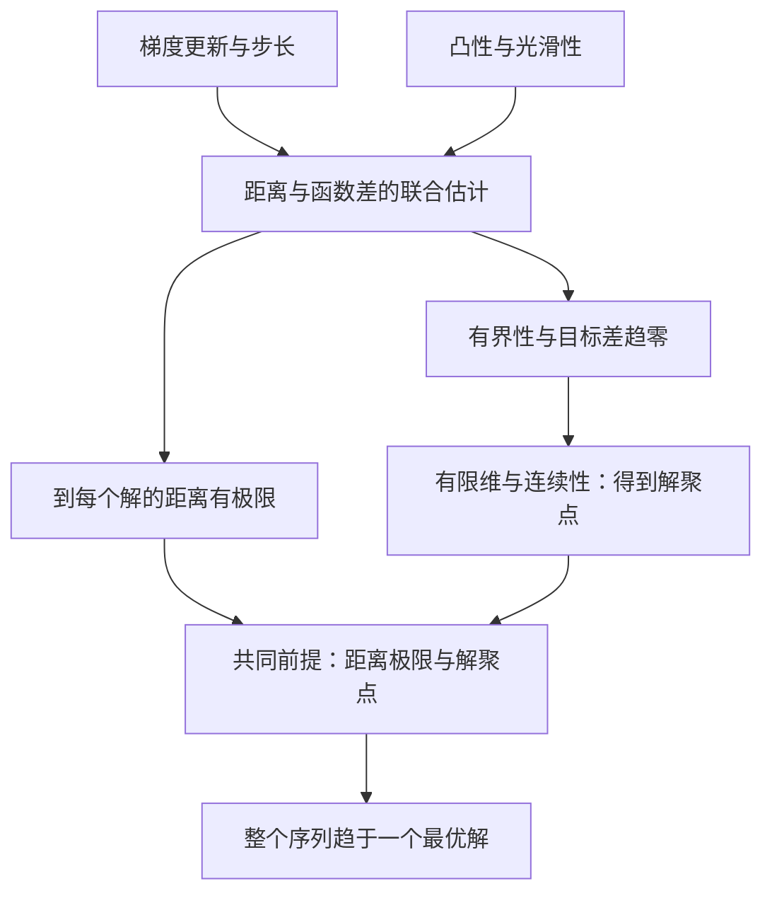

图中的汇合节点表示前提需要共同成立。阅读时可以从最下面的目标反向查找；验证证明时沿着箭头方向进行。

### 2.4 最后迭代点的目标误差
{: id="24-同一条估计还能提供什么速度"}

梯度下降的目标值单调，因此

$$
K\Delta_K
\le\sum_{j=1}^{K}\Delta_j
\le\frac L2\|x_0-z\|^2.
$$

于是

$$
\boxed{
f(x_K)-f^\star
\le\frac{L\|x_0-z\|^2}{2K}.
}
\tag{2.2}
$$

这里得到最后迭代点的目标误差 $O(1/K)$。点收敛已经由距离极限与解聚点证明；式 (2.2) 单独描述函数差的速度。若希望进一步给出点距离的速度，继续寻找函数差与距离之间的定量联系。

### 2.5 二次增长与误差界
{: id="25-希望把函数差或残差转成距离时"}

假如有二次增长关系

$$
F(x)-F^\star
\ge\frac\mu2\operatorname{dist}(x,S)^2,
\qquad \mu>0,
$$

那么

$$
\operatorname{dist}(x_k,S)
\le\sqrt{\frac{2\Delta_k}{\mu}}.
$$

这说明函数差能够控制解集距离。若已有 $\Delta_k=O(1/k)$，由这条转换得到 $d_k=O(k^{-1/2})$。

如果手中可计算的是残差 $r(x)$，可以寻找误差界

$$
\operatorname{dist}(x,S)\le\kappa r(x).
$$

两条关系控制的对象分别为函数差和残差。它们的常数、适用区域和残差定义都属于定理的一部分。PL、二次增长与误差界之间的关系依赖具体函数类别和正则性，见 [Karimi–Nutini–Schmidt][pl] 与 [Drusvyatskiy–Lewis][error-bounds]。

若还具有相对于非空闭集 $S$ 的 Fejér 性质，那么对 $m\ge k$，

$$
\|x_m-x_k\|
\le\|x_m-z\|+\|x_k-z\|
\le2\|x_k-z\|,
\qquad z\in S.
$$

对 $z$ 取下确界：

$$
\|x_m-x_k\|\le2d_k.
$$

因此，$d_k\to0$ 保证 Cauchy 性质。在完备空间中，序列强收敛到某个 $\bar x\in S$，并且

$$
\boxed{\|x_k-\bar x\|\le2d_k.}
\tag{2.3}
$$

这条估计也能把解集距离的几何上界传递给点距离。第 1.4 节中的交替序列缺少这里的 Fejér 条件。

### 2.6 Lasso 的近端梯度残差
{: id="26-lasso怎样找到可计算的一阶残差"}

考虑

$$
F(x)=f(x)+g(x)
=\frac12\|Ax-b\|^2+\lambda\|x\|_1,
\qquad \lambda>0.
$$

希望证明迭代点接近最优性条件

$$
0\in\nabla f(x)+\partial g(x).
$$

由于算法需要同时处理光滑项与不可微项，可以使用近端梯度更新

$$
x^+=\operatorname{prox}_{\gamma g}
\bigl(x-\gamma\nabla f(x)\bigr),
$$

其中

$$
\operatorname{prox}_{\gamma g}(v)
=\operatorname*{argmin}_u
\left\{g(u)+\frac1{2\gamma}\|u-v\|^2\right\}.
$$

对于 Lasso，$\nabla f(x)=A^\top(Ax-b)$，可取任意正的梯度 Lipschitz 上界 $$L\ge\|A\|^2$$，并令 $0<\gamma\le1/L$。近端操作逐坐标为

$$
\bigl[\operatorname{prox}_{\gamma g}(v)\bigr]_j
=\operatorname{sign}(v_j)
\max\{|v_j|-\gamma\lambda,0\}.
$$

现在从“希望控制最优性残差”反推。近端子问题的最优性条件给出

$$
\frac{x-x^+}{\gamma}-\nabla f(x)\in\partial g(x^+).
$$

定义可计算的近端梯度映射

$$
G_\gamma(x)=\frac{x-x^+}{\gamma}.
$$

于是

$$
v^+=G_\gamma(x)+\nabla f(x^+)-\nabla f(x)
\in\partial F(x^+),
$$

并且

$$
\boxed{
\operatorname{dist}(0,\partial F(x^+))
\le(1+\gamma L)\|G_\gamma(x)\|.
}
\tag{2.4}
$$

算法步长因此变成了下一点的一阶残差证书。近端最优性与光滑上界还给出

$$
F(x)-F(x^+)
\ge\left(\frac1\gamma-\frac L2\right)\|x^+-x\|^2
\ge\frac\gamma2\|G_\gamma(x)\|^2.
$$

对于凸复合目标，还可以建立与式 (2.1) 对应的距离估计。若希望进一步证明线性速度，则继续检查近端残差的误差界或相应增长条件。[Parikh–Boyd，第 4.2 节][prox]讨论了近端梯度的固定点与最优性关系。

这个实例展示了结构的作用：光滑项提供梯度，近端项提供子问题最优性，两者共同产生可计算残差和下降关系。

## 3. Lyapunov 函数与有限长度
{: id="3-怎样构造能量控制整条轨迹"}

### 3.1 步长平方可和与有限长度
{: id="31-只有步长趋零时还缺什么"}

如果目标是证明序列具有 Cauchy 性质，三角不等式给出

$$
\|x_m-x_k\|
\le\sum_{j=k}^{m-1}\|x_{j+1}-x_j\|.
$$

因此，一条足够的路径是有限长度：

$$
\sum_{k=0}^{\infty}\|x_{k+1}-x_k\|<\infty.
$$

常见下降估计先提供

$$
F(x_k)-F(x_{k+1})
\ge a\|x_{k+1}-x_k\|^2,
\qquad a>0.
$$

目标值有下界时，求和得到步长平方可和。此时需要继续寻找能够控制步长一次总和的关系。

这个需要可以用数列直接检验。取

$$
x_k=\sum_{j=1}^{k}\frac1j.
$$

步长趋零、步长平方可和，但序列无界。即便增加有界性，平方可和仍然没有保证点收敛。例如

$$
x_k=\bigl(\cos\log(k+1),\sin\log(k+1)\bigr)
$$

处于单位圆上，步长为 $O(1/k)$，步长平方可和，而沿着接近不同角度的子序列具有不同极限。

所以，从下降走到点收敛，关键问题之一是：能否把现有的平方控制加强为轨迹长度控制？

### 3.2 惯性梯度法的能量函数
{: id="32-lyapunov-函数的形式怎样被找到"}

能量函数需要完成两个任务：具有可以利用的变化关系，并且能够控制所研究的量。具体形式可以从算法展开式中寻找。

以惯性梯度更新为例：

$$
x_{k+1}=x_k-\alpha\nabla F(x_k)
+\beta(x_k-x_{k-1}).
$$

假设 $F$ 的梯度为 $L$-Lipschitz，$L>0$，且存在有限下界 $F_{\inf}$。记向量

$$
p_k=x_{k+1}-x_k,\qquad p_{-1}=x_0-x_{-1}.
$$

更新式意味着

$$
\nabla F(x_k)=\frac{\beta p_{k-1}-p_k}{\alpha}.
$$

把它代入光滑上界：

$$
F(x_{k+1})-F(x_k)
\le
-\left(\frac1\alpha-\frac L2\right)\|p_k\|^2
+\frac\beta\alpha\langle p_k,p_{k-1}\rangle.
$$

当前困难是交叉项。对 $0\le\beta<1$，Young 不等式给出

$$
\frac\beta\alpha\langle p_k,p_{k-1}\rangle
\le\frac\beta{2\alpha}
\bigl(\|p_k\|^2+\|p_{k-1}\|^2\bigr).
$$

右侧出现了上一轮的步长平方。为了把它写成能量差，选择

$$
\boxed{
V_k=F(x_k)-F_{\inf}
+\frac\beta{2\alpha}\|p_{k-1}\|^2.
}
$$

直接整理得到

$$
V_{k+1}-V_k
\le
-\left(\frac{1-\beta}{\alpha}-\frac L2\right)\|p_k\|^2.
$$

当

$$
0<\alpha<\frac{2(1-\beta)}L
$$

时，右侧系数为正。因此 $V_k$ 有有限极限，步长平方可和，并由更新式得到 $\nabla F(x_k)\to0$。

这里能量中的附加项有明确来源：它吸收了更新展开后产生的上一轮步长项。若希望证明点收敛，还需要继续建立解聚点、有限长度或其他充分性质。对提升状态 $(x_k,x_{k-1})$ 使用 KL 定理时，应重新验证相应能量的下降与相对误差条件。

### 3.3 KL 性质与轨迹长度
{: id="33-kl-怎样帮助控制步长的一次总和"}

现在考虑有限维非凸问题。设 $F$ proper、下半连续，迭代点属于 $\operatorname{dom}F$，$\partial F$ 表示 limiting subdifferential。希望证明

$$
x_k\to\bar x,\qquad 0\in\partial F(\bar x).
$$

记

$$
s_k=\|x_{k+1}-x_k\|.
$$

采用以下三组条件，常数 $a,b>0$ 与 $k$ 无关：

$$
F(x_k)-F(x_{k+1})\ge a s_k^2;
\tag{H1}
$$

$$
\exists\,w_{k+1}\in\partial F(x_{k+1}),
\qquad \|w_{k+1}\|\le b s_k;
\tag{H2}
$$

$$
x_{k_j}\to\bar x,
\qquad F(x_{k_j})\to F(\bar x)<\infty.
\tag{H3}
$$

H1 描述充分下降；H2 把一阶信息连接到算法步长；H3 保留函数值与聚点的相容性。下降性与 H3 给出

$$
F(x_k)\downarrow F(\bar x).
$$

令

$$
\delta_k=F(x_k)-F(\bar x).
$$

KL 性质提供一个连续、递增、凹的函数 $\varphi$，满足 $\varphi(0)=0$，并在 $(0,\eta)$ 上连续可微、$$\varphi'>0$$。在 $\bar x$ 的某个邻域内，只要 $0<F(x)-F(\bar x)<\eta$，就有

$$
\varphi'\bigl(F(x)-F(\bar x)\bigr)
\operatorname{dist}(0,\partial F(x))
\ge1.
$$

这条关系将函数差与斜率连接起来。对于处于该邻域内、$\delta_k>0$ 的迭代，H2 与 KL 已保证 $s_{k-1}>0$。由 H2 在 $x_k$ 处的估计，

$$
\varphi'(\delta_k)
\ge\frac1{b s_{k-1}}.
$$

凹性和 H1 随后给出

$$
\begin{aligned}
\varphi(\delta_k)-\varphi(\delta_{k+1})
&\ge\varphi'(\delta_k)(\delta_k-\delta_{k+1})\\
&\ge\frac{a s_k^2}{b s_{k-1}}.
\end{aligned}
$$

因此

$$
\boxed{
2s_k
\le s_{k-1}
+\frac ba\bigl[\varphi(\delta_k)-\varphi(\delta_{k+1})\bigr].
}
\tag{3.1}
$$

现在可以求和。对 $k=m,\ldots,N$ 累加，得到

$$
\sum_{k=m}^{N}s_k
\le
s_{m-1}+\frac ba\varphi(\delta_m).
\tag{3.2}
$$

右侧已经成为一个与 $N$ 无关的有限上界。这就是从步长平方可和进入有限长度所需的联系。

### 3.4 迭代留在 KL 邻域的条件
{: id="34-局部关系怎样支持整个尾部序列"}

KL 不等式在一个邻域中成立，因此还需要证明后续迭代保持在这个邻域内。

H1 与 H3 先给出 $s_k\to0$、$\delta_k\to0$。沿 H3 的子序列选择足够大的起点 $m$，使

$$
\|x_m-\bar x\|+s_{m-1}
+\frac ba\varphi(\delta_m)
$$

小于一个包含于 KL 邻域的球半径，并使 $\delta_m<\eta$。在尚未离开这个球的有限迭代上应用式 (3.2)，总移动距离始终小于所选余量，因此下一点仍在球内。归纳后，整个尾部序列都满足 KL 不等式。

于是可以令 $N\to\infty$，得到

$$
\sum_{k=0}^{\infty}s_k<\infty.
$$

有限长度保证序列强收敛；由于原来已有趋于 $\bar x$ 的子序列，整个序列的极限就是 $\bar x$。H2、H3 与 limiting subdifferential 的闭性进一步给出

$$
0\in\partial F(\bar x).
$$

若某一步 $\delta_k=0$，下降性与 H1 直接使后续步长为零。

这条证明路径对应 [Attouch–Bolte–Svaiter 的 H1、H2、H3 与 Theorem 2.9][kl]。它给出临界点收敛；全局最优性需要其他条件。半代数等结构为验证 KL 性质提供了重要实例。

### 3.5 能量下降与误差控制
{: id="35-怎样判断一个候选能量是否有用"}

完成一个能量构造后，可以依次检查：

| 检查的问题 | 需要写出的关系 |
| --- | --- |
| 能量控制哪个目标量 | 例如 $V_k\ge A_k\Delta_k$，或能量差控制步长 |
| 能量怎样变化 | 下降、收缩、quasi-Fejér 或条件期望递推 |
| 为什么得到所需极限 | 权重增长、残差识别、聚点性质或有限长度 |
| 条件在哪里成立 | 全局区域、局部邻域、提升状态与相应范数 |

非负能量单调首先给出有限极限。误差趋零、点收敛和指定速度，分别需要把这个能量结论继续传递到目标量。

## 4. 收敛速度与加速
{: id="4-希望获得指定速度还缺哪条估计"}

### 4.1 下降估计与残差复杂度
{: id="41-下降关系先能回答哪个问题"}

设 $r_k\ge0$ 为某种残差，已经得到

$$
F(x_{k+1})\le F(x_k)-a r_k^2,\qquad a>0,
$$

并且沿迭代序列有 $F(x_k)\ge F_{\inf}>-\infty$。求和得到

$$
\sum_{k=0}^{K-1}r_k^2
\le\frac{F(x_0)-F_{\inf}}a.
$$

因此

$$
r_k\to0,\qquad
\boxed{
\min_{0\le k<K}r_k^2
\le\frac{F(x_0)-F_{\inf}}{aK}.
}
$$

这里的非渐近结论控制前 $K$ 个迭代中最小的残差平方。若要求残差本身不超过 $\varepsilon$，相应迭代复杂度为 $O(\varepsilon^{-2})$。

希望继续控制目标误差时，需要把下降量 $r_k^2$ 与目标误差建立联系。

### 4.2 多项式收敛速度
{: id="42-从多项式速度反推幂次控制"}

设 $E_k\ge0$ 表示固定的一种误差。若能够得到

$$
E_{k+1}\le E_k-cE_k^{1+\alpha},
\qquad c>0,\quad\alpha>0,
$$

则在误差保持正值时，

$$
\begin{aligned}
E_{k+1}^{-\alpha}-E_k^{-\alpha}
&=\alpha\int_{E_{k+1}}^{E_k}t^{-\alpha-1}\,dt\\
&\ge\alpha E_k^{-\alpha-1}(E_k-E_{k+1})\\
&\ge\alpha c.
\end{aligned}
$$

求和后得到

$$
\boxed{
E_k\le
\bigl(E_0^{-\alpha}+\alpha ck\bigr)^{-1/\alpha}.
}
$$

若某一步误差已经为零，则单独记录有限终止。特别地，$\alpha=1$ 给出 $O(1/k)$。

凸光滑梯度下降能怎样提供这样的幂次关系？固定 $z\in S$，由第 2 节的 Fejér 性质可取

$$
\|x_k-z\|\le R:=\|x_0-z\|.
$$

当 $R>0$ 时，凸性与 Cauchy–Schwarz 不等式给出

$$
\Delta_k
\le\langle\nabla f(x_k),x_k-z\rangle
\le R\|\nabla f(x_k)\|.
$$

于是

$$
\Delta_{k+1}
\le\Delta_k-\frac1{2LR^2}\Delta_k^2.
$$

这里的次线性保证来自一条具体转换：梯度平方能够控制目标误差的平方。$R=0$ 对应从最优解开始的平凡情形。

### 4.3 PL 条件与线性收敛
{: id="43-希望线性收敛时需要什么"}

如果希望证明

$$
E_{k+1}\le qE_k,\qquad 0<q<1,
$$

而当前已有

$$
E_{k+1}\le E_k-a r_k^2,
$$

那么一条足够的补充关系是

$$
r_k^2\ge bE_k,\qquad b>0.
$$

组合后得到

$$
\boxed{E_{k+1}\le(1-ab)E_k.}
$$

选择有效常数使 $0<ab<1$，便得到固定比例收缩；若 $ab=1$，这条估计直接给出下一步误差为零。

对梯度下降，PL 条件正好提供所需联系：

$$
\frac12\|\nabla f(x)\|^2
\ge\mu(f(x)-f^\star).
$$

与步长 $1/L$ 的下降估计组合：

$$
\boxed{
\Delta_{k+1}
\le\left(1-\frac\mu L\right)\Delta_k.
}
\tag{4.1}
$$

因此，从一般凸光滑分析中的 $\Delta_k^2$ 控制，进入 PL 分析中的 $\Delta_k$ 控制，就能够准确定位这两种速度保证之间发生变化的关系。强凸性是提供 PL 的一种充分条件；PL 定理也覆盖具有多个解或非凸结构的某些函数。[Karimi–Nutini–Schmidt，Theorem 1][pl]给出了这条梯度下降分析。

### 4.4 迭代点的线性速度
{: id="44-目标误差线性以后怎样继续得到点速度"}

仍考虑全局 $L$-smooth、全局 PL、解存在和完整步长 $1/L$ 的梯度下降。令

$$
q=1-\mu/L\in(0,1).
$$

式 (4.1) 给出 $\Delta_k\le q^k\Delta_0$。下降估计同时意味着

$$
\|x_{k+1}-x_k\|^2
=\frac1{L^2}\|\nabla f(x_k)\|^2
\le\frac2L\Delta_k.
$$

所以

$$
\|x_{k+1}-x_k\|
\le\sqrt{\frac{2\Delta_0}L}\,q^{k/2}.
$$

步长一次可和，因而序列趋于一个点 $\bar x$；函数连续性和 $\Delta_k\to0$ 识别 $\bar x\in S$。长度尾和还给出

$$
\boxed{
\|x_k-\bar x\|
\le
\frac{\sqrt{2\Delta_0/L}}{1-\sqrt q}\,q^{k/2}.
}
$$

这是点距离的 R-linear 上界。$q=0$ 时单独处理一步达到最优值的情形。

这条路径依次使用了目标误差线性、算法步长与下降量的关系、有限长度和极限识别。图谱中应保存这些中间关系。

另一条常见路径从解集距离出发：

$$
d_{k+1}^2\le d_k^2-a r_k^2,
\qquad
d_k\le\kappa r_k.
$$

它给出

$$
d_{k+1}^2
\le\left(1-\frac a{\kappa^2}\right)d_k^2.
$$

若同时具有相对于 $S$ 的 Fejér 性质，式 (2.3) 又把解集距离速度传递到某个极限点的 R-linear 速度。

### 4.5 凸光滑问题的加速
{: id="45-同样的凸光滑条件下怎样得到加速"}

希望证明 $\Delta_k=O(1/k^2)$，可以反向寻找

$$
V_k\ge A_k\Delta_k,\qquad V_{k+1}\le V_k,
\qquad A_k\text{ 按 }k^2\text{ 增长}.
$$

下面展示一次具体构造。对凸 $L$-smooth 函数，取

$$
t_1=1,\qquad y_1=x_0,
$$

并对 $k\ge1$ 使用

$$
\begin{aligned}
x_k&=y_k-\frac1L\nabla f(y_k),\\
t_{k+1}&=\frac{1+\sqrt{1+4t_k^2}}2,\\
y_{k+1}&=x_k+\frac{t_k-1}{t_{k+1}}(x_k-x_{k-1}).
\end{aligned}
$$

参数满足

$$
t_{k+1}(t_{k+1}-1)=t_k^2.
\tag{4.2}
$$

为什么需要这个恒等式？对任意 $u$，凸性和光滑性提供梯度步的基本关系

$$
f(x_k)-f(u)
\le\frac L2
\bigl(\|u-y_k\|^2-\|u-x_k\|^2\bigr).
$$

固定 $z\in S$，在 $k\ge2$ 时选择

$$
u=\left(1-\frac1{t_k}\right)x_{k-1}+\frac1{t_k}z,
$$

并利用凸性估计 $f(u)$。乘以 $2t_k^2/L$ 后，函数项变为

$$
\frac2L\left[t_k^2\Delta_k-t_k(t_k-1)\Delta_{k-1}\right].
$$

同时定义

$$
z_k=t_kx_k-(t_k-1)x_{k-1}.
$$

外推公式使两个距离项分别成为 $$\|z-z_{k-1}\|^2$$ 与 $$\|z-z_k\|^2$$。再使用式 (4.2)，得到能量

$$
V_k=\frac2L t_k^2\Delta_k+\|z_k-z\|^2
$$

满足 $V_k\le V_{k-1}$。第一步由式 (2.1) 给出 $$V_1\le\|x_0-z\|^2$$。因为 $t_k\ge(k+1)/2$，

$$
\boxed{
f(x_k)-f^\star
\le\frac{2L\|x_0-z\|^2}{(k+1)^2}.
}
$$

这里参数恒等式用于使相邻能量中的函数项相接，外推公式用于使距离项相接。加速所需的系数因此能够从希望得到的能量变化关系中理解。该形式也对应 FISTA 在非光滑项为零时的更新；凸复合推广见 [Beck–Teboulle][fista]。

这条证明给出指定输出点的目标误差上界。关于迭代点自身的极限，应继续检查相应算法的点收敛定理。

### 4.6 Newton 法与超线性收敛
{: id="46-希望超线性时怎样处理一次误差项"}

令

$$
e_k=x_k-x^\star,\qquad E_k=\|e_k\|.
$$

局部 Q-superlinear 的目标是

$$
\frac{E_{k+1}}{E_k}\to0
$$

其中有限终止的情况单独记录。若局部误差展开为

$$
e_{k+1}=M_ke_k+u_k,
$$

那么一组足够的关系是

$$
\|M_k\|\to0,\qquad \|u_k\|=o(E_k).
$$

接下来可以追问：算法怎样使一次误差项消失，问题条件又怎样控制模型余项？

以完整 Newton 步为例。假设 $f$ 在 $x^\star$ 附近属于 $C^2$，并且

$$
\nabla f(x^\star)=0,\qquad
\nabla^2 f(x^\star)\succ0.
$$

记 $H_k=\nabla^2 f(x_k)$，将梯度写为

$$
\nabla f(x_k)=H_ke_k+u_k.
$$

代入更新式：

$$
\boxed{
e_{k+1}
=e_k-H_k^{-1}(H_ke_k+u_k)
=-H_k^{-1}u_k.
}
$$

一次误差项被消去。接下来分别需要

$$
\|H_k^{-1}\|\le M,\qquad \|u_k\|=o(E_k).
$$

解处非退化性与 Hessian 连续性提供局部一致的逆矩阵上界；连续性还给出所需余项估计。先选足够小的邻域，使误差比例小于某个 $q<1$，就能证明充分近的初值产生保持在邻域内的收敛迭代。随后余项与当前误差的比例趋零，得到超线性。

若 Hessian 为 $L_H$-Lipschitz，则

$$
u_k=
\int_0^1
\bigl[\nabla^2 f(x^\star+t e_k)-H_k\bigr]e_k\,dt,
$$

从而

$$
\|u_k\|\le\frac{L_H}{2}E_k^2.
$$

因此

$$
\boxed{E_{k+1}\le\frac{ML_H}{2}E_k^2.}
$$

这给出局部二次上界，见 [Bubeck，第 5.3.2 节][bubeck]。

固定阻尼 $0<\alpha<1$ 则给出

$$
e_{k+1}=(1-\alpha)e_k-\alpha H_k^{-1}u_k.
$$

在二次余项条件下，一次项仍然参与更新。对于未有限终止的局部迭代，相邻点误差的比例趋于 $1-\alpha$。

再看 $f(x)=x^4$。对非零 $x_k$，完整 Newton 步为

$$
x_{k+1}
=x_k-\frac{4x_k^3}{12x_k^2}
=\frac23x_k.
$$

这里使用了二阶导数，但解处 $$f''(0)=0$$，逆 Hessian 的局部一致有界性没有成立。速度结论需要同时记录算法、模型精度、非退化性与步长。

拟 Newton 方法则可以通过沿迭代方向的 Dennis–Moré 条件获得超线性。其常用形式是

$$
\frac{\|(B_k-\nabla^2f(x^\star))s_k\|}{\|s_k\|}\to0,
\qquad s_k=x_{k+1}-x_k.
$$

使用这一条件时，还要保留相应的局部正则性、完整步和收敛到非奇异解等前提，见 [Dennis–Moré][dennis-more]。

### 4.7 KL 指数与收敛速度
{: id="47-kl-指数怎样进入速度递推"}

回到第 3 节的非凸框架，统一采用

$$
\operatorname{dist}(0,\partial F(x))
\ge c\bigl(F(x)-F(\bar x)\bigr)^\theta,
\qquad 0\le\theta<1.
$$

令 $\delta_k=F(x_k)-F(\bar x)$。把 KL 用在 $x_{k+1}$，再结合 H1、H2：

$$
c\delta_{k+1}^{\theta}\le b s_k,
$$

$$
\boxed{
\delta_k-\delta_{k+1}
\ge\frac{ac^2}{b^2}\delta_{k+1}^{2\theta}.
}
$$

这条标量递推控制函数差。点距离的速度继续通过轨迹长度的尾和获得。

| KL 指数 | 函数差的保证 | 迭代点距离的经典保证 |
| --- | --- | --- |
| $\theta=0$ | 有限终止 | 有限终止 |
| $0<\theta<1/2$ | $\delta_{k+1}\le C\delta_k^{1/(2\theta)}$，超线性 | 至少 R-linear |
| $\theta=1/2$ | Q-linear | R-linear |
| $1/2<\theta<1$ | $O(k^{-1/(2\theta-1)})$ | $O(k^{-(1-\theta)/(2\theta-1)})$ |

低指数区间的函数差估计可以由上式直接推出。点距离的经典分类参见 [Attouch–Bolte–Redont–Soubeyran，Theorem 11][kl-rates]。不同文献可能使用互补指数，因此应同时保存指数定义与不等式。

### 4.8 速度提升的来源
{: id="48-怎样回答速度提升来自哪里"}

现在可以在具体证明中区分四种作用。

| 发生变化的位置 | 数学表现 | 对速度分析的作用 |
| --- | --- | --- |
| 问题条件 | 残差平方从控制误差的高次幂，变为控制误差本身 | 产生固定比例收缩 |
| 算法更新与状态 | 外推、参考点、权重或模型发生变化 | 建立更强的能量或局部误差关系 |
| 模型与内部计算精度 | 一次误差项消失，相对余项趋零 | 支持超线性或更高阶 |
| 分析方式 | 找到此前尚未使用的控制关系 | 为同一个迭代给出更准确的理论保证 |

此外，每步成本需要单独记录。梯度查询、样本访问、矩阵分解和通信轮次分别对应不同的计算单位。

## 5. 计算误差与随机迭代
{: id="5-计算误差与随机性怎样进入证明"}

### 5.1 扰动递推
{: id="51-先问希望保留哪条递推"}

假设精确分析已经给出固定比例收缩。每步允许非负误差 $\varepsilon_k$ 后，递推成为

$$
E_{k+1}\le qE_k+\varepsilon_k,
\qquad 0<q<1.
$$

反复代入得到

$$
\boxed{
E_k\le q^kE_0+
\sum_{j=0}^{k-1}q^{k-1-j}\varepsilon_j.
}
\tag{5.1}
$$

这条式子把当前误差分成初始误差的传播和历次计算误差的传播。希望保留什么结论，就可以反向检查右侧需要怎样的控制。

| 对计算误差的控制 | 可以获得的保证 |
| --- | --- |
| $\varepsilon_k\le\bar\varepsilon$ | $\limsup_k E_k\le\bar\varepsilon/(1-q)$ |
| $\varepsilon_k\to0$ | $E_k\to0$ |
| $\varepsilon_k\le cE_k$，且 $q+c<1$ | 固定比例收缩 |
| $E_{k+1}\le q_kE_k+\varepsilon_k$，$q_k\to0$，$\varepsilon_k=o(E_k)$ | 在误差趋零的相应局部情形中得到超线性 |
| $E_{k+1}\le CE_k^2+\varepsilon_k$，$\varepsilon_k=O(E_k^2)$ | 在相应局部收敛条件下保留二次上界 |

可和误差经常支持定性收敛；指定速度需要相应的数量级。例如，当式 (5.1) 对应的单步递推取等号，且 $\varepsilon_k=(k+1)^{-2}$ 时，$E_{k+1}\ge\varepsilon_k$，几何上界就会受到这个多项式项的限制。

若 $\varepsilon_k=O(\rho^k)$，$0<\rho<1$，则直接计算卷积可得

$$
E_k=
\begin{cases}
O(\max\{q,\rho\}^k),&q\ne\rho,\\
O(kq^k),&q=\rho.
\end{cases}
$$

第二种情形仍有 R-linear 上界，例如可以用任意 $q<\widehat q<1$ 的 $C\widehat q^k$ 控制。

### 5.2 inexact Newton 的求解精度
{: id="52-inexact-newton由目标速度反推内部精度"}

考虑方程 $G(x)=0$。记

$$
J_k=G'(x_k),\qquad v_k=\|G(x_k)\|.
$$

内部线性方程允许残差

$$
J_ks_k=-G(x_k)+r_k,
\qquad
\|r_k\|\le\eta_kv_k,
$$

并使用完整步 $x_{k+1}=x_k+s_k$。

假设解处 Jacobian 非奇异、$$G'$$ 在解附近 Lipschitz 连续、初值充分近，且 $\eta_k\le\eta_{\max}<1$。局部逆矩阵有界给出 $$\|s_k\|\le C_0v_k$$，Taylor 展开随后给出

$$
G(x_{k+1})
=G(x_k)+J_ks_k+O(\|s_k\|^2)
=r_k+O(v_k^2).
$$

因此

$$
\boxed{v_{k+1}\le\eta_kv_k+Cv_k^2.}
$$

现在内部精度的要求可以直接读出：

- $\eta_k$ 一致小于 $1$：在充分小的邻域内，残差 Q-linear；
- $\eta_k\to0$：残差超线性；
- $\eta_k=O(v_k)$：残差具有二次上界。

局部非奇异性还给出 $$v_k\asymp\|x_k-x^\star\|$$。因此超线性和二次性质传递到点误差；固定精度时，点误差可以写成相应的 R-linear 上界。

用于优化时取 $G=\nabla F$。如果目标是极小点，还要保留相应极小性条件，例如解处 Hessian 正定。这里 $\eta_k$ 描述允许的残差上界，内部求解也可能达到更高精度。参见 [Eisenstat–Walker，第 1 节][inexact-newton]。

### 5.3 随机梯度的期望误差
{: id="53-随机更新怎样产生期望递推"}

设 $\mathcal F_k$ 表示迭代历史，考虑

$$
x_{k+1}=x_k-\alpha_k g_k,
$$

并假设

$$
\mathbb E[g_k\mid\mathcal F_k]=\nabla F(x_k),
\qquad
\mathbb E[\|g_k-\nabla F(x_k)\|^2\mid\mathcal F_k]\le\sigma^2.
$$

对全局 $L$-smooth 且满足全局 PL 条件的目标，假设 $F^\star$ 有限、PL 常数 $\mu>0$，并且 $\mathbb E[\Delta_0]<\infty$。取 $0<\alpha_k\le1/L$，对光滑上界取条件期望：

$$
\begin{aligned}
\mathbb E[F(x_{k+1})\mid\mathcal F_k]
&\le F(x_k)-\alpha_k\|\nabla F(x_k)\|^2\\
&\quad+\frac{L\alpha_k^2}{2}
\bigl(\|\nabla F(x_k)\|^2+\sigma^2\bigr).
\end{aligned}
$$

使用步长条件与 PL，得到

$$
\boxed{
\mathbb E[\Delta_{k+1}\mid\mathcal F_k]
\le
(1-\mu\alpha_k)\Delta_k
+\frac{L\sigma^2}{2}\alpha_k^2.
}
$$

固定步长 $\alpha$ 时，该递推给出

$$
\limsup_k\mathbb E[\Delta_k]
\le\frac{L\alpha\sigma^2}{2\mu}.
$$

如果希望误差趋零，可以让步长逐渐减小。取

$$
\alpha_k=\frac2{\mu(k+k_0)},
\qquad
k_0\ge\max\{2,2L/\mu\},
$$

可由标量递推得到最后点目标误差的期望 $O(1/k)$。这里的随机结论明确针对非负目标误差的期望。随机梯度方法的相关条件与成本分析见 [Bottou–Curtis–Nocedal][stochastic]。

### 5.4 有限和与方差缩减
{: id="54-有限和结构怎样进一步控制随机项"}

考虑正则 Logistic 回归：

$$
F(x)=\frac1N\sum_{i=1}^{N}f_i(x),
$$

$$
f_i(x)=
\log\bigl(1+\exp(-b_i a_i^\top x)\bigr)
+\frac\mu2\|x\|^2,
\qquad \mu>0,\quad b_i\in\{-1,1\}.
$$

每个分量凸且光滑，$F$ 强凸。设各分量的梯度 Lipschitz 常数都不超过 $L$。如果可以访问分量梯度和一个参考点 $\widetilde x$ 的完整梯度，可以构造

$$
v=\nabla f_i(x)-\nabla f_i(\widetilde x)+\nabla F(\widetilde x),
$$

其中 $i$ 均匀抽样。它满足

$$
\mathbb E_i[v]=\nabla F(x),
$$

以及

$$
\boxed{
\mathbb E_i\|v\|^2
\le4L\bigl(F(x)-F^\star+F(\widetilde x)-F^\star\bigr).
}
$$

这条关系把随机项的二阶矩与当前点、参考点的目标误差联系起来。参考点信息因此可以进入 Lyapunov 函数，并使随机项的上界随优化误差共同减小。

要得到具体线性定理，还需要检查步长、参考点更新、内部迭代长度和输出规则。原始 SVRG 论文的证明采用其 Option II 参考输出，见 [Johnson–Zhang，第 3 节][svrg]。计算成本应同时记录完整梯度和分量梯度的查询次数。

### 5.5 几乎处处收敛
{: id="55-从期望递推走向几乎处处收敛"}

如果目标是路径意义上的极限，可以寻找随机 Lyapunov 关系：

$$
\mathbb E[V_{k+1}\mid\mathcal F_k]
\le(1+\beta_k)V_k-D_k+\varepsilon_k.
$$

这里 $V_k,D_k,\beta_k,\varepsilon_k$ 非负、适应于相应信息，满足所需可积性，并有

$$
\sum_k\beta_k<\infty,\qquad
\sum_k\varepsilon_k<\infty
\quad\text{几乎处处}.
$$

Robbins–Siegmund 型结论给出

$$
V_k\to V_\infty<\infty,\qquad
\sum_kD_k<\infty
\quad\text{几乎处处}.
$$

随后继续识别这个极限。比如，当

$$
D_k=\alpha_kr_k^2,\qquad
\sum_k\alpha_k=\infty,
$$

直接得到的是 $\liminf_k r_k=0$。要证明 $r_k\to0$，可以继续寻找残差极限或残差变化控制。

取 $\alpha_k=1/k$，并令 $r_k$ 在 $k=2^m$ 时等于 $1$，其他位置等于 $0$，就能看到这一步为何需要额外论证：加权残差平方可和，但残差没有极限。

相关随机递推见 [Bertsekas，Proposition A.4.5][bertsekas]；随机 quasi-Fejér 与分块固定点方法见 [Combettes–Pesquet][stochastic-fejer]。

### 5.6 双层 Ridge 的超梯度误差
{: id="56-双层-ridge内部残差怎样影响外层梯度"}

设

$$
w_\lambda=
\operatorname*{argmin}_w
\left\{\frac12\|Aw-b\|^2+\frac\lambda2\|w\|^2\right\},
$$

$$
\lambda\in[\lambda_{\min},\lambda_{\max}],
\qquad\lambda_{\min}>0,
$$

外层目标为

$$
J(\lambda)=\frac12\|Bw_\lambda-c\|^2.
$$

希望控制外层梯度误差，可以先把它转化为两个线性系统的解误差。记

$$
H_\lambda=A^\top A+\lambda I,\qquad d=A^\top b.
$$

内层最优性与隐式求导给出

$$
H_\lambda w_\lambda=d,\qquad
\frac{dw_\lambda}{d\lambda}=-H_\lambda^{-1}w_\lambda.
$$

定义辅助变量

$$
H_\lambda v_\lambda=B^\top(Bw_\lambda-c),
$$

则

$$
J'(\lambda)=-v_\lambda^\top w_\lambda.
$$

设计算结果为 $\widetilde w,\widetilde v$，定义可计算残差

$$
r_w=H_\lambda\widetilde w-d,
$$

$$
r_v=H_\lambda\widetilde v-B^\top(B\widetilde w-c).
$$

因为 $H_\lambda\succeq\lambda_{\min}I$，

$$
\|\widetilde w-w_\lambda\|
\le\frac{\|r_w\|}{\lambda_{\min}},
$$

$$
\|\widetilde v-v_\lambda\|
\le\frac{\|r_v\|}{\lambda_{\min}}
+\frac{\|B\|^2\|r_w\|}{\lambda_{\min}^2}.
$$

于是近似超梯度 $$\widetilde J'=-\widetilde v^\top\widetilde w$$ 满足

$$
\begin{aligned}
|\widetilde J'-J'|
&\le
\left(
\frac{\|\widetilde v\|}{\lambda_{\min}}
+\frac{\|d\|\|B\|^2}{\lambda_{\min}^3}
\right)\|r_w\|\\
&\quad+
\frac{\|d\|}{\lambda_{\min}^2}\|r_v\|.
\end{aligned}
$$

现在就能根据外层投影更新所允许的梯度误差，反向安排两个内部线性系统的残差容差。内层强凸性保证内层解唯一；外层目标的凸性与极限性质需要各自验证。双层问题近似与解稳定性的框架见 [Franceschi 等][bilevel]。

### 5.7 熵正则最优传输的误差
{: id="57-最优传输算法误差可行性误差与参数误差"}

设 $a\in\mathbb R^n$、$b\in\mathbb R^m$ 为严格正的概率向量，$C$ 为有限成本矩阵。记

$$
\Pi(a,b)=\{P\ge0:P\mathbf1=a,\ P^\top\mathbf1=b\},
$$

$$
p_0=\min_{P\in\Pi(a,b)}\langle C,P\rangle.
$$

引入熵正则目标

$$
F_\varepsilon(P)=\langle C,P\rangle
+\varepsilon\sum_{i,j}P_{ij}\log P_{ij},
\qquad \varepsilon>0,
$$

约定 $0\log0=0$。希望输出接近原问题最优值时，首先需要区分固定 $\varepsilon$ 的求解精度与 $\varepsilon$ 本身产生的误差。

若 $\widehat P\in\Pi(a,b)$，且

$$
F_\varepsilon(\widehat P)
-\min_{\Pi(a,b)}F_\varepsilon\le\delta,
$$

定义熵 $H(P)=-\sum_{i,j}P_{ij}\log P_{ij}$。由概率矩阵的熵范围 $0\le H(P)\le\log(nm)$，直接得到

$$
\boxed{
0\le\langle C,\widehat P\rangle-p_0
\le\delta+\varepsilon\log(nm).
}
$$

第一项是求解正则问题的算法误差，第二项来自正则参数。

Sinkhorn 的中间矩阵可能尚未满足两组边际约束，因此还要记录

$$
\eta_k=
\|P_k\mathbf1-a\|_1+\|P_k^\top\mathbf1-b\|_1.
$$

若构造了可行修正 $\widehat P_k$，成本变化可由

$$
|\langle C,P_k\rangle-\langle C,\widehat P_k\rangle|
\le
\max_{i,j}|C_{ij}|
\sum_{i,j}|(P_k-\widehat P_k)_{ij}|
$$

控制。把边际残差转成这种修正距离，还需要相应的可行性估计。

该模型支持

$$
K_{ij}=\exp(-C_{ij}/\varepsilon),\qquad
P=\operatorname{diag}(u)K\operatorname{diag}(v)
$$

的矩阵缩放表达。缩放因子具有比例自由度，运输矩阵是更直接的目标对象。模型与算法见 [Cuturi][sinkhorn]。这里的 Kullback–Leibler 散度与第 3 节的 Kurdyka–Łojasiewicz 性质分别使用全称标注。

### 5.8 统计与离散化误差
{: id="58-统计与离散化误差怎样连接到目标"}

设 $R$ 为总体目标，$R_n$ 为样本目标，在共同的决策集合上比较，并假设相关最优值有限。加减样本目标可得

$$
R(x_k)-\inf R
\le
\underbrace{R_n(x_k)-\inf R_n}_{\text{优化误差}}
+
2\underbrace{\sup_x|R_n(x)-R(x)|}_{\text{统计误差}}.
$$

要使用有限的统计上界，还需要控制函数类别、决策集合与样本条件。该式说明，样本问题求解得越来越准确以后，仍应检查样本目标对总体目标的近似。

对于离散化问题，若离散解和连续解表示在共同空间中，则

$$
\|x_{h,k}-x^\star\|
\le
\underbrace{\|x_{h,k}-x_h^\star\|}_{\text{优化误差}}
+
\underbrace{\|x_h^\star-x^\star\|}_{\text{离散化误差}}.
$$

因此可以从所需总精度反向安排迭代精度和离散尺度。$k$、样本规模 $n$、离散尺度 $h$ 与正则参数分别保留为不同索引；沿 $k=k(h)$ 等联合选择获得收敛时，所有相关误差都需要受到控制。

## 6. 解的表示、拓扑与稳定性
{: id="6-求解对象或空间改变后需要检查什么"}

### 6.1 TV 去噪的点误差界
{: id="61-tv-去噪怎样得到可计算的点误差证书"}

考虑离散 TV 模型

$$
F(x)=\frac12\|x-b\|^2+\lambda\|Dx\|_{2,1},
$$

其中 $\lambda>0$，$$\|Dx\|_{2,1}$$ 表示各像素梯度向量的欧氏范数之和。令

$$
C=\{y:\|y_i\|_2\le\lambda\text{，对所有分组 }i\}.
$$

利用范数的对偶表示，

$$
F(x)=\max_{y\in C}
\left\{\frac12\|x-b\|^2+\langle Dx,y\rangle\right\}.
$$

对固定 $y$ 最小化右侧关于 $x$ 的二次函数，得到对偶目标

$$
d(y)=\langle Db,y\rangle-\frac12\|D^\top y\|^2,
\qquad y\in C.
$$

现在假设希望得到可以计算的点误差上界。原始目标是 $1$-强凸函数，因此对任意 $x$ 与对偶可行点 $y\in C$，

$$
\boxed{
\frac12\|x-x^\star\|^2
\le F(x)-F^\star
\le F(x)-d(y).
}
$$

右侧通过当前原始点和对偶点就能计算。对偶表示因此为点距离提供了新的证书。

原始对偶算法可以分别使用 $D,D^\top$、二次近端操作和到 $C$ 的投影。在一般模型

$$
\min_x f(x)+g(Kx)
$$

中，鞍点形式为

$$
\min_x\max_y
L(x,y),\qquad
L(x,y)=f(x)+\langle Kx,y\rangle-g^\star(y).
$$

相应算法状态是 $(x_k,y_k)$，需要同时控制原始量与对偶量。对指定测试集合 $X\times Y$，可以定义

$$
\operatorname{Gap}_{X,Y}(\bar x,\bar y)
=\sup_{y\in Y}L(\bar x,y)
-\inf_{x\in X}L(x,\bar y).
$$

使用 restricted gap 时，需要注明测试集合及输出点。它与上面利用对偶可行点构造的原始对偶证书分别记录。Chambolle–Pock 的标准结果在鞍点存在、相应闭凸条件和 $$\tau\sigma\|K\|^2<1$$ 等前提下，给出平均输出的 restricted gap 上界，见其 [Theorem 1][chambolle-pock]。

若使用各向异性 TV，即 $$\|Dx\|_1$$，对偶约束相应改为逐坐标的盒约束。

### 6.2 PCA 的子空间误差
{: id="62-pca目标应当怎样体现表示的不唯一性"}

设 $\Sigma=\Sigma^\top$ 为协方差矩阵，特征值满足

$$
\lambda_1\ge\cdots\ge\lambda_n.
$$

取 $1\le r<n$，PCA 可以写成

$$
\max_{U^\top U=I_r}\operatorname{tr}(U^\top\Sigma U).
$$

$U$ 与 $UQ$ 对任意正交矩阵 $Q$ 都表示同一个子空间。若所求对象是主子空间，可以使用投影矩阵

$$
P=UU^\top
$$

来定义误差。

假设

$$
\gamma=\lambda_r-\lambda_{r+1}>0.
$$

这时最优 $r$ 维子空间唯一，记其投影矩阵为 $P^\star$。定义

$$
\Delta(P)=\operatorname{tr}(\Sigma P^\star)
-\operatorname{tr}(\Sigma P).
$$

希望用函数值控制子空间距离，可以直接从谱分解寻找增长关系。设 $v_i$ 为正交特征向量，$a_i=v_i^\top Pv_i$，则

$$
0\le a_i\le1,\qquad
\sum_i a_i=r,\qquad
\sum_{i\le r}(1-a_i)=\sum_{i>r}a_i.
$$

因此

$$
\Delta(P)
\ge\gamma\sum_{i>r}a_i
=\frac\gamma2\|P-P^\star\|_F^2.
$$

于是

$$
\boxed{
\|P-P^\star\|_F
\le\sqrt{\frac{2\Delta(P)}{\gamma}}.
}
$$

目标误差因而控制子空间误差。若只知道流形梯度趋零，还要识别极限对应哪个不变子空间，因为其他特征子空间同样可能满足一阶条件。若 $\gamma=0$，目标可以改为到最优子空间集合的距离。

这个模型连接 Stiefel 表示、Grassmann 表示、解集距离与增长条件，参见 [Boumal，第 2.4 节][manifolds]。

### 6.3 矩阵补全的两种表示
{: id="63-矩阵补全表示改变后重新确定待证命题"}

核范数模型为

$$
\min_X
\frac12\|\mathcal P_\Omega(X-M)\|_F^2+\lambda\|X\|_*.
$$

取 $\lambda>0$，它是凸复合问题。平滑部分的梯度为 $\mathcal P_\Omega(X-M)$，Lipschitz 常数可取 $1$；核范数近端通过奇异值阈值计算。因此可以接入第 2 节的近端残差、距离控制和目标误差分析。[Mazumder–Hastie–Tibshirani][matrix-completion]研究了这一类谱正则方法。

若改用因子表示 $X=UV^\top$，得到

$$
\min_{U,V}
\frac12\|\mathcal P_\Omega(UV^\top-M)\|_F^2
+\frac\lambda2\bigl(\|U\|_F^2+\|V\|_F^2\bigr).
$$

目标关于 $(U,V)$ 通常非凸；预先限制因子列数会限制可表示矩阵的秩。对于正交矩阵 $Q$，$(UQ,VQ)$ 还具有相同重构矩阵和目标值。

因此，开始证明前需要说明所研究的是因子临界点、重构矩阵 $UV^\top$，还是相应等价类。残差趋零首先进入该表示下的一阶条件分析；全局最优性与矩阵恢复性质需要各自的条件。

结构表示同时决定可使用的计算操作、算法状态和结论含义。

### 6.4 Hilbert 空间中的弱收敛
{: id="64-hilbert-空间中怎样重新处理聚点"}

在 Hilbert 空间 $\mathcal H$ 中，

$$
x_k\to x
\quad\Longleftrightarrow\quad
\|x_k-x\|\to0
$$

称为强收敛；而

$$
x_k\rightharpoonup x
\quad\Longleftrightarrow\quad
\langle x_k,v\rangle\to\langle x,v\rangle
\quad\forall v\in\mathcal H
$$

称为弱收敛。

有限维空间中两者一致。无限维 Hilbert 空间的有界序列可以提取弱收敛子序列。比如 $\ell^2$ 的单位向量序列满足

$$
e_k\rightharpoonup0,\qquad\|e_k\|=1.
$$

因此，第 2 节中从有界性提取聚点的环节需要重新注明拓扑。

对非空集合 $S\subset\mathcal H$，一条 Opial 型路径是：

1. 对每个 $z\in S$，$$\|x_k-z\|$$ 有极限；
2. 所有弱聚点都属于 $S$。

第一项已经保证序列有界。若 $p,q\in S$ 为两个弱聚点，则

$$
\|x_k-p\|^2-\|x_k-q\|^2
=2\langle x_k,q-p\rangle+\|p\|^2-\|q\|^2
$$

有极限。沿两个弱收敛子序列取极限，左侧的同一个极限分别等于 $$-\|p-q\|^2$$ 和 $$\|p-q\|^2$$，所以 $p=q$。由有界性和弱聚点唯一性，得到整个序列弱收敛。

希望进一步得到强收敛时，可以继续寻找：

- $x_k\rightharpoonup\bar x$，并且 $$\|x_k\|\to\|\bar x\|$$；
- Fejér 性质再加 $\operatorname{dist}(x_k,S)\to0$；
- 对适当迭代映射的压缩关系；
- 提供强聚点的紧性，并与距离极限结合。

相关 Fejér 与 quasi-Fejér 结论见 [Bauschke–Dao–Moursi][fejer]、[Combettes–Vũ][quasi-fejer]。

### 6.5 单调包含与固定点迭代
{: id="65-从最优性系统走到固定点分析"}

有些问题更自然地写为

$$
0\in A(x),
$$

或单调包含 $0\in A(x)+B(x)$。算法可能先构造一个映射 $T$，使其固定点能够对应原问题的解。

希望证明 $x_{k+1}=T(x_k)$ 收敛，可以继续检查 $T$ 是否具有平均性质。若

$$
T=(1-\alpha)I+\alpha R,
\qquad 0<\alpha<1,
$$

其中 $R:\mathcal H\to\mathcal H$ 非扩张，且 $S=\operatorname{Fix}T\ne\varnothing$，则

$$
\boxed{
\|T(x)-z\|^2
\le\|x-z\|^2
-\frac{1-\alpha}{\alpha}\|x-T(x)\|^2,
\qquad z\in S.
}
$$

它同时给出 Fejér 性质和固定点残差趋零。利用 $I-T$ 的弱到强闭性，即 demiclosedness：若 $x_{k_j}\rightharpoonup\bar x$ 且 $x_{k_j}-T(x_{k_j})\to0$，则 $\bar x\in S$。于是前一节的弱收敛路径可以接通。

非扩张性本身仍需配合适合迭代的性质。例如 $T=-I$ 的直接迭代在两个点之间交替。平均映射中的额外残差项明确说明了它为收敛分析增加的控制。

对于最大单调算子和 $\gamma>0$，resolvent

$$
J_{\gamma A}=(I+\gamma A)^{-1}
$$

提供一类具有上述性质的基本映射。PPA、Forward–Backward 和 Douglas–Rachford 可以通过这种语言联系起来。具体算法还要记录固定点状态怎样映射回原始解，见 [Rockafellar][ppa] 与 [Ryu–Boyd][monotone]。

### 6.6 变分收敛与极小点稳定性
{: id="66-问题本身变化时怎样证明极小点稳定"}

现在令目标函数也随 $n$ 变化。设算法输出 $x_n$ 满足

$$
F_n(x_n)\le\inf F_n+\varepsilon_n,
\qquad\varepsilon_n\downarrow0.
$$

希望证明 $x_n$ 的聚点属于 $\operatorname{argmin}F$。从这个目标反推，可以寻找两条极限关系。

第一条用于识别聚点：对任何 $x_n\to x$，

$$
F(x)\le\liminf_n F_n(x_n).
$$

第二条用于与任意候选点 $z$ 比较：存在恢复序列 $z_n\to z$，使

$$
\limsup_n F_n(z_n)\le F(z).
$$

沿一个收敛的近似极小点子序列，结合

$$
F_n(x_n)\le F_n(z_n)+\varepsilon_n,
$$

便得到

$$
F(x)\le F(z)
\qquad\text{对每个 }z.
$$

因此 $x$ 是极限问题的最优解。这说明下极限条件与恢复序列为何会自然进入极小点稳定性分析。

在这里采用的度量空间与序列拓扑设置中，这两条关系构成 epi-convergence 或 $\Gamma$-convergence 的常用表述。还需要保证近似极小点具有聚点。有限维中，一个常见条件是等度水平有界：每个固定有限水平的集合

$$
\{x:F_n(x)\le a\}
$$

在充分大的 $n$ 上被同一个有界集合包含。结合 proper、下半连续及相应极限条件，可以得到极小值与近似极小点的稳定结论，见 [Rockafellar–Wets，Theorem 7.33][variational]。

紧性的作用可以用

$$
F_n(x)=\min\{x^2,(x-n)^2-1\}
$$

说明。在每个有界区间上，$F_n$ 最终等于 $x^2$，所以局部一致收敛到 $F(x)=x^2$。但 $F_n$ 的唯一极小点为 $x_n=n$，最优值为 $-1$；极限问题的最优值为 $0$。这里近似极小点的统一有界性没有成立。

在 Hilbert 空间的凸问题中，Mosco 收敛使用弱下极限条件与强恢复序列：

$$
x_n\rightharpoonup x
\Longrightarrow
F(x)\le\liminf_n F_n(x_n),
$$

并对每个 $x$ 寻找 $x_n\to x$，满足相应上极限关系。讨论次微分、resolvent 或可行集的变化时，还需要保存各自的收敛定义与归一化条件。

### 6.7 问题变化时的证明要素
{: id="67-重新检查目标的一个固定顺序"}

当问题形式、空间或参数变化时，可以回到同一组问题：

| 检查对象 | 需要重新说明的内容 |
| --- | --- |
| 求解对象 | 一个点、一个子空间、一个矩阵、一个等价类或某个解集 |
| 算法状态 | 原始变量、对偶变量、参考点、动量或内部求解状态 |
| 误差指标 | 函数差、距离、残差、gap、可行性或统计误差 |
| 极限方式 | 强、弱、概率意义，或函数与集合的变分极限 |
| 证明关系 | 聚点如何存在、如何识别、如何控制整个序列 |
| 成本单位 | 迭代、分量查询、内部求解、通信或矩阵运算 |

## 7. 收敛分析图谱
{: id="7-完整知识图谱"}

本图谱覆盖正文与附录中的收敛对象、概率方式、输出规则、速度、结构条件、证明方法、算法、十五类问题结构、七组实例、误差来源与变化问题。总图和各张展开图共同组成一张连续的知识图谱；相同概念使用相同的节点 identifier，便于在不同视图之间追踪。

阅读时从目标反查足够条件，证明时从已验证的前提推向结论。图中“共同前提”表示进入该节点的条件需要同时成立；“支持操作”“研究对象”“属于”等边记录结构或分类关系；“在这些条件下推出”才表示相应的数学蕴含。局部条件还要保留作用邻域和迭代保持条件。

### 7.1 总图
{: id="71-全局关系总图"}

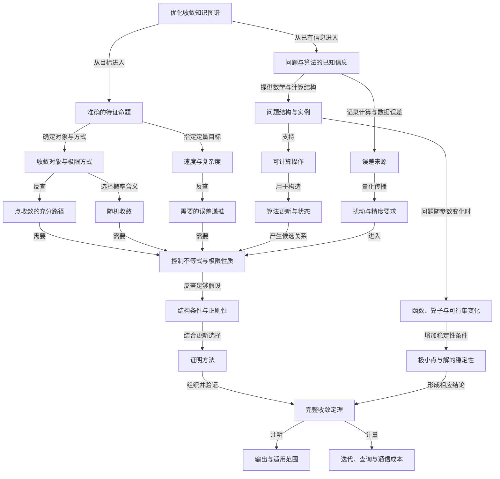

| 想追踪的关系 | 展开位置 | 对应正文 |
| --- | --- | --- |
| 函数值、残差、距离与点收敛 | 7.2—7.4 | 第 1—3、6 节 |
| 概率方式与随机证明 | 7.5 | 第 5 节、附录 A |
| 输出、范围与成本 | 7.6 | 附录 A、B、F |
| 速度提升与条件作用 | 7.7—7.8 | 第 3—4 节 |
| 十五类结构、操作与算法 | 7.9 | 第 2、5、6 节、附录 E |
| 典型实例的证明关系 | 7.10 | 第 2、5、6 节 |
| 误差来源、证书与精度 | 7.11—7.12 | 第 5 节、附录 G |
| 变化问题与解稳定性 | 7.13 | 第 6.6 节 |
| 哪些推断还需要条件 | 7.14 | 各节边界实例 |

<details class="diagram-section" markdown="block">
<summary><h3 id="72-收敛对象之间的条件关系">7.2 误差指标与收敛结论</h3></summary>

下面的残差与目标集合需要事先对应；函数误差均假设最优值有限。每个联合节点保留从一种误差转向另一种误差所需的条件。

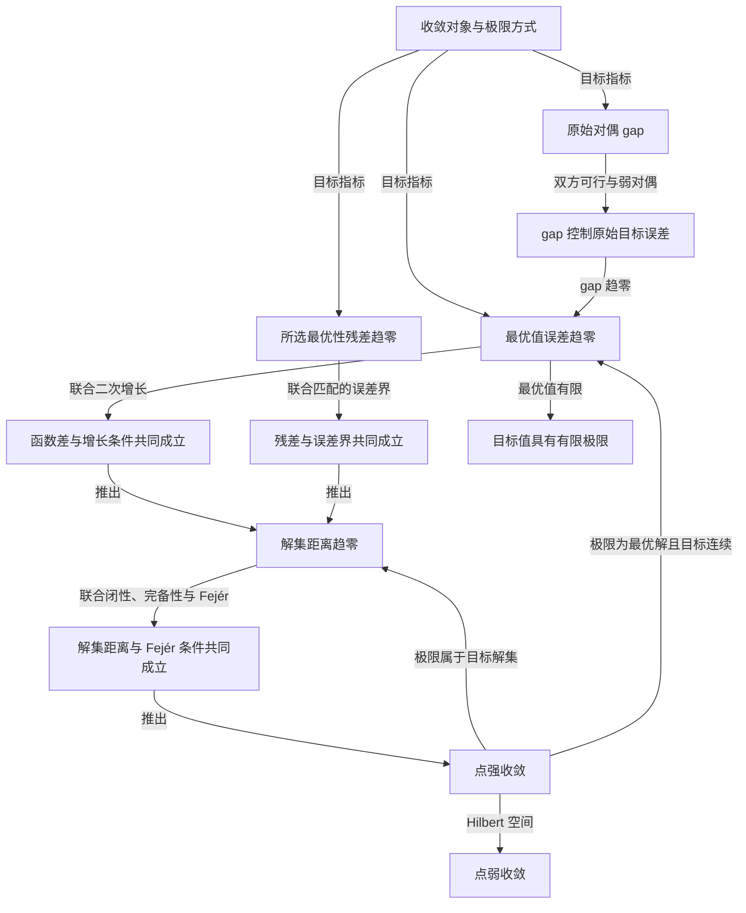

梯度、次微分、近端梯度、固定点和可行性残差分别出现在 7.9 的操作图中。它们通过匹配的最优性条件和误差界进入本图。原始对偶 gap 与 restricted gap 的测试集合和可行性要求按第 6.1 节分别保存。

</details>

<details class="diagram-section" markdown="block">
<summary><h3 id="73-从点收敛目标反查充分路径">7.3 点收敛的判据</h3></summary>

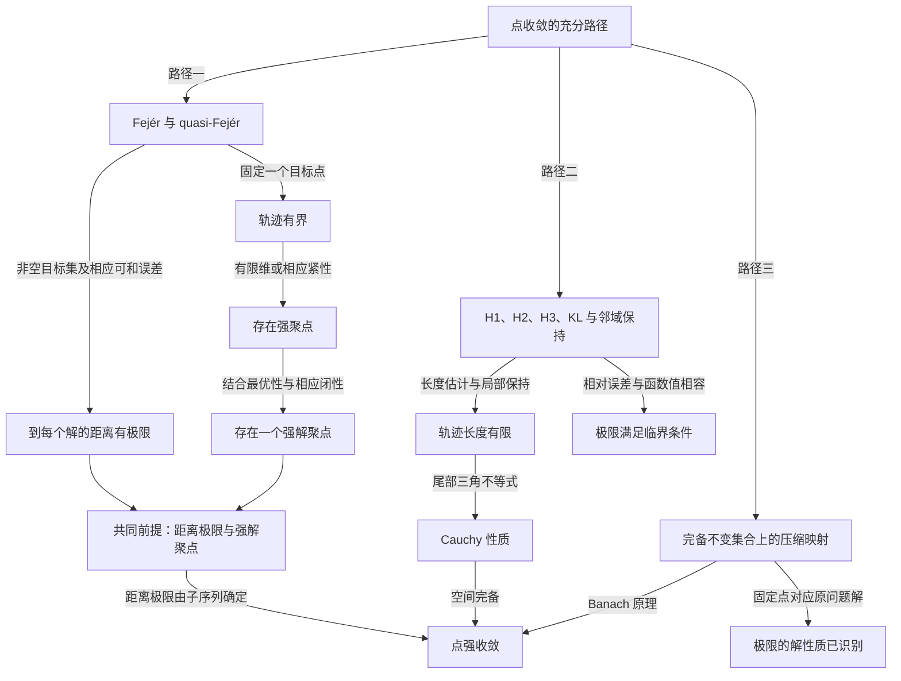

“点强收敛”与“极限满足哪一种解条件”分别记录。KL 路径通常识别临界点；凸优化或其他结构再提供最优性。quasi-Fejér 分支的误差条件采用第 6.4 节所引用的相应定理。

</details>

<details class="diagram-section" markdown="block">
<summary><h3 id="74-弱收敛强收敛与固定点">7.4 强收敛、弱收敛与固定点</h3></summary>

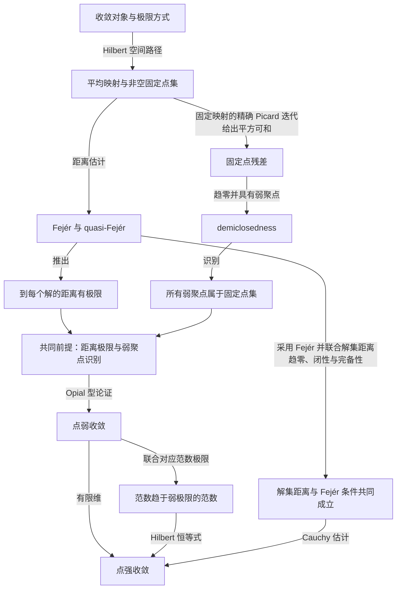

这里取 $S=\operatorname{Fix}T$，“对应范数极限”明确指 $$\|x_k\|\to\|\bar x\|$$。识别弱聚点时，固定点残差以强方式趋零，迭代子序列以弱方式趋于候选点。quasi-Fejér 的相应推广另外保留其误差条件。

</details>

<details class="diagram-section" markdown="block">
<summary><h3 id="75-随机收敛方式与证明路径">7.5 随机收敛与条件期望递推</h3></summary>

下图中的蕴含作用于同一个随机对象。非负误差期望的分支作用于该误差本身。

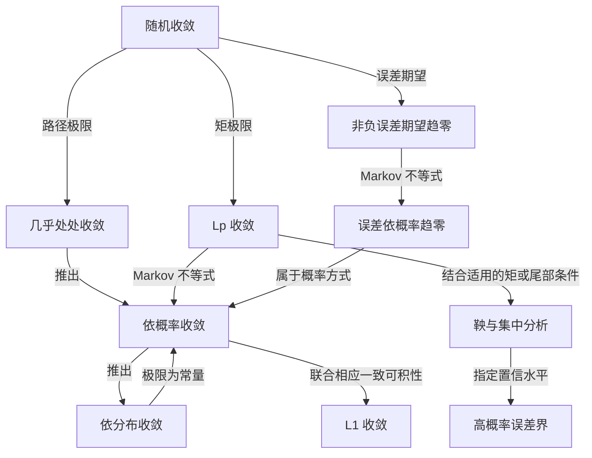

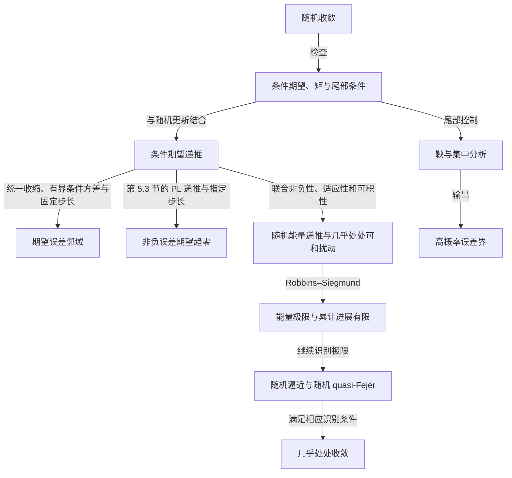

随机能量具有极限以后，还要证明该极限与目标误差的联系。加权残差可和与步长和发散首先给出相应的下极限结论；全序列残差收敛需要继续论证。

</details>

<details class="diagram-section" markdown="block">
<summary><h3 id="76-输出规则与结论范围">7.6 输出规则与结论范围</h3></summary>

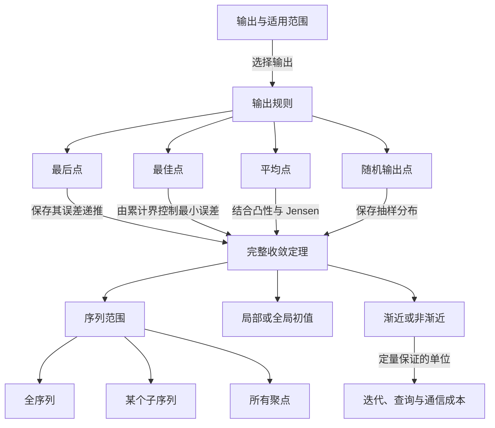

全局初值范围与极限是否全局最优分别记录。算法输出、误差对象和计算单位共同限定一条速度结论。

</details>

<details class="diagram-section" markdown="block">
<summary><h3 id="77-速度提升的控制关系">7.7 收敛速度与复杂度</h3></summary>

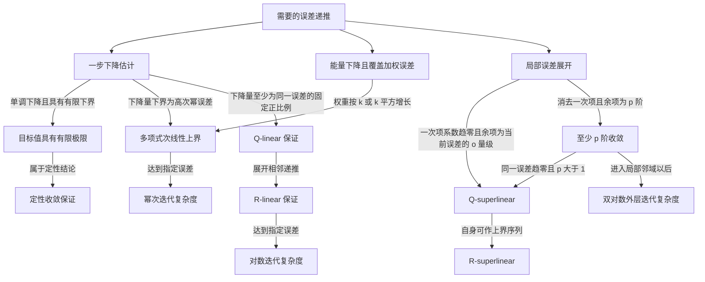

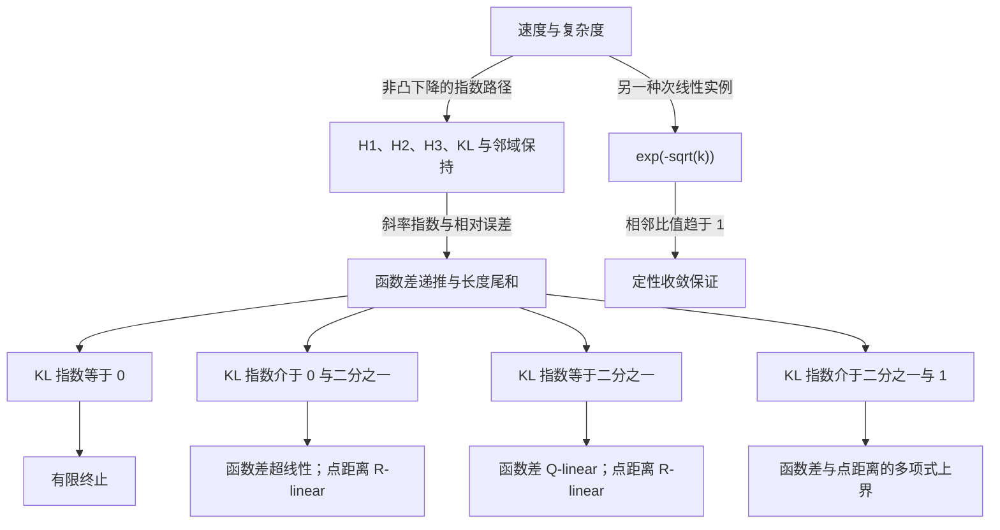

KL 指数采用第 4.7 节的斜率不等式。高指数区间的两个多项式指数分别为 $1/(2\theta-1)$ 与 $(1-\theta)/(2\theta-1)$。有限终止单独记录；比值定义作用于最终为正的误差。

</details>

<details class="diagram-section" markdown="block">
<summary><h3 id="78-条件与证明方法怎样提供控制关系">7.8 结构条件与证明方法</h3></summary>

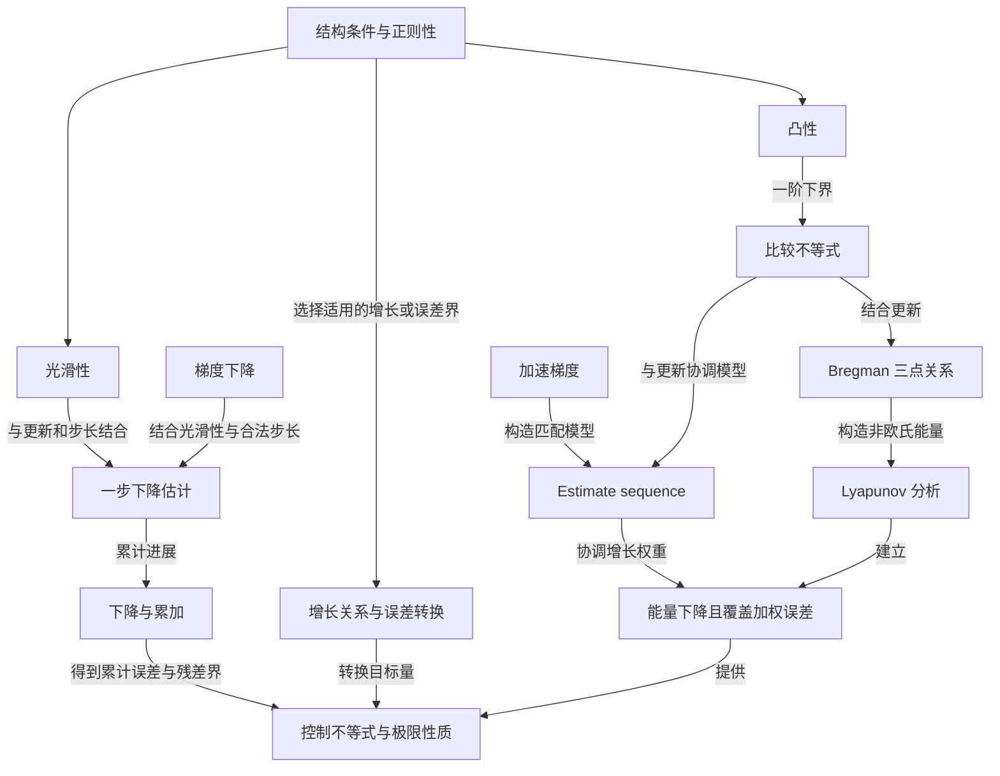

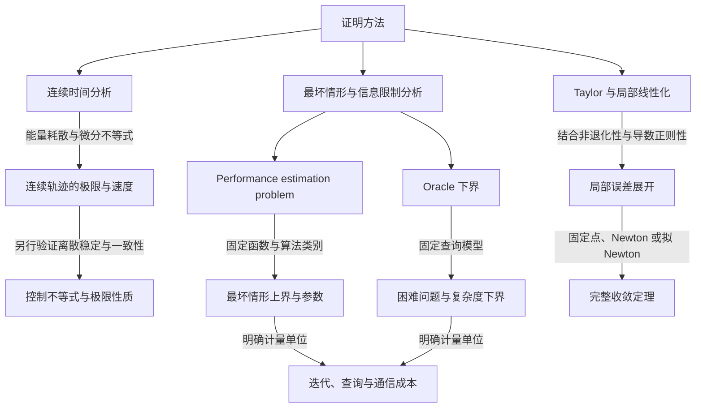

解存在、proper 与下半连续、目标下界及紧性进入聚点与累计估计；最大单调性、cocoercivity、averagedness 与 metric subregularity 进入 7.9 的算子路径；约束资格与二阶条件进入 KKT 和局部稳定性。每一项条件都与其实际提供的关系共同记录。

下面三张图进一步标明存在性、增长关系和局部模型分别提供什么信息。

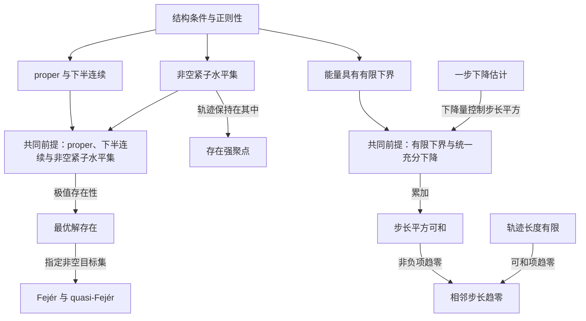

充分下降在这里具体指 $$V_k-V_{k+1}\ge a\|x_{k+1}-x_k\|^2$$，其中 $a>0$ 与 $k$ 无关。相邻步长趋零记录渐近正则性；从这里继续证明点收敛时，仍需 7.3—7.4 的其他关系。

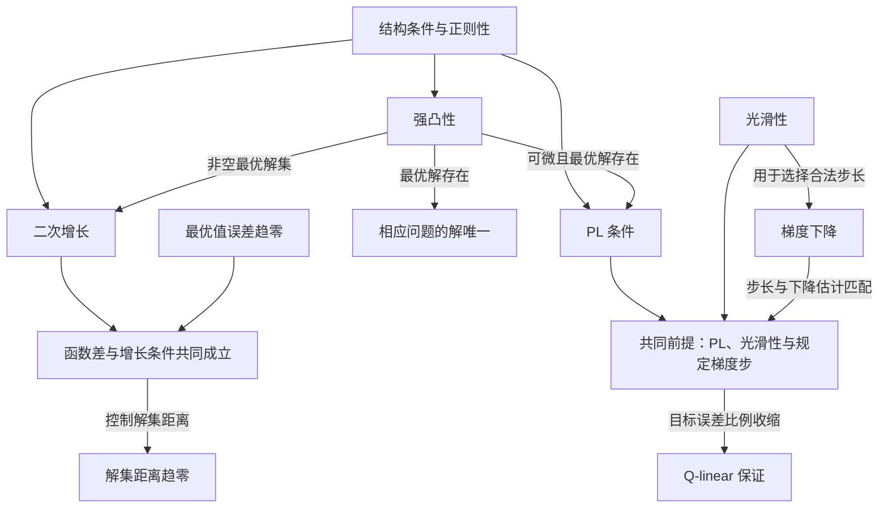

强凸到 PL 的边用于可微函数，PL 到线性速度的边用于第 4.4 节的光滑梯度下降。二次增长独立承担函数差到解集距离的转换；这三个条件在图中分别保存。

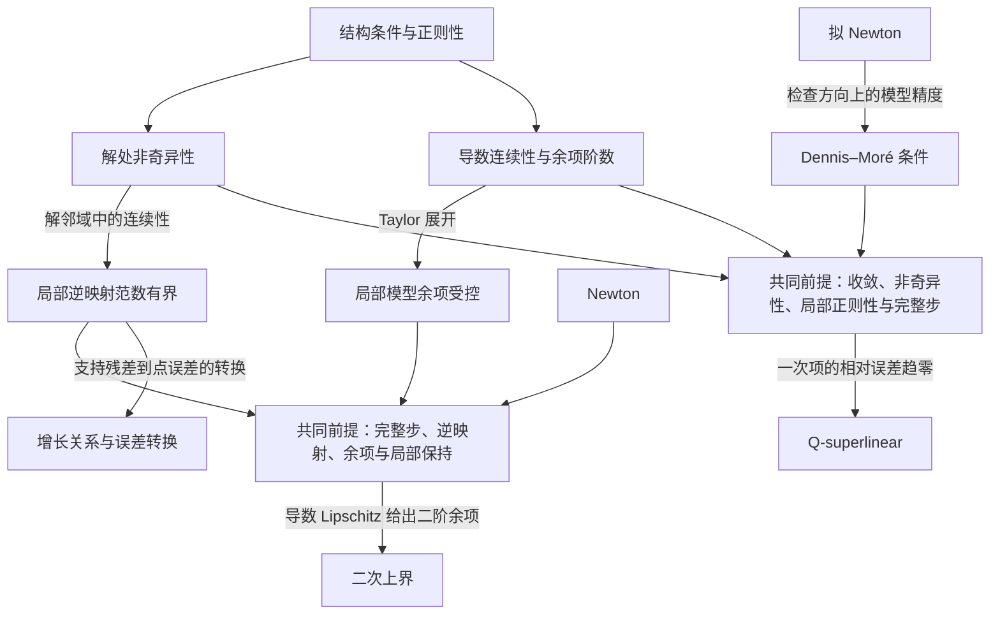

Newton 分支使用充分近的初值与邻域保持。拟 Newton 分支明确把收敛到相应解作为此处局部速度定理的前提，Dennis–Moré 条件用于控制迭代方向上的模型误差。[Dennis–Moré][dennis-more]

</details>

<details class="diagram-section" markdown="block">
<summary><h3 id="79-十五类结构连接到操作算法与误差">7.9 问题结构与算法</h3></summary>

以下六张图共同覆盖附录 E 的十五类结构。结构边表示可以利用的信息与运算；算法适用性和速度仍使用正文及附录 F 的完整条件。“研究”边指定分析对象，不单独宣称该对象已经收敛。

#### 7.9.1 二次、近端与线性复合
{: id="791-二次近端与线性复合"}

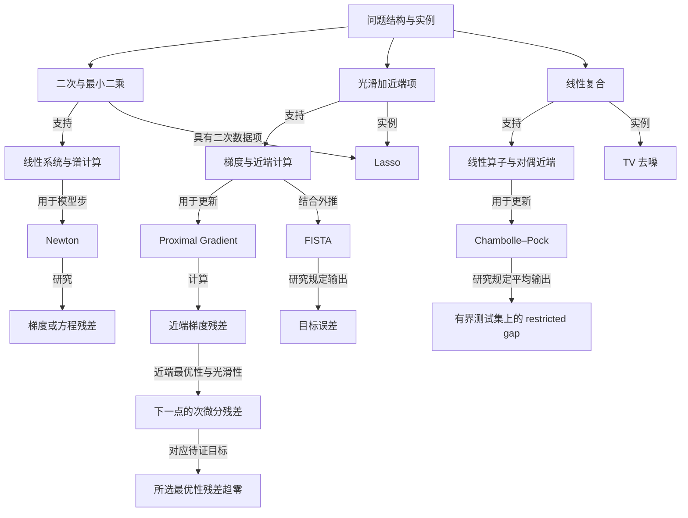

#### 7.9.2 数据访问与分块变量
{: id="792-数据访问与分块变量"}

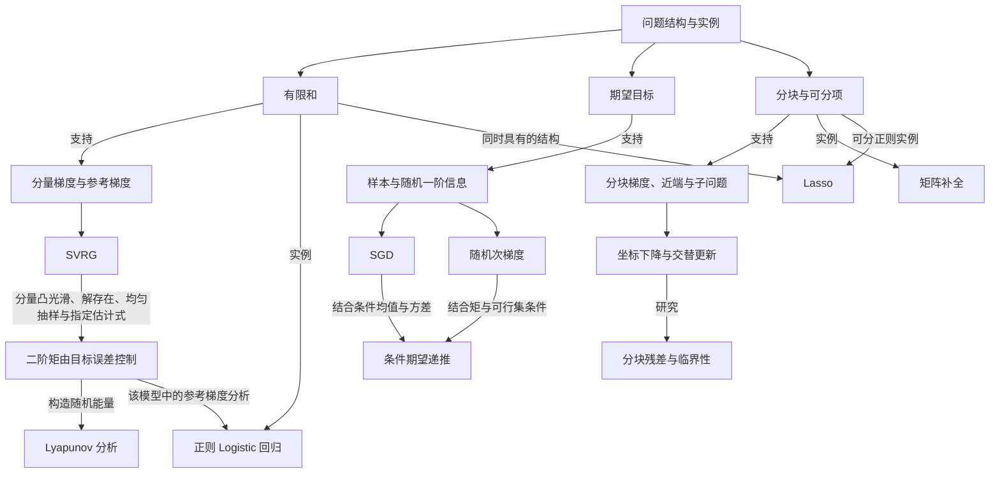

#### 7.9.3 集合约束、线性耦合与鞍点
{: id="793-集合约束线性耦合与鞍点"}

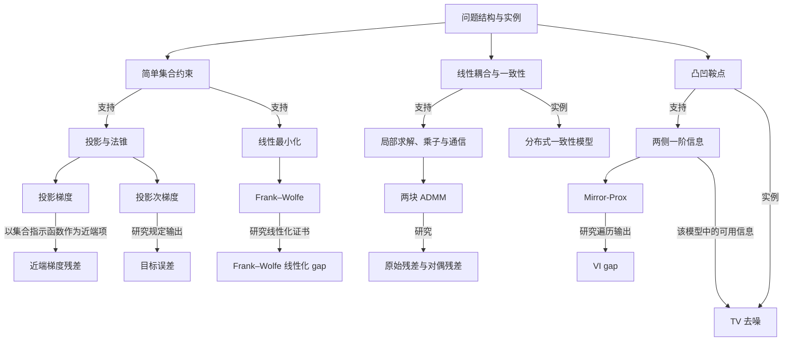

精确投影保持可行性，投影梯度映射进一步衡量最优性。Frank–Wolfe 的线性化 gap、鞍点 restricted gap 和 VI gap 各自保留定义。这里的算法分支用于定位适合研究的证书；具体证书之间的转换需要相应条件。

#### 7.9.4 单调包含与固定点
{: id="794-单调包含与固定点"}

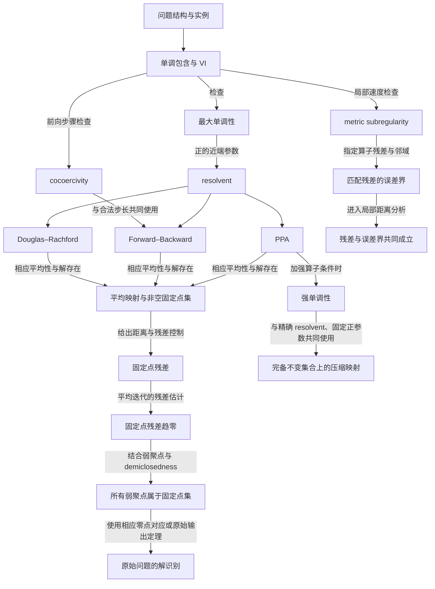

“检查”与“加强条件”表示选择分析假设。强单调性配合相应最大单调与零点存在条件，才进入精确近端映射的收缩结论。PPA、Forward–Backward 使用各自的固定点与零点对应；Douglas–Rachford 还要保存由 resolvent 定义的原始输出及其收敛定理。

#### 7.9.5 凸锥与熵几何
{: id="795-凸锥与熵几何"}

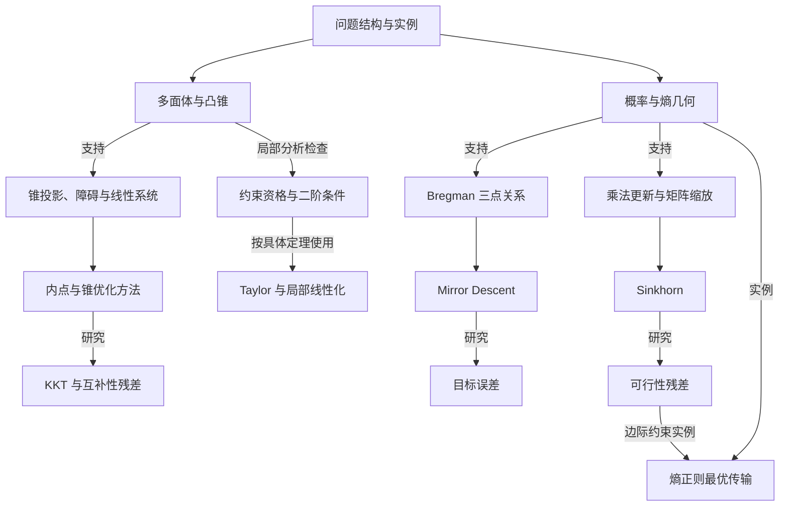

#### 7.9.6 矩阵、流形与双层结构
{: id="796-矩阵流形与双层结构"}

```mermaid
flowchart TD
  map_structures["问题结构与实例"] --> s_spectral["低秩与谱结构"]
  map_structures --> s_manifold["流形约束"]
  map_structures --> s_bilevel["双层优化"]
  s_spectral -->|支持| op_svd["SVD 与谱近端"]
  s_spectral -->|支持| op_factor["因子表示"]
  s_manifold -->|支持| op_tangent["切空间、retraction 与流形导数"]
  s_bilevel -->|支持| op_inner["内部求解与隐式求导"]
  op_svd -->|凸复合路径| alg_pg["Proximal Gradient"]
  op_factor -->|分块路径| alg_block["坐标下降与交替更新"]
  op_tangent --> alg_manifold["流形优化方法"]
  op_inner --> alg_hypergradient["超梯度与外层更新"]
  op_svd -->|实例| ex_matrix["矩阵补全"]
  alg_pg -->|谱近端的实例| ex_matrix
  op_factor -->|实例| ex_matrix
  op_tangent -->|实例| ex_pca["PCA"]
  alg_manifold -->|子空间优化实例| ex_pca
  op_inner -->|实例| ex_bilevel["双层 Ridge"]
  alg_manifold -->|研究临界性| metric_manifold["流形梯度残差"]
  ex_pca -->|固定几何对象| metric_subspace["子空间距离误差"]
  alg_hypergradient -->|研究| metric_hypergradient["超梯度误差"]
  ex_matrix -->|固定表示后定义| metric_matrix["矩阵、因子或等价类误差"]
```

</details>

<details class="diagram-section" markdown="block">
<summary><h3 id="710-实例怎样提供跨领域的误差证书">7.10 模型中的误差界</h3></summary>

Lasso 通过近端最优性连接算法步长与下一点次微分残差；正则 Logistic 通过参考梯度连接有限和结构与随机二阶矩；矩阵补全通过表示选择连接凸复合分析和因子临界点分析。这三条路径已经进入 7.9。

下面四条路径把模型结构进一步连接到最终目标量。

```mermaid
flowchart TD
  map_structures["问题结构与实例"] --> ex_tv["TV 去噪"]
  map_structures --> ex_pca["PCA"]
  map_structures --> ex_ot["熵正则最优传输"]
  map_structures --> ex_bilevel["双层 Ridge"]
  ex_tv --> join_tv["共同前提：对偶可行与原始强凸"]
  ex_pca --> join_pca["共同前提：正交投影、正谱隙与目标差"]
  ex_ot --> join_ot["共同前提：可行输出、正则误差与熵界"]
  ex_bilevel --> join_bilevel["共同前提：统一正定性与内部残差"]
  join_tv -->|gap 控制距离| metric_point["点距离误差"]
  join_pca -->|谱增长关系| metric_subspace["子空间距离误差"]
  join_ot -->|算法误差加参数误差| metric_total["原问题的总误差"]
  join_bilevel -->|残差传递| metric_hypergradient["超梯度误差"]
  metric_hypergradient -->|按外层方法设置精度| precision_rule["绝对与相对精度"]
  metric_total -->|连同可行性检验| theorem_record["完整收敛定理"]
```

这里分别使用第 6.1 节的原始点证书、第 6.2 节的投影矩阵距离、第 5.7 节的可行运输矩阵目标界和第 5.6 节的超梯度界。PCA 分支中的误差证书具体控制子空间距离；流形梯度残差的极限还需要单独识别。

</details>

<details class="diagram-section" markdown="block">
<summary><h3 id="711-误差来源怎样进入分析">7.11 误差来源与传播</h3></summary>

#### 7.11.1 迭代中的误差
{: id="7111-当前算法中的误差"}

```mermaid
flowchart TD
  map_errors["误差来源"] --> error_optimization["优化误差"]
  map_errors --> error_inner["内部求解误差"]
  map_errors --> error_oracle["查询误差"]
  map_errors --> error_random["随机误差"]
  map_errors --> error_numerical["数值误差"]
  error_optimization -->|作为待控制状态| metric_target["当前目标误差"]
  error_inner -->|由残差估计| error_deterministic["可控的附加误差"]
  error_oracle -->|由模型与查询精度估计| error_deterministic
  error_numerical -->|经稳定性估计| error_deterministic
  error_random -->|经条件矩估计| ineq_expectation["条件期望递推"]
  metric_target -->|已建立相应收缩估计| ineq_perturbed["含误差的收缩递推"]
  error_deterministic -->|按已证明的传播系数加入| ineq_perturbed
  ineq_perturbed -->|展开传播| error_convolution["历次误差的加权传播和"]
  ineq_expectation -->|结合适用随机条件| map_probability["随机收敛"]
  error_convolution -->|反查允许的误差量级| precision_rule["绝对与相对精度"]
```

#### 7.11.2 问题近似的误差
{: id="7112-从近似问题走向原问题"}

```mermaid
flowchart TD
  map_errors["误差来源"] --> error_statistical["统计误差"]
  map_errors --> error_model["模型近似误差"]
  map_errors --> error_discretization["离散化误差"]
  map_errors --> error_data["数据与参数扰动"]
  error_statistical -->|样本条件与函数类别| bound_uniform["总体与样本目标的一致误差"]
  error_model -->|比较不同模型| bound_model["适用的模型比较界"]
  error_discretization -->|共同空间中的解比较| bound_discrete["离散解与连续解的距离"]
  error_data -->|敏感性与适用误差界| bound_stability["输入误差到输出变化"]
  bound_uniform -->|按当前问题选用| bound_selected["当前问题采用的比较界"]
  bound_model -->|按当前问题选用| bound_selected
  bound_discrete -->|按当前问题选用| bound_selected
  bound_stability -->|按当前问题选用| bound_selected
  bound_selected --> join_total["共同前提：相容的比较界与优化误差"]
  error_optimization["优化误差"] --> join_total
  join_total -->|加减目标或三角不等式| metric_total["原问题的总误差"]
  metric_total -->|结合紧性、极限识别或适用增长关系| stability_result["极小点与解的稳定性"]
```

联合节点按当前问题选择相关误差项；它表示所选比较界与优化误差必须兼容。统计、模型、离散化和数据扰动可以分别出现，也可以在同一问题中同时出现。

</details>

<details class="diagram-section" markdown="block">
<summary><h3 id="712-误差表达方式与速度保持">7.12 误差估计与求解精度</h3></summary>

#### 7.12.1 先验、后验、前向与后向
{: id="7121-先验后验前向与后向"}

```mermaid
flowchart TD
  theorem_record["完整收敛定理"] -->|问题常数与计算量| analysis_apriori["先验估计"]
  metric_gap["原始对偶 gap"] -->|当前可计算证书| analysis_aposteriori["后验估计"]
  metric_residual["当前可计算残差"] -->|结合匹配的误差界| analysis_aposteriori
  analysis_apriori -->|上界控制所选解距离时| analysis_forward["前向误差"]
  analysis_aposteriori -->|结合匹配误差界或增长关系| analysis_forward
  error_data["数据与参数扰动"] -->|使当前输出满足精确问题| analysis_backward["后向误差"]
  analysis_backward -->|联合问题条件数或稳定性| analysis_sensitivity["稳定性与敏感性"]
  analysis_sensitivity -->|控制输出变化| analysis_forward
  error_random["随机误差"] -->|矩与尾部条件| analysis_probability["概率误差界"]
  analysis_probability -->|指定置信水平与适用界| prob_high["高概率误差界"]
  analysis_aposteriori -->|按当前误差调整| precision_rule["绝对与相对精度"]
  analysis_apriori -->|按目标精度安排| precision_rule
  precision_rule -->|约束内部计算| error_inner["内部求解误差"]
```

概率误差界需要选定相应结论：非负误差的期望界可以通过 Markov 得到一种置信界，集中分析可以提供其他尾部保证。前向与后向误差之间的转换使用具体问题的稳定性关系。

#### 7.12.2 扰动下的收敛速度
{: id="7122-保留什么速度就控制什么误差"}

```mermaid
flowchart TD
  map_perturbed["扰动与精度要求"] --> ineq_perturbed["含误差的收缩递推"]
  ineq_perturbed -->|固定收缩因子在 0 与 1 之间| error_convolution["历次误差的加权传播和"]
  error_convolution -->|附加误差仅有统一上界| result_neighborhood["误差邻域"]
  error_convolution -->|附加误差趋零| rate_qualitative["定性收敛保证"]
  error_convolution -->|相对误差保留收缩系数| rate_qlinear["Q-linear 保证"]
  map_perturbed -->|局部模型与内部残差| alg_inexact_newton["inexact Newton"]
  alg_inexact_newton -->|结合局部正则性与完整步| ineq_inexact["残差的一次项与二次项"]
  ineq_inexact -->|forcing term 趋零| rate_qsuper["Q-superlinear"]
  ineq_inexact -->|forcing term 为当前残差的 O 量级| rate_quadratic["二次上界"]
  rate_quadratic -->|p 等于 2| rate_order["至少 p 阶收敛"]
  alg_inexact_newton -->|内部精度规则| precision_rule["绝对与相对精度"]
```

本图的固定收缩递推使用第 5.1 节的非负误差。确定性递推得到相应误差邻域；期望递推得到期望误差邻域。inexact Newton 的最后一条边具体给出二次上界，即 $p=2$；非奇异性再把残差结论传递到点误差。

</details>

<details class="diagram-section" markdown="block">
<summary><h3 id="713-函数算子与可行集变化时怎样连接极限">7.13 变分极限与解的稳定性</h3></summary>

本节把迭代索引与问题索引分别保存。$k$ 表示算法运行，$n$、$h$ 或正则参数描述正在求解的问题怎样变化。

#### 7.13.1 函数列的收敛
{: id="7131-函数收敛需要控制什么"}

```mermaid
flowchart TD
  map_changes["函数、算子与可行集变化"] --> change_function["目标函数序列"]
  change_function -->|固定自变量| conv_pointwise["逐点收敛"]
  change_function -->|指定集合上的统一误差| conv_uniform["一致与局部一致收敛"]
  change_function -->|控制变化的自变量| change_variational["变分收敛路径"]
  conv_uniform -->|同一集合内的每个固定点| conv_pointwise
  change_variational --> c_liminf["沿收敛序列的下极限条件"]
  change_variational --> c_recovery["每个候选点具有恢复序列"]
  c_liminf --> join_epi["共同前提：下极限与恢复序列"]
  c_recovery --> join_epi
  join_epi -->|在所选序列拓扑中定义| conv_epi["epi 或 Gamma 收敛"]
  conv_epi -->|再与近似最优性和紧性结合| stability_result["极小点与解的稳定性"]
```

逐点收敛控制固定位置的函数值。极小点稳定性需要比较随 $n$ 变化的位置，第 6.6 节的下极限条件与恢复序列正好服务于这一步。[Rockafellar–Wets][variational]给出了相应的变分分析框架。

#### 7.13.2 Mosco 收敛与算子、集合的极限
{: id="7132-弱强拓扑与变化的数学对象"}

```mermaid
flowchart TD
  map_changes["函数、算子与可行集变化"] -->|Hilbert 凸函数路径| conv_mosco["Mosco 收敛"]
  conv_mosco -->|定义条件之一| c_weak_liminf["弱收敛序列的下极限条件"]
  conv_mosco -->|定义条件之一| c_strong_recovery["强恢复序列"]
  c_weak_liminf --> join_mosco["共同前提：两条极限条件与近似最优性"]
  c_strong_recovery --> join_mosco
  prop_near_minimizer["当前问题的近似极小点"] -->|优化误差趋零| join_mosco
  join_mosco -->|沿已有弱聚点子序列比较| prop_weak_cluster["所有弱聚点属于解集"]
  prop_weak_cluster -->|再验证距离或紧性条件| stability_result["极小点与解的稳定性"]
```

```mermaid
flowchart TD
  map_changes["函数、算子与可行集变化"] --> change_operator["算子与 resolvent 的变化"]
  map_changes --> change_set["可行集的变化"]
  change_operator -->|选定图与拓扑| conv_operator_graph["算子图收敛"]
  change_operator -->|选定参数与输入方式| conv_resolvent["resolvent 收敛"]
  change_set -->|以指示函数表示约束| change_function["目标函数序列"]
  change_set -->|选定集合极限定义| conv_set["集合收敛"]
  conv_operator_graph -->|结合解存在与适用稳定性条件| stability_result["极小点与解的稳定性"]
  conv_resolvent -->|结合原始解对应与适用条件| stability_result
  conv_set -->|结合目标函数和紧性条件| stability_result
```

图中 Mosco 的两条定义条件需要同时使用；识别弱聚点时，还需近似最优性与相应紧性。函数、算子图、resolvent 和集合之间的对应关系保留各自的定义、参数和适用条件，避免把不同对象的收敛混为一项结论。

#### 7.13.3 近似极小点的稳定性
{: id="7133-从近似极小点走向极限问题的解"}

```mermaid
flowchart TD
  conv_epi["epi 或 Gamma 收敛"] --> join_minimizer["共同前提：变分极限、近似最优性与聚点存在"]
  prop_near_minimizer["当前问题的近似极小点"] -->|优化误差趋零| join_minimizer
  c_compact_minimizer["近似极小点具有相应紧性"] --> join_minimizer
  join_minimizer -->|下极限与恢复序列比较| prop_optimal_clusters["所有已有聚点均为极限问题的最优解"]
  prop_optimal_clusters --> join_unique_limit["共同前提：聚点识别、相对紧性与解唯一"]
  c_compact_minimizer --> join_unique_limit
  c_unique["相应问题的解唯一"] --> join_unique_limit
  join_unique_limit -->|本图采用强拓扑| goal_point["点强收敛"]
  prop_optimal_clusters -->|构成聚点稳定性结论| stability_result["极小点与解的稳定性"]
  error_optimization["优化误差"] --> join_indices["共同前提：所选索引下的各项误差受控"]
  error_model["模型近似误差"] -->|按当前问题选用| error_selected["当前问题包含的近似误差"]
  error_discretization["离散化误差"] -->|按当前问题选用| error_selected
  error_statistical["统计误差"] -->|按当前问题选用| error_selected
  error_selected --> join_indices
  join_indices -->|选择迭代数、样本数、尺度与参数| metric_total["原问题的总误差"]
  metric_total -->|结合适用的增长或稳定性关系| stability_result
```

前半图采用第 6.6 节的强拓扑设置；若讨论弱拓扑，对应结论应记为点弱收敛。极限目标 proper、下半连续和近似极小值有限等基本前提仍需保留。后半图按具体问题选择实际出现的误差项，并要求这些误差在同一索引选择下同时趋零。

</details>

<details class="diagram-section" markdown="block">
<summary><h3 id="714-用边界实例检查图中的推断">7.14 反例</h3></summary>

这些实例用于定位尚待补充的控制关系。每个节点连接到它所检验的具体推断。

```mermaid
flowchart TD
  check_point["检查点收敛的候选证明"] --> counter_flat["平坦解集上的交替序列"]
  check_point --> counter_stationary["四次函数的非最优临界点"]
  check_point --> counter_steps["圆周上的平方可和步长"]
  counter_flat -->|三个误差为零仍缺少单点极限| need_trajectory["需要控制整条轨迹"]
  counter_stationary -->|残差为零仍需识别最优性| need_optimality["需要连接临界性与最优性"]
  counter_steps -->|步长平方可和仍需更多控制| need_length["需要长度或其他点收敛性质"]
  need_trajectory --> method_fejer["Fejér 与 quasi-Fejér"]
  need_trajectory --> prop_length["轨迹长度有限"]
  need_optimality -->|一种足够结构| c_convex["凸性"]
  need_length --> prop_length
  method_fejer -->|继续识别解聚点| join_point["共同前提：距离极限与强解聚点"]
  prop_length -->|完备性| goal_point["点强收敛"]
```

```mermaid
flowchart TD
  check_assumption["检查条件提供了什么信息"] --> counter_nonexpansive["T 等于负恒等映射"]
  check_assumption --> counter_degenerate["四次函数的 Newton 更新"]
  check_assumption --> counter_escape["局部一致收敛但极小点无界"]
  counter_nonexpansive -->|直接迭代在两点交替| need_regular["需要控制固定点残差"]
  counter_degenerate -->|点误差仅乘以三分之二| need_nondegenerate["需要检查非退化性与局部模型"]
  counter_escape -->|最优值与极小点均需重新分析| c_compact_minimizer["近似极小点具有相应紧性"]
  need_regular -->|一种足够结构| c_averaged["平均映射与非空固定点集"]
  need_nondegenerate --> method_local["Taylor 与局部线性化"]
  c_compact_minimizer -->|与变分极限和近似最优性联合| join_minimizer["共同前提：变分极限、近似最优性与聚点存在"]
```

| 图中实例 | 本文中的具体构造 | 检验的推断 |
| --- | --- | --- |
| 平坦解集 | $F(x,y)=x^2$，$z_k=(0,(-1)^k)$ | 函数差、残差、解集距离均为零，仍需单点极限的证明 |
| 非最优临界点 | $f(x)=x^4-x^2$，$x_k=0$ | 梯度为零还要识别最优性 |
| 圆周轨迹 | $x_k=(\cos\log(k+1),\sin\log(k+1))$ | 有界与步长平方可和还要连接到点收敛 |
| 非扩张直接迭代 | $T=-I$，初值非零 | 固定点存在与非扩张性还要配合合适的更新性质 |
| 退化 Newton | $f(x)=x^4$，$x_{k+1}=2x_k/3$ | 二阶信息的使用还要配合非退化性与余项控制 |
| 变化问题 | $$F_n(x)=\min\{x^2,(x-n)^2-1\}$$ | 局部一致收敛还要配合极小点的紧性 |

</details>

<details class="diagram-section" markdown="block">
<summary><h3 id="715-图谱覆盖索引">7.15 图谱索引</h3></summary>

完整性按本文讨论范围核对。下面每项都有图中节点、相应关系和正文依据。

| 知识领域 | 本文覆盖的内容 | 图中入口 |
| --- | --- | --- |
| 确定性收敛 | 强点、弱点、解集距离、目标值极限、最优值误差；梯度、次微分、近端梯度、固定点与可行性残差；gap、渐近正则性、有限长度 | 7.2—7.4、7.8—7.9 |
| 随机收敛 | 几乎处处、依概率、依分布、Lp、非负误差期望、高概率 | 7.5、7.12 |
| 输出与范围 | 最后点、最佳点、平均点、随机输出；全序列、子序列、聚点；局部与全局、渐近与非渐近、计算单位 | 7.6 |
| 速度与复杂度 | 定性、次线性、Q/R-linear、Q/R-superlinear、至少 p 阶、有限终止、迭代复杂度 | 7.7、7.12 |
| 结构条件 | 存在性、紧性、下界、凸性、光滑性、强凸、PL、增长、误差界、KL、算子性质、局部正则性、随机矩与精度 | 7.3—7.5、7.8—7.9、7.12—7.13 |
| 证明方法 | 累加、Lyapunov、Estimate sequence、Bregman、Fejér、聚点识别、Opial、闭性、压缩、单调算子、误差转换、KL、Taylor、随机、连续时间、PEP 与信息下界 | 7.3—7.5、7.7—7.9 |
| 十五类结构 | 二次、近端复合、线性复合、有限和、期望、分块、简单集合、线性耦合、鞍点、单调包含、凸锥、谱、流形、熵、双层 | 7.9 |
| 七组主要实例 | Lasso、正则 Logistic、TV、PCA、矩阵补全、熵正则最优传输、双层 Ridge | 7.9—7.10 |
| 九类误差来源 | 优化、内部求解、查询、随机、数值、统计、模型、离散化、数据与参数 | 7.11 |
| 七种误差表达 | 先验、后验、前向、后向、稳定性与敏感性、概率界、绝对与相对精度 | 7.12 |
| 变化问题 | 逐点、一致、epi/Gamma、Mosco、算子图、resolvent、可行集、极小点稳定、多个索引 | 7.13 |
| 推断边界 | 六个具体实例及各自需要补充的条件 | 7.14 |

</details>

<details class="diagram-section" markdown="block">
<summary><h3 id="716-从目标使用图谱并保存一条完整结论">7.16 证明目标与定理记录</h3></summary>

| 现在希望证明什么 | 先寻找什么关系 | 再向哪些信息提问 |
| --- | --- | --- |
| 迭代点强收敛 | Cauchy 性质，或到解的距离极限与一个解聚点 | 能量能否控制长度；更新是否具有 Fejér 性质；残差怎样识别聚点 |
| 迭代点弱收敛 | 距离极限与所有弱聚点的解性质 | Hilbert 结构、平均映射、残差强收敛与 demiclosedness |
| 最优值误差线性 | 同一误差的统一比例收缩 | 下降量能否通过 PL、增长或匹配误差界控制当前误差 |
| 点误差超线性 | 一次项的相对系数趋零 | 局部模型怎样抵消一次误差；逆映射、余项与内部精度怎样受控 |
| 凸问题的加速目标误差 | 有界能量覆盖更快增长的加权误差 | 外推参数、函数模型、势函数与输出怎样共同满足递推 |
| 随机轨迹几乎处处收敛 | 随机能量极限与目标识别 | 条件期望递推、可和扰动、随机 quasi-Fejér 或随机逼近条件 |
| 可计算的停止证书 | 当前残差或 gap 到目标误差的上界 | 误差界常数、可行性、对偶证书与适用邻域 |
| 变化问题的极小点稳定 | 聚点存在、下极限与恢复序列 | 近似最优性、紧性、变分收敛、唯一性和联合精度 |

得到结论以后，用同一张定理卡保存它，图中的每条数学边都可以展开为这样的记录。

| 字段 | 必须写明的内容 |
| --- | --- |
| 问题与空间 | 目标函数、约束、有限维或 Hilbert 空间、使用的范数与拓扑 |
| 解的含义 | 最优解、临界点、固定点、鞍点、算子零点或等价类 |
| 算法状态与更新 | 所有状态变量、步长、参数、内部求解及其精度 |
| 前提 | 存在性、结构条件、局部邻域、初值范围与邻域保持 |
| 输出 | 最后点、最佳点、平均点或具体分布的随机点 |
| 误差 | 准确定义的函数差、距离、残差或 gap |
| 核心关系 | 一步递推、比较不等式、闭性或极限识别 |
| 结论方式 | 强、弱、期望、几乎处处、依概率或高概率 |
| 序列范围 | 全序列、某个子序列、所有聚点及极限的解性质 |
| 定量保证 | 上界、常数、指数、Q/R 含义与局部或全局范围 |
| 成本与扰动 | 外层步数、查询、内部求解、通信，以及允许的误差 |
| 依据 | 完整推导或原文定理，并保存对应的适用条件 |

</details>

## 附录 A：收敛对象与输出方式

### A.1 确定性误差对象

| 对象 | 代表性表达 | 需要一同记录的内容 |
| --- | --- | --- |
| 迭代点强收敛 | $\lVert x_k-x^\star\rVert\to0$ | 极限为最优解、临界点、固定点还是鞍点 |
| 迭代点弱收敛 | $x_k\rightharpoonup x^\star$ | 所用空间、弱聚点识别、强收敛的附加条件 |
| 解集距离 | $\operatorname{dist}(x_k,S)\to0$ | 解集是否非空，怎样进一步识别一个点极限 |
| 目标值 | $F(x_k)\to\ell$ | 如何确定 $\ell$ 与期望目标值的关系 |
| 最优值误差 | $F(x_k)-F^\star\to0$ | 最优值有限、可行性以及可达性 |
| 光滑驻点残差 | $\lVert\nabla f(x_k)\rVert\to0$ | 驻点的性质与聚点闭性 |
| 非光滑残差 | $\operatorname{dist}(0,\partial F(x_k))\to0$ | 次微分定义、函数值相容性与闭性 |
| 近端梯度残差 | $\lVert G_\gamma(x_k)\rVert\to0$ | 步长、近端项、它与原问题最优性的联系 |
| 固定点残差 | $\lVert x_k-T(x_k)\rVert\to0$ | 固定点与原始解的对应关系 |
| 可行性残差 | 等式残差与不等式违反量趋零 | 残差与到可行集距离之间的关系 |
| 原始对偶或鞍点 gap | 按具体问题定义的 gap 趋零 | 双方可行性、测试集合和输出规则 |
| 渐近正则性 | $\lVert x_{k+1}-x_k\rVert\to0$ | 这是哪条点收敛路径的中间性质 |
| 有限长度 | $\sum_k\lVert x_{k+1}-x_k\rVert<\infty$ | 完备性与极限识别 |

### A.2 随机收敛方式

下面以随机向量 $X_k,X$ 为例。

| 方式 | 定义或表达 | 常用联系 |
| --- | --- | --- |
| 几乎处处收敛 | $\mathbb P(\lim_kX_k=X)=1$ | 推出依概率收敛 |
| 依概率收敛 | 对每个 $\varepsilon>0$，$\mathbb P(\lVert X_k-X\rVert>\varepsilon)\to0$ | 推出依分布收敛 |
| $L^p$ 收敛 | $\mathbb E\lVert X_k-X\rVert^p\to0$，$p\ge1$ | 推出依概率收敛；$p=2$ 为均方收敛 |
| 依分布收敛 | 对有界连续测试函数，期望收敛 | 极限为常量时等价于依概率收敛 |
| 非负误差的期望收敛 | $\mathbb E E_k\to0$，$E_k\ge0$ | Markov 不等式给出误差依概率收敛 |
| 高概率界 | $\mathbb P(E_k\le b(k,\delta))\ge1-\delta$ | 指明 $\delta$ 及是否同时覆盖所有 $k$ |

几乎处处收敛与 $L^p$ 收敛之间的进一步联系需要可积性等条件。依概率收敛配合相应的一致可积性，可以支持 $L^1$ 收敛。向量均值 $\mathbb E X_k$ 的收敛与非负点误差期望的收敛分别记录。Hilbert 空间向量的弱收敛，与概率测度的弱收敛也分别记录。概率背景可参见 [Durrett][probability]。

### A.3 输出与适用范围

| 属性 | 常用取值 | 记录要求 |
| --- | --- | --- |
| 输出 | 最后点、最佳点、平均点、随机点 | 输出规则与证明对象一致 |
| 序列范围 | 全序列、子序列、所有聚点 | 指明最终证明到哪一级 |
| 初值范围 | 全局、局部 | 全局初值保证与全局最优性分别注明 |
| 时间范围 | 渐近、非渐近 | 是否给出有限迭代次数的界 |
| 误差保证 | 上界、精确渐近阶、下界 | 上界允许具体序列更快 |
| 成本 | 迭代、查询、样本、通信、矩阵运算 | 保留对应单位与单步代价 |

例如，

$$
\bar x_K=
\frac{\sum_{k=0}^{K-1}w_kx_k}{\sum_{k=0}^{K-1}w_k},
\qquad w_k\ge0,\quad \sum_{k=0}^{K-1}w_k>0,
$$

在 $F$ 凸时满足

$$
F(\bar x_K)
\le
\frac{\sum_{k=0}^{K-1}w_kF(x_k)}{\sum_{k=0}^{K-1}w_k}.
$$

这说明平均误差怎样通过凸性转为平均点的目标误差。最后点与随机输出点则使用各自的证明关系。

## 附录 B：速度与复杂度

固定非负误差 $E_k\to0$；涉及比值时，先考虑最终保持正值的情况，有限终止另行记录。

| 速度类型 | 典型表达 | 含义 |
| --- | --- | --- |
| 定性收敛 | $E_k\to0$ | 尚未指定速度 |
| 多项式次线性上界 | $E_k=O(k^{-a})$，$a>0$ | 常见指数为 $1/2,1,2$ |
| 其他次线性实例 | $E_k=e^{-\sqrt{k}}$ | 相邻误差比例趋于 $1$ |
| Q-linear 保证 | 最终 $E_{k+1}\le qE_k$，$0<q<1$ | 相邻误差受到固定比例控制 |
| R-linear 保证 | $E_k\le Cq^k$，$0<q<1$ | 误差受到几何序列控制 |
| Q-superlinear | $E_{k+1}/E_k\to0$ | 相对剩余误差趋零 |
| R-superlinear | $E_k$ 由某个 Q-superlinear 序列从上方控制 | 通过上界序列定义 |
| 至少 $p$ 阶 | $E_{k+1}\le CE_k^p$，$p>1$ | $p=2$ 给出二次上界 |
| 有限终止 | 存在有限 $K$，使所有 $k\ge K$ 都有 $E_k=0$ | 与活动结构的有限识别分别记录 |

Q 型性质控制相邻误差，R 型性质通过相应上界序列控制误差。Q-linear 推出 R-linear。$O(1/k^2)$ 是关于迭代次数的上界；二次收敛使用相邻误差的平方关系。任何上界都应与具体序列的精确渐近阶分别记录。

设 $K(\varepsilon)$ 表示达到 $E_k\le\varepsilon$ 所需迭代数：

$$
E_k\le Ck^{-a}
\Longrightarrow
K(\varepsilon)=O(\varepsilon^{-1/a});
$$

$$
E_k\le Cq^k
\Longrightarrow
K(\varepsilon)
=O\left(\frac{\log(C/\varepsilon)}{-\log q}\right).
$$

局部已经满足 $E_{k+1}\le CE_k^p$、$p>1$ 并进入足够小邻域时，新增外层迭代数通常为 $O(\log\log(1/\varepsilon))$。进入适用邻域的成本和每次内部求解成本需要另外计入。

## 附录 C：常用结构条件
{: id="附录-c结构条件提供了哪些关系"}

| 条件 | 提供的关系或性质 | 在证明中的作用 |
| --- | --- | --- |
| proper、下半连续与适当的水平集紧性 | 极小值及聚点存在 | 建立对象与极限的存在性 |
| 目标有有限下界 | 下降量可以求和 | 残差或步长平方可和 |
| 轨迹有界、紧性 | 提取相应拓扑下的聚点 | 接入聚点识别 |
| $L$-smooth | 二次上界模型 | 步长选择、下降与模型余项 |
| 凸性 | 一阶下界、Jensen 不等式 | 最优性、比较不等式与平均输出 |
| 强凸性 | 统一二次下界 | 唯一解、增长条件、距离控制 |
| PL | $\tfrac12\lVert\nabla f(x)\rVert^2\ge\mu(f(x)-f^\star)$ | 将梯度下降量转换为目标误差收缩 |
| 二次增长 | $F(x)-F^\star\ge\tfrac\mu2\operatorname{dist}(x,S)^2$ | 从函数差控制解集距离 |
| 误差界 | $\operatorname{dist}(x,S)\le\kappa r(x)$ | 残差证书、距离速度与停止准则 |
| Metric subregularity | 在指定邻域中，$\operatorname{dist}(x,A^{-1}(0))\le\kappa\operatorname{dist}(0,A(x))$ | 算子残差到零点集距离 |
| KL 性质 | 斜率与局部函数差的关系 | 与下降、相对误差共同支持有限长度 |
| 最大单调性 | resolvent 的可解性与几何性质 | 单调包含与近端方法 |
| Cocoercivity、averagedness | 残差项参与的距离估计 | Fejér、渐近正则性、固定点分析 |
| 强单调性、压缩性 | 定量距离控制 | 唯一性、强收敛与线性速度 |
| 非退化性与导数正则性 | 逆映射上界与 Taylor 余项 | 局部超线性、二次与敏感性 |
| 约束资格与二阶条件 | KKT 表达、局部解性质 | 按具体定理组合用于局部稳定与速度 |
| 随机矩、条件期望与尾部条件 | 随机项的数量控制 | 期望、几乎处处及高概率分析 |
| 可和误差、相对精度 | 累计扰动与当前误差的联系 | 保留定性收敛或指定速度 |

每条关系都保存常数、量词、作用区域和残差定义。涉及 PL、二次增长、误差界的等价或蕴含时，继续核对凸性、光滑性与局部范围；相关分析见 [PL 文献][pl]、[误差界文献][error-bounds]和[单调算子综述][monotone]。

## 附录 D：证明方法索引
{: id="附录-d按证明任务检索分析方法"}

| 证明方法 | 当前想完成的任务 | 典型操作 |
| --- | --- | --- |
| 下降与累加 | 控制累计进展 | 把一步差求和，得到残差或目标误差上界 |
| Lyapunov | 同时控制多个状态量 | 展开更新、处理交叉项、选择系数 |
| Estimate sequence | 构造加速保证 | 协调函数模型、权重和输出点 |
| Bregman 三点恒等式 | 在非欧氏几何中控制更新 | 将近端最优性转成距离差 |
| Fejér、quasi-Fejér | 证明距离极限与轨迹控制 | 到每个解的距离递推、可和误差 |
| 聚点识别 | 说明极限满足目标条件 | 连续性、下半连续性、闭性与最优性条件 |
| Opial、demiclosedness | 从弱聚点走向全序列弱收敛 | 识别弱聚点并证明弱极限唯一 |
| 压缩映射 | 直接控制点距离 | 构造不变集合与统一收缩因子 |
| 单调算子 | 将问题转成适合迭代的形式 | resolvent、平均映射、固定点与原始解对应 |
| PL、增长条件、误差界 | 在不同误差指标间转换 | 残差到函数差、函数差到距离 |
| KL 与有限长度 | 控制整条非凸轨迹 | 斜率、相对误差、下降和长度尾和 |
| Taylor 与局部线性化 | 证明局部速度 | 分离一次项与余项，控制逆映射 |
| 超鞅与随机逼近 | 建立随机路径上的极限 | 条件期望递推与可和扰动 |
| 鞅和集中不等式 | 建立高概率保证 | 控制累计随机波动及尾部概率 |
| 连续时间分析 | 研究流与能量耗散 | 微分不等式、LaSalle、ODE 或微分包含 |
| Performance estimation problem | 研究指定算法的最坏情形 | 把性能上界写成优化问题或半定规划 |
| Oracle 下界 | 判断指定查询模型的限制 | 在固定函数类别与信息模型中构造困难问题 |

连续时间结论用于离散算法时，需要相应的离散稳定性与一致性论证。性能估计与信息下界也应保留函数类别、算法类别和计算模型。可进一步参见 [Bubeck][bubeck]、[Drori–Teboulle][pep]、[Nemirovski][mirror-prox]。

## 附录 E：常见问题结构
{: id="附录-e十五类结构化问题"}

结构标签可以同时成立。每一行先说明能够使用哪些信息与操作，再连接到相应的证明目标。

| 结构 | 典型形式 | 可使用的信息或操作 | 实例与分析入口 |
| --- | --- | --- | --- |
| 二次与最小二乘 | $\tfrac12x^\top Qx-c^\top x$、$\tfrac12\lVert Ax-b\rVert^2$ | 谱信息、线性系统、矩阵向量乘法 | Ridge；残差到解误差、条件数 |
| 光滑加近端项 | $f(x)+g(x)$ | 梯度、近端算子 | Lasso、Elastic Net；近端残差 |
| 线性复合 | $f(x)+g(Kx)$ | $K,K^\top$、共轭函数与近端操作 | TV、Fused Lasso；原始对偶状态 |
| 有限和 | $N^{-1}\sum_i f_i(x)+r(x)$ | 分量梯度、完整梯度、抽样 | 经验风险；随机项与查询成本 |
| 期望目标 | $\mathbb E_\xi[f(x;\xi)]$ | 样本、随机梯度、矩估计 | 总体风险、资源配置；概率收敛 |
| 分块与可分项 | $f(x_1,\ldots,x_m)+\sum_jg_j(x_j)$ | 分块梯度、近端或子问题 | Group Lasso、因子模型；分块残差 |
| 简单集合约束 | $\min_{x\in C}f(x)$ | 投影、线性最小化、法锥 | 单纯形、球、盒约束；可行性与驻点 |
| 线性耦合与一致性 | $\sum_i f_i(x_i)$，$\sum_iA_ix_i=b$ | 局部求解、乘子、通信 | 分布式回归；原始与对偶残差 |
| 凸凹鞍点 | $\min_x\max_y L(x,y)$ | 两侧一阶信息与近端操作 | TV、零和博弈；gap |
| 单调包含与 VI | $0\in A(x)+B(x)$ | resolvent 与算子查询 | 平衡问题；零点与固定点残差 |
| 多面体与凸锥 | $Ax=b,\ x\in K$ | 线性系统、锥投影、障碍函数 | LP、SOCP、SDP；KKT 与互补性 |
| 低秩与谱结构 | 核范数、秩约束、谱函数 | SVD、因子表示、谱近端操作 | 矩阵补全；矩阵或因子误差 |
| 流形约束 | $\min_{x\in\mathcal M}f(x)$ | 切空间、retraction、流形导数 | PCA、旋转估计；子空间与流形驻点 |
| 概率与熵几何 | 单纯形、负熵、Bregman 距离 | 乘法更新、矩阵缩放 | 最优传输；边际残差与参数误差 |
| 双层优化 | $\min_\lambda J(w_\lambda,\lambda)$ | 内层求解、隐式求导、辅助线性系统 | 超参数选择；内部误差向外层传递 |

例如，Lasso 同时具有二次损失、有限和、光滑加近端项和可分正则结构。结构可以减少每步成本，也可以为更强控制关系创造条件；具体速度仍由相应定理确定。

若把有限和问题写为分布式一致性模型，

$$
\min_{x_1,\ldots,x_p,z}
\sum_{i=1}^{p}f_i(x_i)+r(z)
\quad\text{s.t.}\quad x_i=z,
$$

则算法新增了变量副本、乘子和通信。把所有局部变量归为一块，再与 $z$ 构成两块，可以进入标准两块 ADMM 框架；其他分块更新使用各自的收敛定理。参见 [Boyd 等的 ADMM 综述][admm]。

## 附录 F：常用算法的收敛结果
{: id="附录-f常用算法的结果索引"}

以下结果分别对应指定的误差与输出。在涉及最优解或鞍点时，假设相应解存在；近端、投影与线性子问题需要满足相应可解性要求。表中的速度均为典型保证。

| 算法与问题 | 主要条件与参数 | 指标和输出 | 速度保证 |
| --- | --- | --- | --- |
| 梯度下降，凸光滑 | 凸、$L$-smooth、步长 $1/L$ | 最后点目标误差 | $O(1/k)$ |
| 梯度下降，PL | $L$-smooth、全局 PL、步长 $1/L$ | 最后点目标误差 | $\Delta_k\le(1-\mu/L)^k\Delta_0$ |
| 加速梯度，凸光滑 | 凸、$L$-smooth、指定加速参数 | 规定输出点目标误差 | $O(1/k^2)$ |
| 加速梯度，强凸光滑 | $\mu$-强凸、$L$-smooth、匹配参数 | 规定输出点目标误差 | $O(e^{-k/\sqrt\kappa})$，$\kappa=L/\mu$ |
| 投影次梯度，凸 | 闭凸可行集、次梯度范数上界 $G$、初始距离上界 $R$、匹配步长 | 平均点或最佳点目标误差 | $O(RG/\sqrt K)$ |
| Proximal Gradient | $f$ 凸且 $L$-smooth，$g$ proper 闭凸，步长 $1/L$ | 最后点复合目标误差 | $O(1/k)$ |
| FISTA | 同上，标准 FISTA 参数 | FISTA 规定输出点目标误差 | $O(1/k^2)$ |
| 梯度下降，非凸光滑 | $L$-smooth、有限目标下界、步长 $1/L$ | 前 $K$ 步最小梯度范数平方 | $O(1/K)$ |
| Mirror-Prox | 闭凸域、单调 Lipschitz 算子、强凸距离生成函数、有限 Bregman 上界、匹配步长 | 遍历输出的 VI gap | $O(1/K)$ |
| Chambolle–Pock | 闭凸鞍点、$\tau,\sigma>0$、$\tau\sigma\lVert K\rVert^2<1$、$\theta=1$ | 平均输出在有界测试集上的 restricted gap | $O(1/K)$ |
| PPA，凸函数 | proper 闭凸、精确近端步、固定 $\lambda>0$ | 最后点目标误差 | $O(1/k)$ |
| PPA，强凸函数 | $\mu$-强凸、精确近端步、固定 $\lambda>0$ | 到唯一解的距离 | 每步因子 $1/(1+\mu\lambda)$ |
| Newton | 解处 Hessian 正定、Hessian 在解邻域内 Lipschitz、充分近初值、完整步 | 点距离 | 局部二次上界 |
| 拟 Newton | 收敛到非奇异解、局部正则性、完整步、Dennis–Moré 条件 | 点距离 | 局部 Q-superlinear |
| SGD，强凸光滑 | 条件期望等于梯度、方差有界、匹配的 $1/k$ 步长 | 最后点目标误差的期望 | $O(1/k)$ |
| 投影随机次梯度，凸 | 闭凸可行集、条件期望为次梯度、二阶矩有界、初始距离上界、匹配步长 | 平均点目标误差的期望 | $O(1/\sqrt K)$ |
| SVRG，强凸有限和 | 分量凸光滑、整体强凸、论文规定的步长与轮内长度、Option II | 参考输出目标误差的期望 | 关于外层轮数的几何上界 |

对给定总步数 $K$，次梯度方法的一种匹配选择是常步长 $R/(G\sqrt K)$。Mirror-Prox 常用的 VI gap 具有

$$
\operatorname{Gap}_{\mathrm{VI}}(\bar z)
=\sup_{u\in C}\langle F(u),\bar z-u\rangle
$$

这样的形式；应保存具体文献使用的定义与测试集合。

主要来源：[Bubeck][bubeck]、[Beck–Teboulle][fista]、[Nemirovski][mirror-prox]、[Chambolle–Pock][chambolle-pock]、[Rockafellar][ppa]、[Dennis–Moré][dennis-more]、[Bottou–Curtis–Nocedal][stochastic]与[Johnson–Zhang][svrg]。

## 附录 G：误差分析的对象与方法

### G.1 误差类型
{: id="g1-误差来自哪里"}

| 误差来源 | 典型对象 | 接入证明的位置 |
| --- | --- | --- |
| 优化误差 | 当前点到当前问题最优值或解集的误差 | 目标误差、距离或残差递推 |
| 内部求解误差 | 近端、投影、Newton 方程的计算残差 | 相对误差或 forcing term |
| 查询误差 | 近似梯度、函数值或模型 | 一步估计中的附加项 |
| 随机误差 | 抽样造成的条件波动 | 条件期望、二阶矩与尾部估计 |
| 数值误差 | 浮点与线性代数求解误差 | 传播关系、前向与后向分析 |
| 统计误差 | 样本目标与总体目标的差异 | 一致误差界与概率分析 |
| 模型近似误差 | 替代模型或函数类别限制 | 模型误差与优化误差的联合控制 |
| 离散化误差 | 连续问题与离散问题之间的差异 | 一致性、稳定性与离散尺度 |
| 数据与参数扰动 | 输入改变导致的解变化 | 敏感性、解映射与误差界 |

### G.2 误差估计方法
{: id="g2-希望怎样表达误差"}

| 分析方式 | 回答的问题 |
| --- | --- |
| 先验估计 | 根据问题常数、迭代数、步长、样本数或尺度，可以预先保证什么 |
| 后验估计 | 当前可计算残差、gap 或模型差能够证明多少精度 |
| 前向误差 | 当前输出与原问题精确解之间有多大距离 |
| 后向误差 | 当前输出可以看作多大数据扰动后问题的精确解 |
| 稳定性与敏感性 | 输入或内部误差会怎样传递到输出 |
| 概率误差界 | 期望、矩或指定置信水平下能保证什么 |
| 绝对与相对精度 | 允许误差是否随当前误差或残差的大小调整 |

误差分析与收敛分析通过同一组控制关系连接：后验残差进入误差界，内部精度进入扰动递推，统计与离散化误差进入最终目标的比较不等式。

## 参考文献

以下文献按本文使用的证明任务排列。正文中的完整推导可以单独阅读，具体算法的推广仍应同时核对原文的变量、输出规则与适用前提。

1. Bubeck，*Convex Optimization: Algorithms and Complexity*。梯度、次梯度、加速、复杂度与局部 Newton 分析。[原文][bubeck]
2. Bauschke–Dao–Moursi，*On Fejér Monotone Sequences and Nonexpansive Mappings*。距离极限、聚点和固定点；见 Fact 2.1。[原文][fejer]
3. Karimi–Nutini–Schmidt，*Linear Convergence of Gradient and Proximal-Gradient Methods Under the Polyak–Łojasiewicz Condition*。PL、线性速度与相关条件；见 Theorem 1。[原文][pl]
4. Drusvyatskiy–Lewis，*Error Bounds, Quadratic Growth, and Linear Convergence of Proximal Methods*。误差界、二次增长和近端方法。[原文][error-bounds]
5. Parikh–Boyd，*Proximal Algorithms*。近端与复合结构；见第 4.2 节。[原文][prox]
6. Attouch–Bolte–Svaiter，*Convergence of Descent Methods for Semi-Algebraic and Tame Problems*。H1、H2、H3、KL 与有限长度；见 Theorem 2.9。[原文][kl]
7. Attouch–Bolte–Redont–Soubeyran，*Proximal Alternating Minimization and Projection Methods for Nonconvex Problems*。KL 指数与点速度；见 Theorem 11。[原文][kl-rates]
8. Beck–Teboulle，*A Fast Iterative Shrinkage-Thresholding Algorithm for Linear Inverse Problems*。FISTA 与加速能量。[原文][fista]
9. Dennis–Moré，*A Characterization of Superlinear Convergence and Its Application to Quasi-Newton Methods*。拟 Newton 超线性条件。[原文][dennis-more]
10. Eisenstat–Walker，*Choosing the Forcing Terms in an Inexact Newton Method*。内部计算精度与局部速度。[原文][inexact-newton]
11. Bottou–Curtis–Nocedal，*Optimization Methods for Large-Scale Machine Learning*。随机梯度、误差与计算成本。[原文][stochastic]
12. Johnson–Zhang，*Accelerating Stochastic Gradient Descent Using Predictive Variance Reduction*。SVRG、二阶矩估计与参考输出。[原文][svrg]
13. Bertsekas，*Mathematical Background*。随机递推与超鞅工具；见 Proposition A.4.5。[原文][bertsekas]
14. Combettes–Pesquet，*Stochastic Quasi-Fejér Block-Coordinate Fixed Point Iterations with Random Sweeping*。随机固定点与分块方法。[原文][stochastic-fejer]
15. Franceschi 等，*Bilevel Programming for Hyperparameter Optimization and Meta-Learning*。双层近似与解稳定性。[原文][bilevel]
16. Cuturi，*Sinkhorn Distances: Lightspeed Computation of Optimal Transportation Distances*。熵正则最优传输与矩阵缩放。[原文][sinkhorn]
17. Chambolle–Pock，*A First-Order Primal-Dual Algorithm for Convex Problems with Applications to Imaging*。原始对偶方法与 restricted gap；见 Theorem 1。[原文][chambolle-pock]
18. Boumal，*An Introduction to Optimization on Smooth Manifolds*。流形表示、PCA 与矩阵问题。[原文][manifolds]
19. Mazumder–Hastie–Tibshirani，*Spectral Regularization Algorithms for Learning Large Incomplete Matrices*。矩阵补全与谱正则。[原文][matrix-completion]
20. Combettes–Vũ，*Variable Metric Quasi-Fejér Monotonicity*。度量变化、弱收敛与强收敛。[原文][quasi-fejer]
21. Rockafellar，*Monotone Operators and the Proximal Point Algorithm*。单调算子与 PPA。[原文][ppa]
22. Ryu–Boyd，*A Primer on Monotone Operator Methods*。resolvent、平均映射与算法表示。[原文][monotone]
23. Rockafellar–Wets，*Variational Analysis*。epi-convergence、极小点与解稳定性；见 Theorem 7.33。[原文][variational]
24. Durrett，*Probability: Theory and Examples*。概率收敛与鞅。[原文][probability]
25. Drori–Teboulle，*Performance of First-Order Methods for Smooth Convex Minimization: A Novel Approach*。性能估计问题。[原文][pep]
26. Nemirovski，*Prox-Method with Rate of Convergence O(1/T) for Variational Inequalities with Lipschitz Continuous Monotone Operators and Smooth Convex–Concave Saddle Point Problems*。Mirror-Prox 与 gap。[原文][mirror-prox]
27. Boyd 等，*Distributed Optimization and Statistical Learning via the Alternating Direction Method of Multipliers*。一致性模型、通信与 ADMM。[原文][admm]
28. Boyd–Vandenberghe，*Convex Optimization*。凸问题、对偶、约束与结构化模型。[原文][convex-book]

[bubeck]: https://arxiv.org/pdf/1405.4980
[fejer]: https://cmps-people.ok.ubc.ca/bauschke/Research/95.pdf
[pl]: https://optimization-online.org/wp-content/uploads/2016/08/5590.pdf
[error-bounds]: https://sites.math.washington.edu/~ddrusv/split_arxiv.pdf
[prox]: https://web.stanford.edu/~boyd/papers/pdf/prox_algs.pdf
[kl]: https://bolte.perso.math.cnrs.fr/MPA.pdf
[kl-rates]: https://arxiv.org/pdf/0801.1780
[fista]: https://doi.org/10.1137/080716542
[dennis-more]: https://www.math.unm.edu/~vageli/courses/Ma576/Broyden/dennis_more74.pdf
[inexact-newton]: https://users.wpi.edu/~walker/Papers/forcing_terms,SISC_17,1996,16-32.pdf
[stochastic]: https://arxiv.org/pdf/1606.04838
[svrg]: https://proceedings.neurips.cc/paper_files/paper/2013/file/ac1dd209cbcc5e5d1c6e28598e8cbbe8-Paper.pdf
[bertsekas]: https://web.mit.edu/dimitrib/www/Appendix_A_NEW_ALG.pdf
[stochastic-fejer]: https://arxiv.org/pdf/1404.7536
[bilevel]: https://proceedings.mlr.press/v80/franceschi18a/franceschi18a.pdf
[sinkhorn]: https://arxiv.org/pdf/1306.0895
[chambolle-pock]: https://optimization-online.org/wp-content/uploads/2010/06/2646.pdf
[manifolds]: https://www.nicolasboumal.net/book/IntroOptimManifolds_Boumal_2023.pdf
[matrix-completion]: https://www.jmlr.org/papers/volume11/mazumder10a/mazumder10a.pdf
[quasi-fejer]: https://arxiv.org/pdf/1206.5705
[ppa]: https://sites.math.washington.edu/~rtr/papers/rtr066-MonoOpProxPoint.pdf
[monotone]: https://web.stanford.edu/~boyd/papers/pdf/monotone_primer.pdf
[variational]: https://sites.math.washington.edu/~rtr/papers/rtr169-VarAnalysis-RockWets.pdf
[probability]: https://math.duke.edu/~rtd/PTE/PTE5_011119.pdf
[pep]: https://arxiv.org/pdf/1206.3209
[mirror-prox]: https://www2.isye.gatech.edu/~nemirovs/SIOPT_042562-1.pdf
[admm]: https://stanford.edu/~boyd/papers/pdf/admm_distr_stats.pdf
[convex-book]: https://web.stanford.edu/~boyd/cvxbook/bv_cvxbook.pdf
